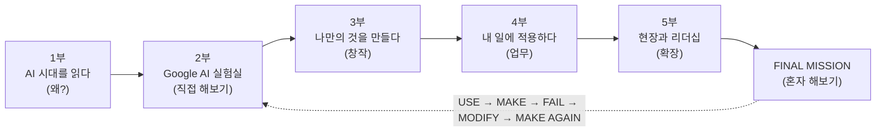

# 손으로 배우는 AI

### 인공지능 특강 교재 — 대학 · CEO 과정

> 설명을 듣는 수업이 아니라, **직접 눌러보고 · 만들고 · 결과를 확인하는** 교재입니다.
> 수업이 끝나도 이 저장소는 끝나지 않습니다. 새로운 AI, 새로운 프롬프트, 새로운 미션이 계속 추가됩니다.

---

## 이 교재는 누구를 위한 것인가요?

| 독자 | 이렇게 쓰세요 |
|---|---|
| 🎓 **대학생** (전공 무관) | 1부 → 2부 → 3부 순서로 읽고, 마지막에 [FINAL MISSION](docs/finale/20-final-mission.md)을 완성합니다 |
| 💼 **CEO 과정 원우** (기업 대표·관리자) | 1부 → 2부를 체험한 뒤, 4부(업무 적용)와 5부(현장·리더십)를 중심으로 봅니다 |
| 🧑‍🏫 **강사·조교** | [강사용 운영안](docs/appendix/e-instructor-guide.md)에 차시별 진행표가 있습니다 |

AI를 처음 써 보는 분을 기준으로 썼습니다. 준비물은 **Google 계정, Chrome, 노트북 또는 스마트폰, 해결하고 싶은 문제 하나**면 충분합니다.

## 학습 흐름



## 목차

**시작하기** — [표지·학습 지도](docs/index.md) · [교재 사용법](docs/how-to-use.md)

| 부 | 장 | 한 줄 요약 |
|---|---|---|
| **1부 AI 시대를 읽다** | [01. 입구 쇼크](docs/part1/01-entry-shock.md) | 기업은 AI 시대에 신입을 어떻게 계산하는가 |
| | [02. 구조적 레버리지](docs/part1/02-structural-leverage.md) | 남보다 빠른 사람은 '숨겨진 설계도'를 먼저 읽는다 |
| **2부 Google AI 실험실** | [03. 준비하기](docs/part2/03-getting-started.md) | 계정·브라우저·바로가기 준비 |
| | [04. Gemini](docs/part2/04-gemini.md) | 생각하고 질문하기 |
| | [05. AI 리서치](docs/part2/05-ai-research.md) | 답을 받지 말고 조사하게 하기 |
| | [06. Gemini Notebook](docs/part2/06-notebooklm.md) | 내 자료로 AI와 공부하기 |
| | [07. AI 이미지](docs/part2/07-ai-image.md) | 글을 이미지로 바꾸기 |
| | [08. Flow 영상](docs/part2/08-flow-video.md) | 아이디어 → 이미지 → 영상 |
| | [09. AI 도구 상자](docs/part2/09-ai-toolbox.md) | 무엇을 하고 싶은지에 따라 도구 고르기 |
| **3부 나만의 것을 만들다** | [10. 대체 불가능한 창작자](docs/part3/10-irreplaceable-creator.md) | '딸깍'의 시대, 차이는 경험에서 벌어진다 |
| | [11. 프롬프트 연출](docs/part3/11-prompt-directing.md) | 쉬운 말을 현장의 전문 명령어로 |
| | [12. 코드로 만드는 모션그래픽](docs/part3/12-motion-graphics.md) | 코드 한 파일로 홍보 영상 만들기 |
| | [13. 자료 실사화](docs/part3/13-field-to-page.md) | 조사한 자료를 살아 있는 페이지로 |
| **4부 내 일에 적용하다** | [14. AI 도입 자기점검](docs/part4/14-ai-self-check.md) | 측정되지 않는 개선은 개선이 아니다 |
| | [15. NVIDIA Build 모델 비교](docs/part4/15-nvidia-build.md) | 같은 요청을 두 모델에 — 비교하고 판단하기 |
| | [16. AI CEO 만들기](docs/part4/16-ai-ceo.md) | Claude Code로 1인 기업 업무 체계 세우기 |
| | [17. 크롬 한방 자동화](docs/part4/17-chrome-bookmarklet.md) | 북마크 하나로 반복 작업 줄이기 |
| **5부 현장과 리더십** | [18. 모두의 창업 사례](docs/part5/18-startup-case.md) | 현장과 기술을 인공지능으로 잇다 |
| | [19. 건강리더십과 조직운영](docs/part5/19-health-leadership.md) | 리더의 몸이 조직의 방향을 결정한다 |
| **마무리** | [20. FINAL MISSION](docs/finale/20-final-mission.md) | 이제 설명 없이 혼자 해봅니다 |

**부록** — [A. 바로가기 링크](docs/appendix/a-links.md) · [B. 프롬프트 모음](docs/appendix/b-prompts.md) · [C. 용어 사전](docs/appendix/c-glossary.md) · [D. 워크시트](docs/appendix/d-worksheets.md) · [E. 강사용 운영안](docs/appendix/e-instructor-guide.md) · [F. 교재 제작 과정](docs/appendix/f-making-of.md)

**바로 실행해 보는 예제** — [`docs/examples/`](docs/examples/)

| 파일 | 내용 | 관련 장 |
|---|---|---|
| `entry-shock-anatomy.html` | 입구 쇼크 해부도 — 기업 판단 5단계, 업무 분해 실습, 비용 계산기 (원자료 수업 도구) | 1장 |
| `prompt-continuity-lab.html` | Prompt Continuity Lab — 쉬운 말을 촬영·음악 전문 명령어로 바꾸는 오프라인 도구 (원자료 수업 도구) | 11장 |
| `motion-promo-template.html` | 9:16 · 24초 모션그래픽 홍보영상 템플릿 (외부 라이브러리 없음) | 12장 |
| `youtube-links-bookmarklet.js` / `.txt` | 유튜브 검색 결과 링크 한 번에 복사하는 북마클릿 | 17장 |
| `nvidia-build-chat.mjs` | NVIDIA Build API 호출 예제 (Node.js) | 15장 |
| `cafe-ceo/CLAUDE.md` | AI CEO 실습용 메모리 파일 예시 | 16장 |

## 교재 사이트로 보기

이 저장소는 [MkDocs Material](https://squidfunk.github.io/mkdocs-material/)로 **검색되는 교재 웹사이트**를 만듭니다.
GitHub에 올리면 `.github/workflows/deploy.yml` 이 자동으로 GitHub Pages에 게시합니다. (설정 방법: [교재 제작 과정](docs/appendix/f-making-of.md))

내 컴퓨터에서 미리 보기:

```bash
pip install -r requirements.txt
mkdocs serve
```

## 함께 만들기

- 🔥 **좋은 AI를 발견했나요?** → Issues 에서 「새로운 AI 제보」
- 💡 **내 분야에 써 봤나요?** → Issues 에서 「활용 사례 공유」
- 🛠 **틀린 곳·깨진 링크를 찾았나요?** → Issues 에서 「오류·수정 제안」 또는 직접 수정(Pull Request)

자세한 방법과 집필 규칙은 [CONTRIBUTING.md](CONTRIBUTING.md)에 있습니다.

## 알아두기

- 원자료: 노션 페이지 「인공지능 특강 - 대학, CEO과정」 (2026년 10월 기준 내용)
- AI 서비스의 이름·화면·무료 범위·가격은 자주 바뀝니다. 각 장에 **확인한 날짜**를 적어 두었으니, 실제 화면과 다르면 Issue로 알려주세요.
- AI가 만든 결과는 언제나 **초안**입니다. 사실·숫자·출처는 사람이 확인한 뒤 사용합니다.
