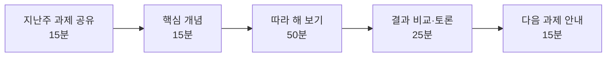

# E. 강사용 운영안

> **이 장에서 배울 것**
> - 대학 특강(120분 1회)과 CEO 과정(8주) 두 가지 운영안
> - 수업 전 점검표와 현장에서 자주 생기는 문제의 대처법
> - 평가 기준과 수업 후 복습 자료 전달 방법
>
> ⏱ 준비 시간: 수업 전 30분 · 🧰 준비물: 강사용 노트북, 프로젝터, 수강생 명단 · 📶 대상: 강사·조교

## 운영 원칙

1. **설명보다 손이 먼저입니다.** 한 꼭지마다 강사 설명은 5분을 넘기지 않고, 나머지는 수강생이 직접 누르고 만듭니다.
2. **도구 구경이 아니라 한 바퀴입니다.** 도구를 많이 보여 주기보다 `생각 → 자료학습 → 이미지 → 영상 → 새로운 AI 발견` 을 실제로 한 바퀴 돌게 합니다.
3. **결과는 공유합니다.** 각 미션이 끝나면 2~3명의 결과를 화면에 띄워 같은 요청이 어떻게 다르게 나왔는지 비교합니다.
4. **실패도 결과입니다.** USE → MAKE → FAIL → MODIFY → MAKE AGAIN. 막힌 경험을 말하게 하고, 프롬프트를 고쳐 다시 만들게 합니다.

## 운영안 1 — 대학 특강 (120분, 1회)

| 시간 | 꼭지 | 교재 | 수강생이 남길 결과 |
|---|---|---|---|
| 0~10분 | 도입: "입구가 좁아지고 있다" — 기업이 신입을 계산하는 5단계 중 2개만 소개 | [01장](../part1/01-entry-shock.md) | 질문 1개 메모 |
| 10~20분 | 준비: Google 계정 확인, Gemini for Students 안내, 바로가기 북마크 | [03장](../part2/03-getting-started.md) | 바로가기 5개 |
| 20~35분 | Gemini 3분 미션 → 2명 공유 | [04장](../part2/04-gemini.md) | 내 분야 활용 아이디어 9개 중 1개 선택 |
| 35~50분 | AI 리서치 또는 Gemini Notebook (전공 자료 1개) | [05장](../part2/05-ai-research.md) · [06장](../part2/06-notebooklm.md) | 핵심 개념 5개 + 확인 질문 3개 |
| 50~60분 | 휴식 | | |
| 60~80분 | 이미지 만들기 → Flow로 영상 확장 | [07장](../part2/07-ai-image.md) · [08장](../part2/08-flow-video.md) | 이미지 1장, (가능하면) 짧은 영상 1개 |
| 80~95분 | 생각해 봅시다: '딸깍' 영상 vs 50번 다듬은 영상, 4사분면 자기진단 | [10장](../part3/10-irreplaceable-creator.md) | 내 사분면 위치 |
| 95~115분 | FINAL MISSION — 설명 없이 혼자 해보기 | [20장](../finale/20-final-mission.md) | 5칸 워크시트 완성 |
| 115~120분 | COME BACK AGAIN — 교재 저장, Issue 제보 방법 안내 | [F부록](f-making-of.md) | 교재 북마크 |

> 💡 **팁** 시간이 부족하면 Stitch·Opal·AI Studio는 **BONUS LAB** 으로 돌리고 "수업 끝나고 도전"으로 안내합니다.

## 운영안 2 — CEO 과정 (8주, 주 1회 120분)

> ⚠️ **주의** 요일·시간은 해당 연도 모집 공고를 따릅니다. (원자료의 홍보 영상에는 '매주 화요일 18:30'으로 표기되어 있으나, 공식 공고와 대조 후 안내하세요.)

| 주차 | 주제 | 교재 | 그 주의 과제 |
|---|---|---|---|
| 1주 | AI 시대를 읽다 — 입구 쇼크, 구조적 레버리지 | [01](../part1/01-entry-shock.md) · [02](../part1/02-structural-leverage.md) | 우리 회사 업무 5개를 '업무 분해 시트'로 나누기 |
| 2주 | Google AI 실험실 Ⅰ — Gemini · 리서치 · Gemini Notebook | [03](../part2/03-getting-started.md)~[06](../part2/06-notebooklm.md) | 회사 자료 1개로 Gemini Notebook 학습 노트 만들기 |
| 3주 | Google AI 실험실 Ⅱ — 이미지 · Flow · 도구 상자 | [07](../part2/07-ai-image.md)~[09](../part2/09-ai-toolbox.md) | 우리 가게/회사 소개 이미지 1장 + 15초 영상 |
| 4주 | 대체 불가능한 창작자 · 프롬프트 연출 | [10](../part3/10-irreplaceable-creator.md) · [11](../part3/11-prompt-directing.md) | 홍보 영상 BRIEF와 A/B/C 제작 가설 |
| 5주 | AI 도입 자기점검 · NVIDIA Build 모델 비교 | [14](../part4/14-ai-self-check.md) · [15](../part4/15-nvidia-build.md) | 1주 시간 기록표 작성 (실측) |
| 6주 | AI CEO 만들기 · 크롬 한방 | [16](../part4/16-ai-ceo.md) · [17](../part4/17-chrome-bookmarklet.md) | 우리 회사용 CLAUDE.md 초안 |
| 7주 | 모션그래픽 · 자료 실사화 | [12](../part3/12-motion-graphics.md) · [13](../part3/13-field-to-page.md) | 24초 홍보 영상 템플릿을 우리 회사 내용으로 바꾸기 |
| 8주 | 현장과 리더십 · 종합 발표 | [18](../part5/18-startup-case.md) · [19](../part5/19-health-leadership.md) · [20](../finale/20-final-mission.md) | FINAL MISSION 발표 (1인 3분) |

### 매주 공통 진행 순서



## 수업 전 점검표

- [ ] 강의실 와이파이에서 각 서비스(Gemini, Gemini Notebook, Flow, NVIDIA Build 등)가 열리는지 직접 확인했다.
- [ ] 학교·기관 전산망에서 API 호출이 막히지 않는지 확인했다. (막히면 전산팀에 해당 주소의 HTTPS 통신 허용 여부 문의)
- [ ] 각 서비스의 무료 범위·크레딧을 수업 당일 기준으로 다시 확인했다. (계정·지역·요금제에 따라 다를 수 있음)
- [ ] 수강생에게 Google 계정과 비밀번호를 미리 확인해 오도록 안내했다.
- [ ] 실습 예시에 실제 학생·고객·환자 정보가 들어 있지 않다.
- [ ] 교재 사이트 주소를 QR 코드로 준비했다.

## 현장에서 자주 생기는 문제

| 문제 | 대처 |
|---|---|
| 계정 로그인이 안 된다 / 비밀번호를 모른다 | 옆 사람과 짝을 지어 한 화면으로 진행하고, 수업 후 계정 복구 |
| 학교·회사 계정이라 일부 AI 서비스가 막혀 있다 | 개인 Google 계정으로 다시 로그인 (기관 정책 확인) |
| 영상 생성 크레딧이 없다 | 이미지 단계까지 진행하고, 강사 화면으로 영상 단계를 시연 |
| 결과가 너무 평범하다 | "누구를 위한 것인지, 어떤 형식으로, 무엇을 빼고" 를 프롬프트에 추가하게 함 ([07장](../part2/07-ai-image.md)) |
| AI가 없는 논문·통계를 지어냈다 | 좋은 학습 기회로 삼아 원문 확인 과정을 함께 시연 ([05장](../part2/05-ai-research.md)) |
| 진도 차이가 크다 | 빠른 수강생에게 BONUS LAB(Stitch·Opal·AI Studio) 안내 |

## 평가 기준 (FINAL MISSION · 종합 발표)

[14장](../part4/14-ai-self-check.md)의 6개 기준을 발표용으로 줄여 씁니다.

| 기준 | 배점 | 확인 질문 |
|---|---|---|
| 구체성 | 25 | 해결하려는 문제가 누구의, 어떤 장면인지 분명한가? |
| 근거·검증 | 25 | AI 결과에서 사실·숫자·출처를 직접 확인했는가? |
| 실행 가능성 | 20 | 내일 바로 다시 해 볼 수 있는가? |
| 개선 과정 | 20 | 실패하고 고친 기록(프롬프트 변화)이 있는가? |
| 나다움 | 10 | 나의 경험·판단이 결과에 더해졌는가? |

## 수업 후 복습 자료 보내기

수업이 끝나면 아래 프롬프트로 카카오톡 안내문을 만들어 보냅니다. ([15장](../part4/15-nvidia-build.md)의 복습 자료 실습과 같은 방식입니다)

```text
나는 [과정 이름] 담당 강사다.
수강생에게 수업 복습 자료를 전달하려고 한다.

실제로 진행한 내용:
[수업에서 다룬 내용을 적기]

수업에서 막혔거나 실행하지 못한 내용:
[없으면 없음이라고 적기]

수강생이 다음에 해볼 활동:
[활동 한 가지 적기]

다음을 작성해줘.
1. 카카오톡 복사용 안내문 400자 이내
2. 핵심 배움 3개
3. 10분 안에 따라 할 복습 활동 1개
4. 다음 수업 전에 확인할 준비물

날짜·장소·강사명은 제공한 경우에만 넣어줘.
실행하지 못한 내용을 실행했다고 쓰지 마.
어려운 기술 용어는 일상적인 표현으로 바꿔줘.
```

> ✅ **확인** 보내기 전에 날짜·장소·이름·링크를 직접 확인합니다. AI는 제공하지 않은 날짜를 그럴듯하게 채워 넣을 수 있습니다.

## 한 줄 정리

> 강사의 역할은 도구를 보여 주는 것이 아니라, 수강생이 **혼자서 한 바퀴를 돌 수 있게** 만드는 것입니다.

---
📎 **원자료**: 노션 「인공지능 특강 - 대학, CEO과정」 > TODAY'S MISSION · 바로가기 - 링크 안내 · 엔비디아 적용하기(60분 따라 하기)
