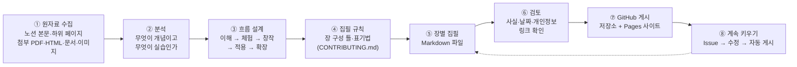
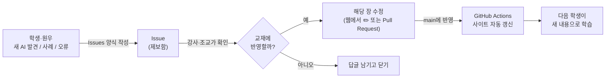

# F. 교재 제작 과정 — 노션 수업 자료가 GitHub 교재가 되기까지

> **이 장에서 배울 것**
> - 흩어진 수업·활동 자료를 하나의 흐름을 가진 교재로 엮는 방법
> - 이 교재의 GitHub 저장소 구조와 각 파일의 역할
> - GitHub에 교재를 올리고, 웹사이트로 게시하고, 계속 키워 가는 방법
>
> ⏱ 소요 시간: 30분 (GitHub에 처음 올리기 포함 60분) · 🧰 준비물: GitHub 계정 · 📶 난이도: 초급

## 왜 배우나요?

수업 자료는 보통 **수업한 순서, 업데이트한 순서**로 쌓입니다.
노션 페이지 맨 위에는 가장 최근에 추가한 모션그래픽 자료가, 중간에는 Google AI 실습이, 아래에는 리더십 강의 요약이 있는 식입니다.
수업에 참여한 사람에게는 익숙하지만, **처음 보는 사람에게는 어디서부터 읽어야 할지 알 수 없습니다.**

교재를 만든다는 것은 이 자료를 **배우는 사람의 순서**로 다시 놓는 일입니다.
그리고 GitHub를 쓰면, 그 교재를 **여러 사람이 함께 고치고 키울 수 있는 형태**로 만들 수 있습니다.

> 💡 **팁** 이 장 자체가 하나의 실습입니다. 여러분의 수업 노트, 회사 매뉴얼, 동아리 자료도 같은 방법으로 교재가 될 수 있습니다.

## 1. 전체 제작 흐름



## 2. 원자료는 무엇이었나

원자료는 노션 페이지 「인공지능 특강 - 대학, CEO과정」입니다. (2026년 10월 기준)

| 구분 | 내용 |
|---|---|
| 본문 | GOOGLE AI EXPERIENCE LAB (Gemini → 리서치 → Gemini Notebook → 이미지 → Flow → 도구 상자 → FINAL MISSION), 이해해봅시다·생각해봅시다 슬라이드, 건강리더십 강의 요약 |
| 하위 페이지 7개 | 크롬 한방! · 자료 실사화 - 현장 방문 · 모두의 창업 · 엔비디아 적용하기 · 바로가기 - 링크 안내 · 경험과 생각으로 · 바로가기 모음집 |
| 첨부 PDF 2개 | 구조적 레버리지 (14장) · 대체 불가능한 창작자의 조건 (15장) — 이미지로 된 슬라이드 |
| 첨부 HTML 5개 | 후마니타스 모션그래픽 2종 · 입구 쇼크 해부도 · 프롬프트 연출 현장실습 · 현장 방문(여행) 계획 페이지 |
| 첨부 문서 1개 | AI 도입 자기점검 보고서 (docx) |
| 영상 6개 · 이미지 27개 | 쇼릴·숏폼·피치 영상, 수업 슬라이드 캡처, 스토리보드 |

> ⚠️ **주의** 원자료에는 개인 일정(항공편), 증명서, 실명 연락 내용 같은 개인정보가 섞여 있었습니다. 교재에는 **학습에 필요한 구조만 남기고 개인정보는 모두 뺐습니다.** 여러분이 자료를 교재로 만들 때도 이 단계를 꼭 거치세요.

## 3. 흐름 설계 — 원자료 대응표

노션의 순서를 그대로 옮기지 않고, 처음 배우는 사람이 **왜 → 해보기 → 만들기 → 일에 쓰기 → 넓히기** 순서로 읽도록 다시 배치했습니다.

| 노션 원자료 | 교재 위치 | 다시 배치한 이유 |
|---|---|---|
| 첨부 「입구 쇼크 해부도.html」 | [01. 입구 쇼크](../part1/01-entry-shock.md) | "왜 지금 AI를 배워야 하는가"에 대한 가장 직접적인 답이라 맨 앞에 둠 |
| 첨부 「구조적_레버리지.pdf」 (키노트) | [02. 구조적 레버리지](../part1/02-structural-leverage.md) | 도구보다 먼저 '보는 눈'을 다룸 |
| GOOGLE AI EXPERIENCE LAB — START HERE · STEP 01 | [03. 준비하기](../part2/03-getting-started.md) | |
| 01. GEMINI | [04. Gemini](../part2/04-gemini.md) | |
| 02. AI RESEARCH | [05. AI 리서치](../part2/05-ai-research.md) | |
| 03. NOTEBOOK / LEARNING | [06. Gemini Notebook](../part2/06-notebooklm.md) | 하위 페이지는 'NotebookLM'으로 바꾸자고 권했지만, 확인해 보니 2026년 7월에 공식 이름이 **Gemini Notebook** 으로 바뀌어 본문 표기(Gemini Notebook)를 유지. 집필 중 사실 확인이 왜 필요한지 보여 주는 사례 |
| 04. GOOGLE AI IMAGE | [07. AI 이미지](../part2/07-ai-image.md) | |
| 05. GOOGLE FLOW | [08. Flow 영상](../part2/08-flow-video.md) | |
| 06. GOOGLE AI TOOL BOX · 하위 「바로가기 - 링크 안내」 | [09. AI 도구 상자](../part2/09-ai-toolbox.md) | Quick Start 5개 / MORE AI 3개로 나눈 권고를 반영 |
| 첨부 「대체 불가능한 창작자의 조건.pdf」 · 하위 「경험과 생각으로」 · 4단계 실행 가이드 이미지 | [10. 대체 불가능한 창작자](../part3/10-irreplaceable-creator.md) | 창작 실습에 들어가기 전의 마음가짐으로 3부 맨 앞에 둠 |
| 하위 「자료 실사화」 — 프롬프트 연출 현장실습, 스토리보드 | [11. 프롬프트 연출](../part3/11-prompt-directing.md) | |
| 본문 맨 위 '모션그래픽' · 후마니타스 HTML 2종 · 쇼릴 | [12. 코드로 만드는 모션그래픽](../part3/12-motion-graphics.md) | 노션에서는 최신 업데이트라 맨 위였지만, 기초 실습 뒤의 심화 단계로 이동 |
| 하위 「자료 실사화」 — 현장 방문 계획 HTML | [13. 자료 실사화](../part3/13-field-to-page.md) | 개인 여행 정보는 빼고 '조사 → 검증된 페이지' 방법만 남김 |
| 첨부 「AI도입_자기점검_보고서.docx」 | [14. AI 도입 자기점검](../part4/14-ai-self-check.md) | |
| 하위 「엔비디아 적용하기」 | [15. NVIDIA Build 모델 비교](../part4/15-nvidia-build.md) | 특정인 대상 안내문을 일반 독자용으로 다시 씀 |
| 본문 「이해해봅시다」 슬라이드 (10월 3일 추가) | [16. AI CEO 만들기](../part4/16-ai-ceo.md) | 이미지 속 내용을 글과 프롬프트로 풀어 씀 |
| 하위 「크롬 한방!」 | [17. 크롬 한방 자동화](../part4/17-chrome-bookmarklet.md) | 노션의 코드가 중간에 잘려 있어 완전한 코드로 다시 작성 |
| 하위 「모두의 창업」 | [18. 모두의 창업 사례](../part5/18-startup-case.md) | |
| 본문 「건강리더십과 조직운영」 | [19. 건강리더십과 조직운영](../part5/19-health-leadership.md) | CEO 과정 확장 주제로 5부에 배치 |
| FINAL MISSION · THIS WEEK'S NEW AI · COME BACK AGAIN | [20. FINAL MISSION](../finale/20-final-mission.md) | 모든 부를 마친 뒤 종합 미션으로 |
| 하위 「바로가기 모음집」 | [A. 바로가기 링크](a-links.md) | |

## 4. 저장소 구조

```text
ai-lecture-textbook/
├── README.md                  ← 저장소 첫 화면 (표지 + 목차)
├── CONTRIBUTING.md            ← 함께 만들기 안내 + 집필 규칙
├── mkdocs.yml                 ← 교재 사이트 설정과 목차(nav)
├── requirements.txt           ← 사이트 생성 도구 목록 (mkdocs-material)
├── .github/
│   ├── workflows/deploy.yml   ← main에 올리면 사이트 자동 게시
│   ├── ISSUE_TEMPLATE/        ← 🔥 새로운 AI 제보 · 💡 활용 사례 · 🛠 오류 제안 양식
│   └── pull_request_template.md
└── docs/                      ← 교재 본문 (이 폴더가 웹사이트가 됩니다)
    ├── index.md               ← 표지 · 학습 지도
    ├── how-to-use.md          ← 교재 사용법
    ├── part1/ … part5/        ← 1~5부 (각 폴더의 index.md는 부 소개)
    ├── finale/                ← 20. FINAL MISSION
    ├── appendix/              ← 부록 A~F
    ├── examples/              ← 바로 실행해 보는 예제 (HTML · JS)
    ├── assets/                ← 이미지
    └── stylesheets/extra.css  ← 한국어 읽기 편한 글자 간격
```

| 파일 형식 | 왜 이 형식인가 |
|---|---|
| **Markdown (.md)** | 메모장으로도 고칠 수 있는 글 형식. GitHub가 바로 보기 좋게 보여 주고, 웹사이트로도 바뀝니다 |
| **Mermaid** | 글자로 그리는 그림. ` ```mermaid ` 상자에 흐름을 적으면 그림이 됩니다. 그림 파일을 따로 고칠 필요가 없습니다 |
| **MkDocs Material** | `docs/` 폴더의 Markdown을 검색되는 교재 웹사이트로 바꿔 주는 도구 |
| **GitHub Actions** | 사람이 버튼을 누르지 않아도, 수정이 올라오면 사이트를 자동으로 다시 만들어 줍니다 |

## 5. 교재를 계속 키우는 방법

원자료의 「THIS WEEK'S NEW AI」와 「AI를 발견하면 알려주세요」를 GitHub의 기능으로 옮겼습니다.



| 원자료의 약속 | GitHub에서 하는 방법 |
|---|---|
| NEW → 새로운 Google AI | Issue 「🔥 새로운 AI 제보」 → [09. AI 도구 상자](../part2/09-ai-toolbox.md)에 추가 |
| UPDATE → 기존 AI의 새로운 기능 | 같은 양식에서 "UPDATE" 선택 → 해당 장의 날짜 표기 갱신 |
| MISSION → 새로운 실습 | 같은 양식에서 "MISSION" 선택 → 해당 장 '따라 해 보기'에 추가 |
| PROMPT → 바로 쓸 수 있는 프롬프트 | 같은 양식에서 "PROMPT" 선택 → [B. 프롬프트 모음](b-prompts.md)에 추가 |
| CASE → 다른 학생들의 활용 사례 | Issue 「💡 활용 사례 공유」 → [20. FINAL MISSION](../finale/20-final-mission.md) 사례 모음에 추가 |

> 💡 **팁** 학기마다 GitHub의 **Releases** 에 `2026-2학기` 처럼 버전을 남겨 두면, "그 학기에 배운 교재"를 언제든 다시 볼 수 있습니다.

## 6. GitHub에 처음 올리기 (따라 해 보기)

### 6-1. 저장소 만들기

1. [github.com](https://github.com) 에 로그인합니다. (계정이 없다면 가입합니다)
2. 오른쪽 위 **+** → **New repository** 를 누릅니다.
3. Repository name 에 `ai-lecture-textbook` 을 적습니다.
4. 공개 범위를 고릅니다. 학생 모두가 보게 하려면 **Public**, 수강생만 보게 하려면 **Private** (Private은 GitHub Pages 사용 조건이 계정 요금제에 따라 다릅니다).
5. "Add a README file" 은 **체크하지 않고** **Create repository** 를 누릅니다. (README는 이미 교재에 있습니다)

### 6-2. 파일 올리기 — 둘 중 하나를 고르세요

**방법 A. 명령어 (git이 설치된 컴퓨터)** — 교재 폴더에서 실행합니다.

```bash
git remote add origin https://github.com/<내-아이디>/ai-lecture-textbook.git
```

```bash
git branch -M main
```

```bash
git push -u origin main
```

**방법 B. GitHub Desktop (명령어가 낯설다면)**

1. [GitHub Desktop](https://desktop.github.com/) 을 설치하고 로그인합니다.
2. File → Add local repository → 교재 폴더를 고릅니다.
3. **Publish repository** 를 누릅니다.

> ⚠️ **주의** 웹 화면에 파일을 끌어다 놓는 방식은 `.github` 처럼 이름이 점(.)으로 시작하는 폴더가 빠질 수 있습니다. 자동 게시가 작동하려면 `.github` 폴더가 꼭 올라가야 하므로 방법 A나 B를 권합니다.

### 6-3. 교재 웹사이트 켜기 (GitHub Pages)

1. 저장소의 **Settings** → 왼쪽 **Pages** 를 엽니다.
2. **Build and deployment** → **Source** 를 **GitHub Actions** 로 바꿉니다.
3. **Actions** 탭에서 「교재 사이트 게시」가 초록색 ✅ 으로 끝나면, `https://<내-아이디>.github.io/ai-lecture-textbook/` 에서 교재를 볼 수 있습니다.
4. `mkdocs.yml` 맨 위의 `site_url`, `repo_url` 주석(#)을 지우고 내 주소로 바꿔 두면, 사이트 오른쪽 위에 저장소 바로가기가 생깁니다.

### 6-4. 수정하면 어떻게 되나요?

`docs/` 안의 파일을 고쳐서 `main` 에 반영하면 → Actions가 자동으로 사이트를 다시 만들고 → 몇 분 뒤 웹사이트에 반영됩니다.
사이트 생성 중 오류(예: 깨진 내부 링크)가 있으면 Actions가 빨간색 ❌ 으로 멈추고 이전 사이트가 그대로 유지되므로, 잘못된 내용이 바로 게시되지 않습니다.

## 7. 아직 남은 일

| 할 일 | 방법 |
|---|---|
| 노션의 슬라이드·스토리보드 이미지 넣기 | 노션에서 이미지를 내려받아 `docs/assets/` 에 넣고, 해당 장에 `` 로 연결 |
| 쇼릴·피치 영상 연결 | GitHub에는 100MB 넘는 파일을 올릴 수 없으므로 YouTube(일부 공개) 등에 올리고 링크로 연결 |
| PDF 키노트 원본 공유 | 저장소 **Releases** 에 첨부하거나 학교 LMS에 올리고 링크로 연결 |
| 라이선스 정하기 | 교재를 다른 사람이 어디까지 쓸 수 있는지 정해 `LICENSE` 파일로 추가 (예: 비영리 공유 허용 여부) |
| 실제 화면 확인 | 각 서비스의 화면·무료 범위를 수업 직전에 다시 확인하고 날짜 표기 갱신 |

## 체크리스트

- [ ] 원자료 대응표를 보고, 노션의 각 자료가 교재 어디에 있는지 찾을 수 있다.
- [ ] 저장소의 `docs/`, `mkdocs.yml`, `.github/` 가 각각 무슨 역할인지 설명할 수 있다.
- [ ] GitHub에 저장소를 만들고 교재를 올렸다.
- [ ] GitHub Pages를 켜고 교재 사이트 주소를 확인했다.
- [ ] Issue 양식으로 제보 하나를 직접 남겨 보았다.

## 생각해 보기

> 🗣 **토론**
> 1. 내가 가진 자료(수업 노트·회사 매뉴얼·동아리 자료) 중 교재로 만들 만한 것은 무엇인가요? 그 자료의 '배우는 사람의 순서'는 지금 순서와 어떻게 다른가요?
> 2. 여러 사람이 함께 고치는 교재에서 '틀린 내용이 올라오지 않게' 하려면 어떤 규칙이 필요할까요?
> 3. AI로 교재 초안을 만들 때, 사람이 끝까지 맡아야 하는 일은 무엇인가요?

## 한 줄 정리

> 교재 만들기는 자료를 **배우는 사람의 순서로 다시 놓는 일**이고, GitHub는 그 교재를 **함께, 계속** 키우게 해 줍니다.

---
📎 **원자료**: 노션 「인공지능 특강 - 대학, CEO과정」 전체 (본문 + 하위 페이지 7개 + 첨부 파일)
