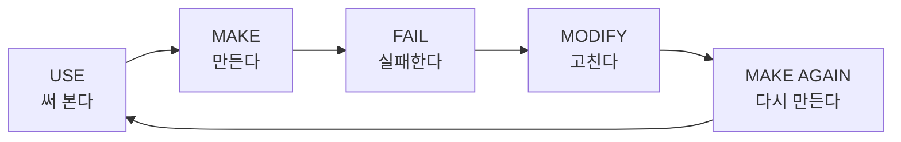

# 20. FINAL MISSION — 이제 설명 없이 혼자 해봅니다

> **이 장에서 배울 것**
> - 지금까지 배운 것을 모아, 내 문제 하나를 AI로 **혼자** 해결해 봅니다.
> - 결과를 스스로 평가하고, 다시 개선하는 습관을 만듭니다.
> - 내가 발견한 AI와 사례를 교재에 보태는 방법을 압니다.
>
> ⏱ 소요 시간: 20분 · 🧰 준비물: 지금까지 북마크한 AI 도구, 해결하고 싶은 문제 하나 · 📶 난이도: 종합

## 왜 배우나요?

수업 중에 따라 한 것은 **선생님의 문제**였습니다.
이제는 **나의 문제**를, **설명 없이**, **혼자** 풀어 볼 차례입니다.

처음부터 잘 될 필요는 없습니다. 실패해도 괜찮습니다.
AI를 배우는 가장 좋은 방법은 직접 쓰고, 만들고, 실패하고, 고치고, 다시 만드는 것입니다.



## 🧪 FINAL MISSION 워크시트

아래 다섯 칸을 채우세요. 종이에 옮겨 적거나, 이 표를 복사해 메모장에 붙여 넣어도 됩니다.

| 칸 | 질문 | 나의 답 |
|---|---|---|
| ① | **내가 해결하고 싶은 문제** | [                         ] |
| ② | **사용할 AI** | [                         ] |
| ③ | **내가 입력한 Prompt** | [                         ] |
| ④ | **만들어진 결과** | [                         ] |
| ⑤ | **다시 개선한다면?** | [                         ] |

> 💡 **팁** 어떤 AI를 써야 할지 모르겠다면 [09. AI 도구 상자](../part2/09-ai-toolbox.md)의 "무엇을 하고 싶습니까?" 표를 다시 보세요. 프롬프트가 막막하면 [부록 B. 프롬프트 모음](../appendix/b-prompts.md)에서 비슷한 것을 골라 고쳐 쓰세요.

### 진행 순서

1. ① 칸에 **이번 주에 실제로 해야 하는 일** 하나를 적습니다.
2. ② 칸에 그 일에 맞는 AI를 하나 고릅니다.
3. ③ 칸에 프롬프트를 쓰고 실행합니다. **역할·상황·원하는 형식**이 들어 있는지 확인하세요.
4. ④ 칸에 결과를 한두 줄로 요약하거나, 결과물 파일 이름·링크를 적습니다.
5. ⑤ 칸에 "다음에는 이렇게 바꾸겠다"를 적고, **실제로 한 번 더 고쳐서 실행**합니다.

## 예시 — 이렇게 채웁니다

### 예시 1. 스포츠과학 전공생

| 칸 | 나의 답 |
|---|---|
| ① 해결하고 싶은 문제 | "청소년 운동참여와 자기효능감" 과제를 위한 선행연구를 찾는 데 매번 3시간이 걸린다 |
| ② 사용할 AI | Gemini(조사) → Gemini Notebook(논문 정리) |
| ③ 입력한 Prompt | 아래 코드 블록 참고 |
| ④ 만들어진 결과 | 핵심 연구 흐름 정리와 출처 목록. 그중 2개는 원문을 열어 보니 내용이 달라서 제외함 |
| ⑤ 다시 개선한다면? | 출처를 찾지 못한 내용은 "출처 미확인"으로 표시하게 하고, 확인한 논문만 Gemini Notebook에 올려 요약시키겠다 |

```text
나는 스포츠과학 전공 2학년이다.
"청소년 운동참여와 자기효능감"에 관한 선행연구를 조사하고
핵심 흐름을 3단계로 정리해줘.
각 내용마다 근거와 출처를 제시하고,
출처를 찾지 못한 내용은 "출처 미확인"이라고 표시해줘.
```

### 예시 2. 카페 대표 (CEO 과정)

| 칸 | 나의 답 |
|---|---|
| ① 해결하고 싶은 문제 | 가을 신메뉴를 손님에게 알릴 홍보 문구와 이미지가 필요하다 |
| ② 사용할 AI | Gemini(문구·이미지) → Flow(짧은 영상) |
| ③ 입력한 Prompt | 아래 코드 블록 참고 |
| ④ 만들어진 결과 | 문구 3안과 세로형 이미지 1장. 이미지 속 한글이 깨져서 글자 없는 버전으로 다시 만듦 |
| ⑤ 다시 개선한다면? | 단골손님이 실제로 했던 말을 문구에 넣고, 매장 실제 사진을 참고 자료로 함께 주겠다 |

```text
나는 매주 수요일이 휴무인 작은 동네 카페의 대표다.
가을 신메뉴 [메뉴 이름]을 단골손님에게 알리고 싶다.
단기 매출보다 오래 다시 찾아오는 손님을 중요하게 생각한다.
인스타그램용 홍보 문구 3가지를 각각 3줄 이내로 써주고,
가장 좋은 문구에 어울리는 세로형(9:16) 이미지를 글자 없이 만들어줘.
```

> ⚠️ **주의** 예시는 이해를 돕기 위한 가상 상황입니다. 실제 고객 이름, 연락처, 매출 자료 등은 입력하지 마세요.

## ✅ 스스로 평가하기 (자기 평가 루브릭)

각 항목에 0~2점을 매겨 보세요. (0: 아직 / 1: 부분적으로 / 2: 충분히)

| 평가 항목 | 0점 | 1점 | 2점 | 내 점수 |
|---|---|---|---|---|
| **문제의 구체성** | "공부 잘하고 싶다"처럼 막연함 | 할 일은 있지만 범위가 넓음 | 이번 주에 할 일 하나로 좁혀짐 | |
| **도구 선택** | 이유 없이 고름 | 대략 맞는 도구 | 하고 싶은 일에 딱 맞는 도구 | |
| **프롬프트** | 한 줄 질문 | 역할·상황·형식 중 일부 포함 | 역할·상황·형식 모두 포함 | |
| **결과 검증** | 그대로 사용 | 대충 훑어봄 | 출처·사실·오류를 직접 확인 | |
| **개선** | 개선 계획 없음 | 개선 계획만 있음 | 실제로 고쳐서 다시 실행함 | |

| 합계 | 의미 |
|---|---|
| 0~4점 | 괜찮습니다. 2부 실험실의 미션을 하나 더 따라 해 보세요 |
| 5~7점 | 잘하고 있습니다. ⑤ 개선을 실제로 한 번 더 실행해 보세요 |
| 8~10점 | 혼자 할 수 있습니다. 내 사례를 교재에 공유해 주세요 |

## 💡 AI를 발견하면 알려주세요

좋은 AI를 발견했습니까? 미션을 하며 좋은 결과를 얻었습니까?
**어떤 도구인지, 무엇에 사용했는지, 어떤 결과가 나왔는지** 공유해 주세요.
여러분의 발견이 다음 학생의 학습자료가 됩니다.

| 이런 경우 | GitHub Issue 양식 |
|---|---|
| 새로운 AI 도구를 발견했다 | 🔥 새로운 AI 제보 |
| FINAL MISSION 결과를 나누고 싶다 | 💡 활용 사례 공유 |
| 교재 내용이 화면과 다르거나 틀렸다 | 🛠 오류·수정 제안 |

저장소의 **Issues** 탭 → **New issue** → 양식 선택 → 빈칸 채우기 → 제출.
자세한 방법은 [부록 F. 교재 제작 과정](../appendix/f-making-of.md)을 보세요.

## 🔄 COME BACK AGAIN

오늘 수업은 여기서 끝나지만, 이 교재는 끝나지 않습니다.
**저장(북마크)해 두세요.**

다음에 들어오면

- 새로운 AI,
- 새로운 Prompt,
- 새로운 Mission

이 추가되어 있을 수 있습니다.

## 다시 돌아가 보기

| 부 | 이런 때 다시 보세요 |
|---|---|
| [1부 AI 시대를 읽다](../part1/index.md) | 왜 AI를 배워야 하는지 다시 생각하고 싶을 때 |
| [2부 Google AI 실험실](../part2/index.md) | 도구 사용법이 기억나지 않을 때 |
| [3부 나만의 것을 만들다](../part3/index.md) | AI로 만든 결과물이 뻔하게 느껴질 때 |
| [4부 내 일에 적용하다](../part4/index.md) | 결과물을 실제 업무·과제에 연결하고 싶을 때 |
| [5부 현장과 리더십](../part5/index.md) | 조직과 현장에서 AI를 어떻게 이끌지 고민될 때 |

## 체크리스트

- [ ] FINAL MISSION 다섯 칸을 모두 채웠다.
- [ ] ⑤ 개선 내용을 실제로 한 번 더 실행했다.
- [ ] 자기 평가 루브릭으로 점수를 매겼다.
- [ ] 이 교재를 북마크했다.
- [ ] (선택) 내 발견이나 사례를 GitHub 이슈로 공유했다.

## 생각해 보기

- 오늘 처음 AI를 쓸 때와 지금, 내가 AI에게 요청하는 방식은 어떻게 달라졌나요?
- 이번 미션에서 **AI가 한 일**과 **내가 한 일**을 나눠 적어 보세요. 어느 쪽이 결과의 품질을 결정했나요?
- 다음 주에 같은 문제를 다시 만난다면, 무엇부터 하겠습니까?

## 한 줄 정리

> **USE → MAKE → FAIL → MODIFY → MAKE AGAIN.** AI를 배우는 가장 좋은 방법은 직접 사용하는 것입니다.

---
📎 **원자료**: 노션 「인공지능 특강 - 대학, CEO과정」 > 🧪 FINAL MISSION · 💡 AI를 발견하면 알려주세요 · 🔄 COME BACK AGAIN / AI도입_자기점검_보고서 (예시 1 상황) / 카카오톡 슬라이드 「AI CEO」 (예시 2 상황)
