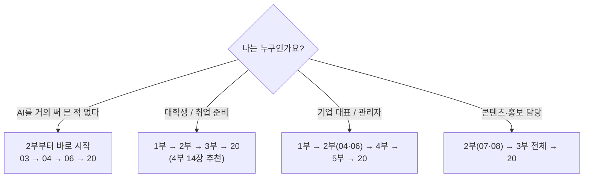

# 교재 사용법

> **이 장에서 배울 것**
> - 이 교재를 어떤 순서로, 어떻게 읽으면 좋은지
> - 각 장에 반복해서 나오는 표시(아이콘·상자)의 뜻
> - 수업 전에 준비할 것과 AI를 쓸 때 지킬 약속
>
> ⏱ 소요 시간: 10분 · 🧰 준비물: 없음 · 📶 난이도: 입문

## 왜 이 장을 먼저 읽나요?

AI 교재는 읽기만 하면 남는 것이 거의 없습니다.
이 교재의 모든 장은 **읽기 → 따라 하기 → 확인하기 → 생각하기** 순서로 되어 있습니다.
이 순서를 알고 시작하면, 처음 보는 도구 앞에서도 무엇을 해야 할지 헤매지 않습니다.

## 나에게 맞는 읽기 순서



| 시간이 이만큼 있다면 | 이렇게 보세요 |
|---|---|
| 30분 | [04. Gemini](part2/04-gemini.md)의 3분 미션 → [20. FINAL MISSION](finale/20-final-mission.md) 빈칸 채우기 |
| 2시간 (특강 1회) | 1부 01장 훑어보기 → 2부 03~08장 실습 → 20장 |
| 6~8주 (정규 과정) | [강사용 운영안](appendix/e-instructor-guide.md)의 주차별 진행표를 따릅니다 |

## 각 장의 구성

모든 장은 같은 틀로 되어 있습니다.

| 칸 | 하는 일 |
|---|---|
| **이 장에서 배울 것** | 장을 끝냈을 때 할 수 있게 되는 것. ⏱ 시간, 🧰 준비물, 📶 난이도 |
| **왜 배우나요?** | 이 내용이 내 삶·일과 어떤 관계인지 |
| **핵심 개념** | 꼭 알아야 할 생각과 용어 (표와 그림으로) |
| **따라 해 보기** | 번호를 따라 직접 실행. 프롬프트는 복사해서 사용 |
| **체크리스트** | ☑ 표시로 스스로 완료 여부 확인 |
| **생각해 보기** | 혼자 또는 조별로 이야기할 질문 |
| **한 줄 정리** | 장 전체를 한 문장으로 |

## 자주 나오는 표시

| 표시 | 뜻 |
|---|---|
| > 💡 **팁** | 알아두면 편한 요령 |
| > ⚠️ **주의** | 실수하기 쉬운 곳, 개인정보·비용 관련 경고 |
| > ✅ **확인** | 결과가 맞게 나왔는지 점검하는 방법 |
| > 🗣 **토론** | 함께 이야기해 볼 질문 |
| `[대괄호]` | 프롬프트에서 **내 상황으로 바꿔 넣을 곳** |
| 📎 **원자료** | 이 내용이 나온 강의 노션 페이지의 위치 |

### 프롬프트 복사해서 쓰는 법

회색 상자 오른쪽 위의 복사 버튼을 누르고, AI 입력창에 붙여 넣은 뒤 `[대괄호]` 부분만 바꿉니다.

```text
나는 [전공/직업]을 하고 있다.
내가 Google AI를 활용해서
오늘 바로 해볼 수 있는 일을
초급 / 중급 / 고급으로 나누어
각각 3개씩 제안해줘.
```

예: `[전공/직업]` → `스포츠과학을 전공하는 3학년 학생` 또는 `가나자와에서 카페를 운영하는 대표`

## 준비물

- [ ] Google 계정 (Gmail 주소)
- [ ] Chrome 브라우저
- [ ] 노트북 또는 스마트폰 (둘 다 있으면 더 좋습니다)
- [ ] **오늘 해결해 보고 싶은 문제 하나** — 가장 중요한 준비물입니다

## AI를 쓸 때 지킬 다섯 가지 약속

1. **AI의 결과는 언제나 초안입니다.** 제출·게시 전에 처음부터 끝까지 다시 읽습니다.
2. **출처가 없는 사실은 쓰지 않습니다.** 논문·통계·인용은 원문을 직접 확인합니다. AI는 존재하지 않는 자료를 그럴듯하게 만들어 낼 수 있습니다.
3. **개인정보를 넣지 않습니다.** 학생·고객·환자의 이름, 연락처, 신체 정보, 증명서 번호 등은 지우거나 바꿔서 입력합니다.
4. **재료 모으기는 맡기고, 판단은 맡기지 않습니다.** 무엇이 옳은지, 무엇을 할지는 내가 정합니다.
5. **날짜를 적습니다.** 무료 여부·가격·기능은 자주 바뀝니다. 확인한 날짜를 기록해 두면 나중에 비교할 수 있습니다.

> ⚠️ **주의** 이 교재에 적힌 서비스 이름, 화면 구성, 무료 범위, 가격은 **2026년 10월 기준**입니다. 실제 화면과 다르면 화면을 우선하고, [Issue로 알려 주세요](appendix/f-making-of.md#5-교재를-계속-키우는-방법).

## 체크리스트

- [ ] 나에게 맞는 읽기 순서를 정했다.
- [ ] 준비물 네 가지를 갖췄다.
- [ ] AI를 쓸 때 지킬 다섯 가지 약속을 읽었다.

## 한 줄 정리

> 이 교재는 읽는 책이 아니라 **누르고, 만들고, 고치는 책**입니다.
