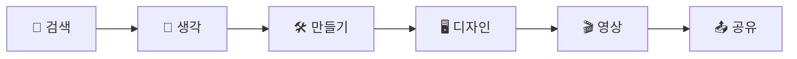
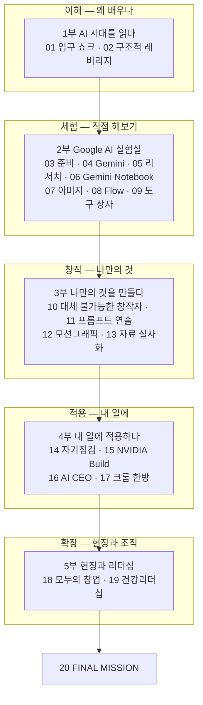
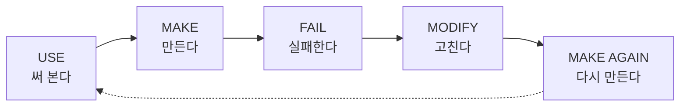

# 손으로 배우는 AI

### 인공지능 특강 교재 — 대학 · CEO 과정

> **Google 계정 하나로 시작하는 AI 실전 체험**
> 설명을 듣는 수업이 아니라 직접 눌러보고, 만들고, 결과를 확인하는 시간입니다.

---

## 오늘의 목표는 "많이 아는 것"이 아닙니다

AI 도구의 이름을 많이 외우는 것이 목표가 아닙니다.
다양한 AI를 **직접 사용하면서** 아래 과정을 한 바퀴 경험하는 것이 목표입니다.

그리고 그 경험을 **내 전공, 내 업무, 내 회사**로 가져가는 것이 이 교재의 끝입니다.

## 교재 지도

| 이 교재로 할 수 있게 되는 것 | 해당 장 |
|---|---|
| AI가 일자리의 '입구'를 어떻게 바꾸는지 설명할 수 있다 | [01](part1/01-entry-shock.md) |
| Google AI 서비스를 직접 실행하고, 자연어로 원하는 것을 요청할 수 있다 | [04](part2/04-gemini.md) ~ [08](part2/08-flow-video.md) |
| 내 자료(PDF·강의자료)로 AI와 공부할 수 있다 | [06](part2/06-notebooklm.md) |
| 이미지와 영상을 만들고, 프롬프트를 고쳐 다시 만들 수 있다 | [07](part2/07-ai-image.md), [08](part2/08-flow-video.md), [11](part3/11-prompt-directing.md) |
| AI 결과에 나의 경험과 판단을 더해 '대체 불가능한' 결과물을 만들 수 있다 | [10](part3/10-irreplaceable-creator.md) |
| 내 업무에 AI를 도입할 계획을 숫자로 세우고 점검할 수 있다 | [14](part4/14-ai-self-check.md), [15](part4/15-nvidia-build.md) |
| AI에게 업무 체계(폴더·문서·일보)를 맡기는 방법을 안다 | [16](part4/16-ai-ceo.md) |
| 나의 전공·업무에 적용할 AI를 하나 찾고, 혼자서 결과물을 완성할 수 있다 | [20](finale/20-final-mission.md) |

## 오늘 수업이 끝나면

- [ ] Google AI 서비스를 직접 실행해 본다.
- [ ] AI에게 내가 원하는 것을 자연어(평소 쓰는 말)로 요청해 본다.
- [ ] 이미지 또는 콘텐츠를 직접 만들어 본다.
- [ ] 영상 AI를 경험해 본다.
- [ ] 나의 전공/업무에 적용할 AI를 하나 찾는다.
- [ ] 이 교재를 저장(북마크)하고 수업 이후 다시 사용한다.

## 이 교재의 약속

> 🔄 **COME BACK AGAIN**
> 오늘 수업은 끝나도 이 교재는 끝나지 않습니다.
> 다음에 들어오면 새로운 AI, 새로운 Prompt, 새로운 Mission이 추가되어 있을 수 있습니다.

AI를 배우는 가장 좋은 방법은 직접 사용하는 것입니다.

👉 처음이라면 [교재 사용법](how-to-use.md)부터 읽어 주세요.
