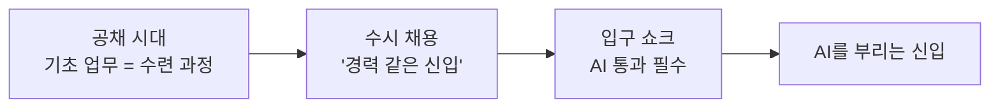
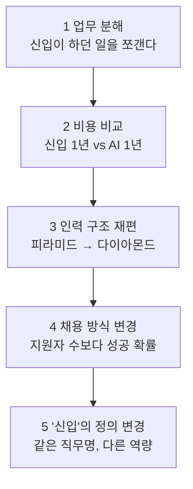
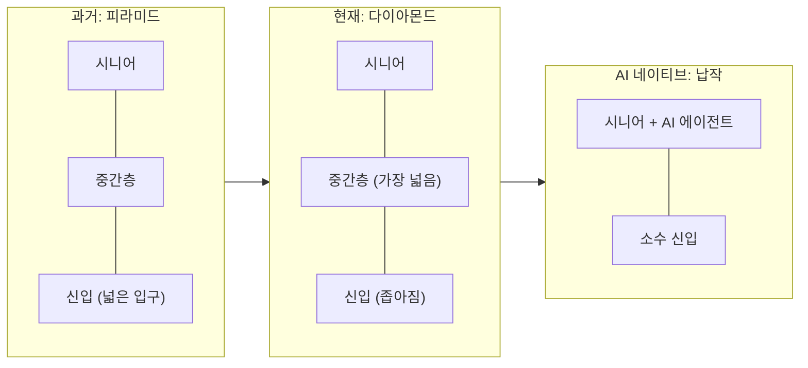
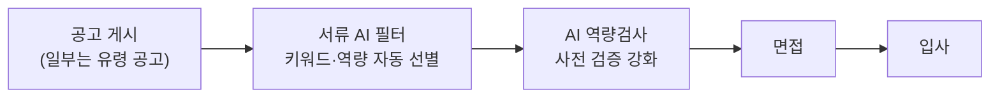

# 01. 입구 쇼크: 기업은 신입을 어떻게 보는가

> **이 장에서 배울 것**
> - "입구 쇼크(Entry Shock)"가 무엇이고, 경기 침체와 무엇이 다른지 설명할 수 있습니다.
> - 신입 채용 공고 하나가 줄어들기까지 기업 안에서 일어나는 **다섯 번의 결정**을 따라갑니다.
> - 기업의 비용 계산을 직접 해 보고, 그 계산에서 **빠진 항목**이 무엇인지 찾습니다.
> - 기업의 계산식을 거꾸로 읽어 **나의 대응 전략**을 세웁니다.
>
> ⏱ 소요 시간: 50분 · 🧰 준비물: 계산기(휴대폰), 내 전공·업무 한 가지 · 📶 난이도: 입문

## 왜 배우나요?

졸업을 앞둔 학생들에게서 요즘 자주 듣는 말이 있습니다.

- "지원해도 연락이 없어요."
- "공고는 많은데 합격자는 거의 없대요."
- "신입 공고인데 경력 2년을 요구해요."

이것은 개인의 노력 부족만으로 설명되지 않습니다. 기업 내부에서 **신입을 바라보는 계산식 자체가 바뀌고 있기** 때문입니다.
반대로 CEO 과정의 대표님들은 이렇게 묻습니다. "신입을 뽑을까, AI를 들일까?"

이 장은 같은 문(신입 채용) 앞에서 **학생과 기업이 서로 반대편에서 보고 있는 장면**을 한 장의 지도로 그립니다.
학생은 기업의 계산을 알아야 자리를 찾을 수 있고, 기업은 계산에서 빠진 것을 알아야 10년 뒤를 대비할 수 있습니다.

## 핵심 개념

### 입구 쇼크란?

> 📌 **정의** **입구 쇼크(Entry Shock)** — 생성형 AI가 조직 사다리의 맨 아랫칸, 즉 신입이 맡던 기초 업무를 흡수하면서 노동시장의 "입구"가 좁아지거나 그 모양이 바뀌는 현상입니다.

핵심은 **"회복되어도 예전 입구로 돌아오지 않는다"** 는 점입니다.
경기 침체 때 줄어든 채용은 경기가 좋아지면 다시 늘어납니다. 하지만 AI가 가져간 업무는 경기가 좋아져도 사람에게 돌아오지 않습니다.

입구의 모양은 이렇게 변해 왔습니다.



> ⚠️ **주의** 위 그림은 채용 규모를 통계로 그린 것이 아니라 **변화의 방향**을 보여 주는 개념도입니다. 수치 근거는 이 장 끝의 참고 보도를 확인하세요.

### 기업 내부의 다섯 번의 결정

신입 채용 공고 하나가 줄어들기까지, 회사 안에서는 다섯 번의 결정이 일어납니다.



#### 1단계. 업무 분해 — "신입이 하던 일을 하나씩 쪼개서 본다"

기업은 "신입 한 명"을 통째로 보지 않습니다. 직무를 **업무 단위(task)** 로 쪼갠 뒤, 업무마다 세 가지를 묻습니다.

1. **반복적인가?** — 매일·매주 비슷하게 되풀이되는가
2. **정형화됐는가?** — 입력과 출력의 형식이 정해져 있는가
3. **결과를 검증하기 쉬운가?** — 맞았는지 틀렸는지 빨리 확인할 수 있는가

세 조건을 **모두** 만족하는 업무가 AI에게 넘어갑니다.

| 사무·기획 보조 신입의 업무 예 | 판정 | 이유 |
|---|---|---|
| 회의록·보고서 초안 | AI가 흡수 | 반복 · 정형 · 검증 쉬움 |
| 데이터 정리·단순 분석 | AI가 흡수 | 반복 · 정형 · 검증 쉬움 |
| 자료 리서치·요약 | AI가 흡수 | 반복 · 정형 · 검증 쉬움 |
| 현장 관계자 응대 | 사람이 유지 | 관계가 필요함 |
| 판단이 필요한 예외 처리 | 사람이 유지 | 판단·책임이 필요함 |

- **기업이 보는 것**: 업무별 AI 대체 가능 비율
- **신입에게 생기는 변화**: "배우면서 하던 일"이 사라져 **학습 사다리의 첫 칸**이 없어집니다.
- **핵심 질문**: "이 업무의 결과를 **누가, 어떻게** 검증하는가?"

#### 2단계. 비용 비교 — "신입 1년 비용과 AI 1년 비용을 나란히 놓는다"

신입의 비용은 급여만이 아닙니다. 온보딩(적응) 기간의 낮은 생산성, 선배의 코칭 시간, 교육비가 더해집니다.
반면 AI 도구는 구독·사용량 과금으로 **바로** 가동됩니다. 이 비용 구조의 차이(**비용 비대칭**)가 기업이 "채용보다 도입"을 먼저 검토하게 만드는 경제적 이유입니다.

| 신입 쪽 비용 항목 | AI 쪽 비용 항목 |
|---|---|
| 연봉 | 구독료 |
| 4대보험·복리후생 | 토큰(사용량) 비용 |
| 온보딩 손실(적응 기간의 낮은 생산성) | 검수·감독 인력의 시간 |
| 선배 코칭 시간 | 오류 리스크 |
| 이직 리스크 | |

> 💡 **팁** 자주 빠뜨리는 항목은 **AI 결과물을 검수할 사람의 시간**입니다. 바로 이 시간이 "사람이 유지하는 업무"가 됩니다.

아래 **따라 해 보기 2. 비용 계산기**에서 직접 계산해 봅니다.

#### 3단계. 인력 구조 재편 — "피라미드가 다이아몬드로 바뀐다"

넓은 신입층이 받치던 **피라미드** 조직이, 중간층 중심의 **다이아몬드**, 또는 소수 시니어가 AI를 부리는 **납작한 구조**로 바뀝니다.
AI 네이티브 스타트업일수록 시니어 중심의 작고 평평한 팀을 선호한다는 연구 결과도 보고됐습니다.



- **기업의 논리**: 관리 비용은 줄고, 숙련자 1인당 산출은 늘어납니다.
- **장기 부작용**: 신입을 키우지 않으면 **10년 뒤 시니어가 없습니다.** 기업도 알고 있는 딜레마입니다.

#### 4단계. 채용 방식 변경 — "지원자 수보다 채용 성공 확률을 높인다"

대규모 공채가 수시 채용으로 바뀌고, 다음과 같은 현상이 늘어납니다.



사람이 지원자를 처음 만나는 지점이 점점 **뒤로** 밀립니다. 채용 과정이 "사람 대 사람" 평가에서 "AI 시스템을 통과하는 게임"처럼 바뀌고 있다는 지적이 나옵니다.

| 학생에게 보이는 현상 | 기업 내부의 이유 |
|---|---|
| 지원해도 연락이 없다, 공고는 많은데 합격자는 적다 | 채용 예산을 검증 단계에 배분 — 잘못 뽑는 비용이 더 크다고 판단 |

#### 5단계. "신입"의 정의 변경 — "같은 직무명, 전혀 다른 요구 역량"

"신입 사상 최대 채용"이라는 뉴스가 나와도 안심하기 어렵습니다. 직무 이름은 그대로인데 **요구 역량이 통째로 바뀐** 경우가 많기 때문입니다.
받아쓰던 자리가 AI를 부리는 자리로 바뀌었고, 신입 공고에서 AI 활용 능력 요구는 최근 거의 두 배로 늘었습니다.

| 이전의 이상형 | 지금의 이상형 |
|---|---|
| 경력직 같은 신입 — 바로 투입 가능한 실무 경험 | AI보다 저렴하고 효율적인 신입 / **AI를 지휘해 결과를 내는 신입** |

> 🔄 **반전** 그런데 고용주가 가장 중시하는 역량은 여전히 AI 활용 능력이 아니라 **소통·문제해결 같은 기본기**라는 조사도 있습니다.

### 두 갈래 기업 — 모든 기업이 입구를 닫는 것은 아니다

같은 AI를 도입해도 결론은 반대로 갈립니다. 갈림길은 **"AI를 얼마나 깊게 쓰는가"** 입니다.

| 조사 | 수치 |
|---|---|
| AI 활용으로 올해 신입 채용을 **늘릴 것** (스트라다, 2026) | 46% |
| AI 때문에 신입 채용을 **줄일 것** (스트라다, 2026) — 전년 13%에서 증가 | 17% |
| 미국 기업 중 신입 채용 **중단·감축** 응답 (별도 조사, 2026) | 64% |

> ⚠️ **주의** 조사마다 표본과 질문이 달라 수치가 서로 맞지 않습니다. 이 수업의 질문은 "어느 쪽이 맞는가"가 아니라 **"왜 갈리는가"** 입니다.

| | 부분 도입 기업 → **입구 축소** | 심층 도입 기업 → **입구 재설계** |
|---|---|---|
| 기업이 하는 일 | 반복·일상 업무 자동화에만 AI 사용 | AI로 업무가 오히려 복잡해졌다고 판단 (검수·조합·판단 업무 증가) |
| | 절감된 인건비를 성과로 봄 | AI 문해력이 높은 젊은 인력을 적극 채용 |
| | 신입 공고 축소·동결, 경력직 선호 | 신입을 "AI 에이전트를 지휘하는 역할"로 재정의 |
| | "신입 뽑느니 AI 토큰을 더 쓰자" | 온보딩 자체를 AI 활용 훈련으로 전환 |
| 신입에게 일어나는 일 | 수련용 업무가 사라져 첫 직장 진입이 어려움 | 채용 수는 유지되거나 늘지만 요구 역량은 더 높음 |
| | 채용 준비 비용(AI 역량검사 사교육 등)이 개인에게 전가 | 입사 첫날부터 결과물 검증·책임이 주어짐 |
| | 들어가도 성장 사다리의 첫 칸이 없음 | "AI보다 잘하는가"가 아니라 **"AI와 함께 더 잘하는가"** 로 평가 |

## 따라 해 보기

### 1. 기업의 눈으로 업무 분해하기 (15분)

정답을 외우는 활동이 아닙니다. 기업이 쓰는 세 가지 질문을 몸에 익히는 것이 목적입니다.

1. 내 전공(또는 우리 회사)의 **신입이 맡을 법한 업무 5개**를 적습니다.
2. 업무마다 세 질문에 O / △ / X 로 답합니다.
3. 세 칸이 모두 O이면 "AI가 흡수", 하나라도 X면 "사람이 유지", X 없이 △가 섞여 있으면 "AI와 함께(사람이 검수)"로 판정합니다.
4. "사람이 유지"인 업무에는 **왜** 사람이 필요한지(관계·판단·책임 중 무엇인지) 적습니다.

| 업무 | 반복적인가? | 정형화됐는가? | 검증이 쉬운가? | 판정 | 사람이 필요한 이유 |
|---|:-:|:-:|:-:|---|---|
| (예) 회의록 초안 작성 | O | O | O | AI가 흡수 | — |
| (예) 고객 불만 예외 처리 | △ | X | X | 사람이 유지 | 판단·책임 |
| | | | | | |
| | | | | | |
| | | | | | |

막히면 AI에게 먼저 쪼개 달라고 해 보세요. 사용법은 [04. Gemini](../part2/04-gemini.md)에서 배웁니다.

```text
나는 [전공 또는 업종]의 신입 [직무명]을 준비하고 있다.
이 직무의 신입이 처음 1년 동안 맡는 업무를 10개로 나눠줘.
각 업무마다 다음 세 가지를 O / △ / X로 판정하고 이유를 한 줄씩 적어줘.
1. 반복적인가
2. 정형화됐는가
3. 결과를 검증하기 쉬운가
마지막에 세 가지가 모두 O인 업무와, 하나라도 X인 업무를 표로 나눠줘.
확실하지 않은 내용은 "추정"이라고 표시해줘.
```

> ✅ **확인** AI의 판정을 그대로 믿지 말고, 내가 아는 현장과 다른 곳에 밑줄을 그어 보세요. 그 밑줄이 바로 **사람의 판단**입니다.

### 2. 비용 계산기 — 기업 재무팀의 책상 (20분)

> ⚠️ **주의** 아래 숫자는 모두 **수업용 예시 가정값**입니다. 실제 값은 기업·직무·국가에 따라 크게 다릅니다. 결론보다 **어떤 항목이 계산에 들어가는지**에 주목하세요.

**가정값**

| 구분 | 항목 | 값 |
|---|---|---|
| A. 신입 1명 | 연봉 | 3,600만원 |
| | 4대보험·복리후생 | 연봉의 20% 가산 |
| | 온보딩 기간 / 그동안의 생산성 | 6개월 / 50% |
| | 선배 코칭 시간 | 주당 4시간 |
| B. AI 도구 (같은 업무 범위) | 좌석당 월 구독+사용료 | 40만원 |
| | 결과물 검수에 쓰는 시니어 시간 | 주당 3시간 |
| 공통 | 선배·시니어 시간의 가치 | 시간당 4만원 |
| | 연간 근무 주수 | 48주 |

**A. 신입 1년 총비용**

| 단계 | 계산 | 결과 |
|---|---|---|
| ① 인건비 | 3,600만원 + (3,600만원 × 20%) = 3,600 + 720 | **4,320만원** |
| ② 온보딩 손실 | 인건비 × (6개월 ÷ 12개월) × (100% − 50%) = 4,320 × 0.5 × 0.5 | **1,080만원** |
| ③ 선배 코칭 | 4시간 × 48주 = 192시간 → 192시간 × 4만원 | **768만원** |
| 합계 | 4,320 + 1,080 + 768 | **6,168만원** |

**B. AI 1년 총비용**

| 단계 | 계산 | 결과 |
|---|---|---|
| ④ 구독·사용료 | 40만원 × 12개월 | **480만원** |
| ⑤ 시니어 검수 | 3시간 × 48주 = 144시간 → 144시간 × 4만원 | **576만원** |
| 합계 | 480 + 576 | **1,056만원** |

**비교**: 6,168만원 − 1,056만원 = **5,112만원** 차이. 신입 쪽이 약 **5.8배**(6,168 ÷ 1,056 ≈ 5.84) 비쌉니다.

이 숫자만 보면 기업이 "채용보다 도입"을 먼저 검토하는 이유가 보입니다. 이제 숫자를 바꿔 봅니다.

**직접 바꿔 보기**

1. **검수 시간이 늘어나면?** AI 결과물이 자주 틀려 시니어가 주 10시간을 검수한다면
   → 10시간 × 48주 × 4만원 = 1,920만원, 여기에 구독료 480만원을 더하면 **2,400만원**.
   격차가 5,112만원에서 3,768만원으로 줄어듭니다.
2. **2년차가 되면?** 신입의 온보딩 손실은 0이 되고, 코칭이 주 1시간으로 줄어든다면
   → 4,320만원 + (1시간 × 48주 × 4만원 = 192만원) = **4,512만원**.
   게다가 2년차 신입은 이제 혼자서 결과를 냅니다. 그런데 이 **"만들어 내는 가치"** 는 위 계산 어디에도 없습니다.
3. **내 숫자로 해 보기** 내 전공·업종에 맞는 값으로 빈칸을 채워 보세요.

| 항목 | 내 가정값 | 계산 | 결과 |
|---|---|---|---|
| 신입 연봉 | | | |
| 온보딩 기간·생산성 | | | |
| 코칭 시간 | | | |
| AI 월 비용 | | | |
| 검수 시간 | | | |
| **신입 합계 / AI 합계** | | | |

> 🗣 **토론** 이 계산에는 **신입이 2년차에 만들어 내는 가치**와 **조직의 미래 시니어 공급**이 빠져 있습니다. 바로 그 누락이 이 장의 토론 주제입니다.

### 3. 계산식을 거꾸로 읽기 — 학생의 대응 (15분)

기업의 계산식을 알면, 어디에 자신을 놓아야 하는지가 보입니다. 앞의 다섯 단계를 **거꾸로** 읽으면 전략이 됩니다.
기업이 "사람이 유지" 쪽에 둔 것들이 곧 여러분의 자리입니다.

| 기업의 단계 | 나의 대응 | 구체적인 행동 |
|---|---|---|
| 1단계 역이용 | AI가 흡수한 업무를 **직접 AI로 해 본 결과물**을 보여준다 | "엑셀 할 줄 압니다"가 아니라, AI로 보고서 초안·데이터 정리를 끝까지 해낸 결과물과 **무엇을 고쳤는지**를 포트폴리오로 제시합니다. 매일 도구를 쓰는 손버릇이 곧 증거입니다. |
| 2단계 역이용 | **온보딩 비용을 스스로 낮춘다** | 기업 계산식에서 가장 큰 항목은 "생산성에 도달하기까지의 시간"입니다. 현장 실습·프로젝트 경험이 이 숫자를 줄입니다. |
| 1단계의 "사람" 영역 | **검증·판단·책임**을 맡을 수 있음을 증명한다 | AI 결과물의 오류를 찾아낸 사례, 예외 상황을 처리한 경험, 사람을 상대한 경험이 핵심 역량입니다. 기업이 끝까지 자동화하지 못한 영역입니다. |
| 5단계 대응 | **기본기를 버리지 않는다** | 고용주 조사에서 신입 평가 1순위는 여전히 소통·협업·문제해결이었습니다. AI 문해력은 **입장권**이지, 그 자체가 경쟁력은 아닙니다. |
| 4단계 대응 | **공고 밖에서 입구를 만든다** | 유령 공고와 AI 필터 통과에만 매달리기보다, 소규모 조직·프로젝트·추천을 통한 진입 경로를 함께 설계합니다. 심층 도입 기업일수록 **결과물로 사람을 찾습니다.** |

> 💡 **팁 (CEO 과정 대표님께)** 같은 표를 기업 쪽에서 읽어 보세요. "우리 회사는 부분 도입 기업인가, 심층 도입 기업인가?" "신입을 AI 에이전트를 지휘하는 역할로 다시 정의할 수 있는가?" 이 질문이 [16. AI CEO 만들기](../part4/16-ai-ceo.md)와 [14. AI 도입 자기점검](../part4/14-ai-self-check.md)으로 이어집니다.

## 체크리스트

- [ ] 입구 쇼크를 "경기 침체와 다른 점"을 넣어 한 문장으로 설명할 수 있다.
- [ ] 기업 내부의 다섯 단계를 순서대로 말할 수 있다.
- [ ] 내 전공·업무의 일 5개를 세 질문으로 판정했다.
- [ ] 비용 계산을 직접 해 보고, 계산에서 빠진 항목 2가지를 찾았다.
- [ ] 다섯 가지 대응 중 내가 이번 학기(분기)에 실행할 것 1가지를 골랐다.

## 생각해 보기

> 🗣 **토론** 수업에서 함께 다룰 질문입니다. 정답은 없습니다. 근거를 들어 말해 보세요.

1. 비용 계산기에서 빠진 항목(2년차 이후의 가치, 미래 시니어 공급, 조직 문화)을 넣으면 결론이 어떻게 달라지는가? 기업은 왜 이 항목을 계산에 잘 넣지 않는가?
2. 내 전공 분야의 신입 업무를 1단계처럼 분해해 보자. "사람이 유지" 쪽에 남는 것은 무엇이고, 그것을 학교에서 어떻게 훈련할 수 있는가?
3. "신입을 키우지 않는 기업은 10년 뒤 시니어가 없다"는 말에 기업은 어떻게 반박할까? 그 반박은 타당한가?
4. AI 역량검사 사교육비가 개인에게 전가되는 현상은 누구의 책임인가 — 기업, 대학, 정부, 개인?
5. 두 갈래 기업 중 내가 가고 싶은 곳은 어디이며, 그 기업이 나를 선택하게 만드는 **증거**는 무엇인가?

## 이 장의 용어

| 용어 | 뜻 |
|---|---|
| 입구 쇼크 | AI가 신입 업무를 흡수하면서 노동시장 진입 관문이 좁아지거나 모양이 바뀌는 현상. "첫 직장 쇼크", "신입 실종"으로도 불림 |
| 채용 절벽 | 대기업 정규직 신입 공고가 급감하는 현상. 2025년 하반기 이후 국내 데이터에서 뚜렷함 |
| 유령 공고 | 공고는 게시하되 실제 채용은 거의 진행하지 않는 공고. 미국에서는 "졸업생 패싱"이라는 표현도 등장 |
| AI 문해력 | AI 도구를 업무에 적용하고 결과를 비판적으로 검증하는 능력. 채용의 "입장권"으로 기능 |
| 비용 비대칭 | 신입 온보딩 비용과 AI 도입 비용의 격차. 기업이 채용보다 도입을 먼저 검토하게 하는 유인 |
| 피라미드 → 다이아몬드 | 넓은 신입층이 받치던 조직이 중간·시니어 중심으로 재편되는 인력 구조 변화 |
| 온보딩 | 새로 들어온 사람이 조직에 적응해 제 몫을 하기까지의 과정 |

전체 용어는 [부록 C. 용어 사전](../appendix/c-glossary.md)에 모아 두었습니다.

## 한 줄 정리

> 기업이 AI에 넘기는 것은 "반복·정형·검증 쉬운 일"이고, 사람에게 남기는 것은 **관계·판단·책임**입니다. 그 자리를 증명하는 결과물을 지금부터 만드세요.

## 참고한 보도·자료 (2026년 5월 기준)

- 미 대졸 청년을 덮친 "AI 쇼크" — 기업 64% 신입 채용 중단·감축, 유령 공고
- 이코노미스트 — 블룸버그 "초급 화이트칼라 채용 급감" 분석
- Korea Business Review — 2026 고용 쇼크·채용 절벽 데이터, 비용 비대칭
- 이데일리 — 스트라다 조사: AI로 신입 채용 확대 46%·축소 17%
- 파이낸셜뉴스 — AI 능숙한 신입 "귀하신 몸", AI 문해력
- MBC — "신입 뽑느니 AI 토큰을 더 줘라", AI 역량검사 사교육

> ⚠️ **주의** 위 목록은 원자료(수업용 인터랙티브 자료)에 정리된 보도 제목입니다. 수업에서 인용할 때는 원문 기사를 직접 찾아 날짜와 수치를 다시 확인하세요.

---
📎 **원자료**: 노션 「인공지능 특강 - 대학, CEO과정」 > 인공지능 사회 생태계 파악 > 「입구 쇼크 해부도」(HTML 수업 자료)
