# 02. 구조적 레버리지: 남보다 한발 앞선 자들의 시선

> **이 장에서 배울 것**
> - "무한한 노력"과 "구조적 레버리지"의 차이를 설명할 수 있습니다.
> - 앞선 사람들이 가진 세 가지 시선 — **일과 책임**, **문제를 해결한 총량**, **구조적 필연성** — 을 이해합니다.
> - AI를 아무 일에나 쓰는 대신, **내 일의 진짜 고객이 가진 진짜 고통**에 겨누는 연습을 합니다.
>
> ⏱ 소요 시간: 40분 · 🧰 준비물: 필기도구, 내 직장·사업·전공 한 가지 · 📶 난이도: 입문

## 왜 배우나요?

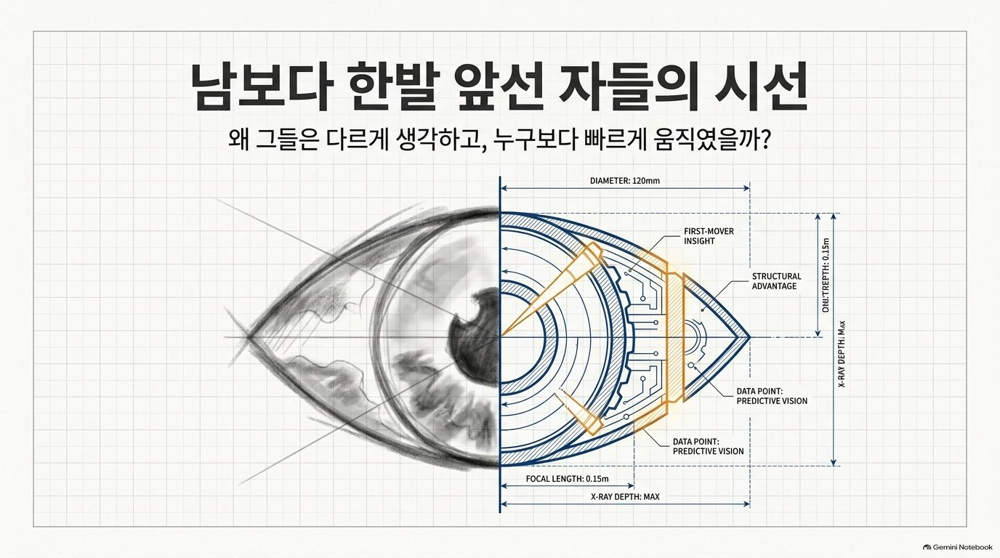

같은 학과, 같은 회사, 같은 시기에 시작했는데 몇 년 뒤 결과가 크게 벌어진 사람들을 본 적이 있을 겁니다.
우리는 흔히 그 차이를 이렇게 설명합니다.

- "저 사람은 원래 부지런해."
- "운이 좋았지."
- "타고났어."

이 장은 다른 설명을 제안합니다.

> 그들은 단순히 발이 빠른 것이 아닙니다. 세상이 작동하는 **"숨겨진 설계도"** 를 먼저 읽고, 가장 확실한 길목을 선점했을 뿐입니다.

AI 시대에 이 관점이 더 중요한 이유가 있습니다. AI는 **힘을 키워 주는 지렛대**입니다.
지렛대는 받침점을 어디에 두느냐에 따라 결과가 완전히 달라집니다. 엉뚱한 곳에 두면 아무리 좋은 AI도 "더 빨리 헛수고하는 기계"가 됩니다.
이 장은 그 받침점을 찾는 법을 다룹니다.

## 핵심 개념

### 1. 빠르다는 것의 "진짜" 의미

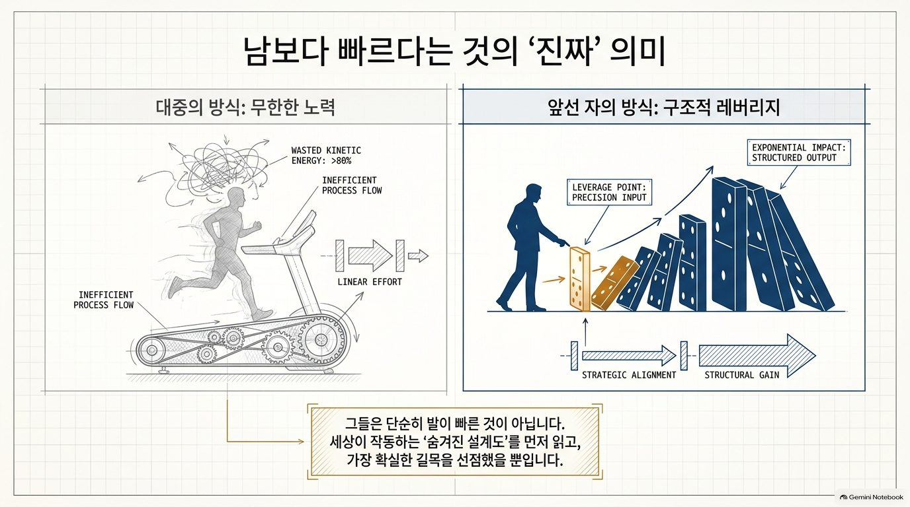

| | 대중의 방식: **무한한 노력** | 앞선 자의 방식: **구조적 레버리지** |
|---|---|---|
| 그림 | 러닝머신 위를 달리는 사람 | 첫 도미노를 정확히 미는 사람 |
| 입력 | 많은 에너지, 비효율적인 과정 | 정밀한 한 번의 입력 (Leverage point) |
| 결과 | 투입한 만큼만 나오는 **선형적** 결과 | 뒤로 갈수록 커지는 **기하급수적** 결과 |
| 핵심 | 열심히 | 어디를 밀어야 하는지 먼저 안다 |

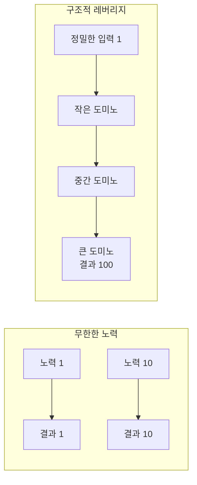

> 💡 **팁** 구조적 레버리지(structural leverage)란 **구조(설계도)를 먼저 읽어서, 작은 힘으로 큰 결과가 나오는 지점에 힘을 쓰는 것**입니다.

앞선 사람들의 시선은 크게 세 가지 영역에서 대중과 다릅니다. 하나씩 살펴봅니다.

### 2. 첫 번째 시선 — 삶의 기준: "모든 프라이빗은 일 위에 성립한다"

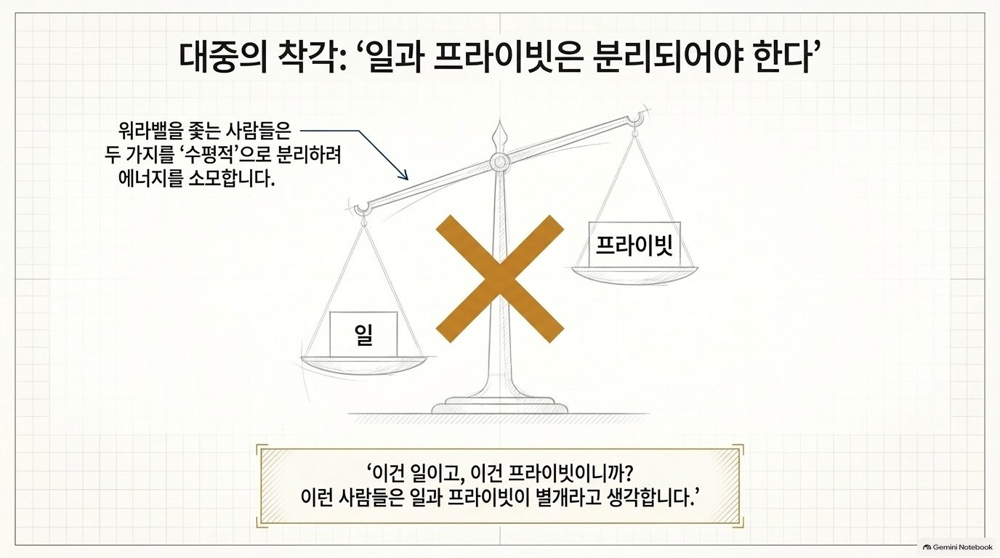

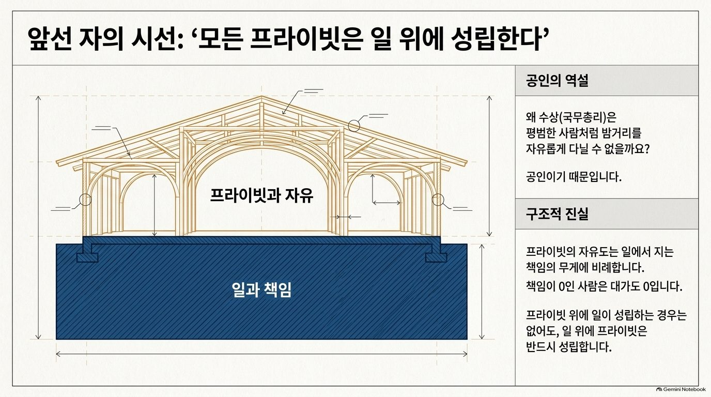

**대중의 착각: "일과 프라이빗은 분리되어야 한다"**

워라밸(일과 삶의 균형)을 좇는 사람들은 일과 프라이빗을 저울의 양쪽에 놓고 **수평적으로 분리**하려 합니다.
"이건 일이고, 이건 프라이빗이니까." 그리고 그 둘을 떼어 놓는 데 많은 에너지를 씁니다.

**앞선 자의 시선: 일과 책임은 프라이빗의 "기반"이다**

앞선 사람들은 둘을 저울이 아니라 **건물**로 봅니다. 아래층(기초)이 일과 책임이고, 그 위에 프라이빗과 자유가 올라갑니다.

> 🗣 **공인의 역설** 왜 수상(국무총리)은 평범한 사람처럼 밤거리를 자유롭게 다닐 수 없을까요? **공인이기 때문**입니다.
> 지는 책임이 크면, 그 책임이 프라이빗의 모양까지 결정합니다.

이 그림이 말하는 구조적 진실은 세 가지입니다.

1. 프라이빗의 자유도는 일에서 지는 **책임의 무게에 비례**합니다.
2. 책임이 0인 사람은 **대가도 0**입니다.
3. 프라이빗 위에 일이 성립하는 경우는 없어도, **일 위에 프라이빗은 반드시 성립**합니다.

**왜 이 생각이 그들을 빠르게 만들까? — 책임의 계단**

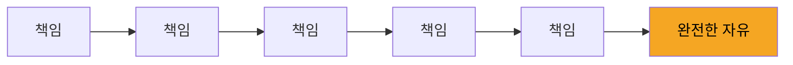

분리하는 데 쓸 에너지를 **책임을 지는 데** 집중합니다. 압도적인 기반(일)을 먼저 다지기 때문에, 결과적으로 남들보다 훨씬 크고 완전한 자유(프라이빗)를 얻습니다.

> ⚠️ **주의** 이 시선은 "쉬지 말고 일만 하라"는 뜻이 아닙니다. 휴식과 건강은 책임을 오래 지기 위한 조건입니다. 리더의 건강이 왜 조직의 문제인지는 [19. 건강리더십과 조직운영](../part5/19-health-leadership.md)에서 다룹니다.

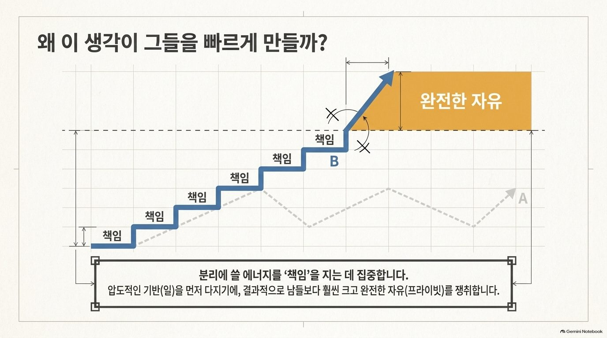

### 3. 두 번째 시선 — 가치 창출: "급여는 문제를 해결한 총량이다"

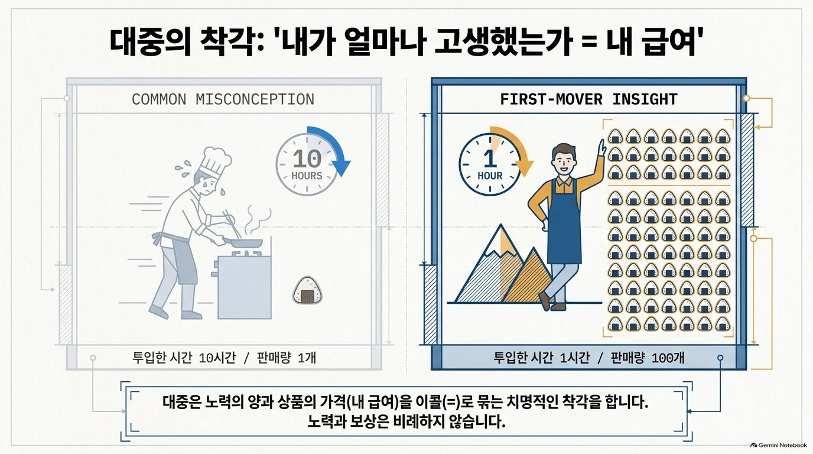

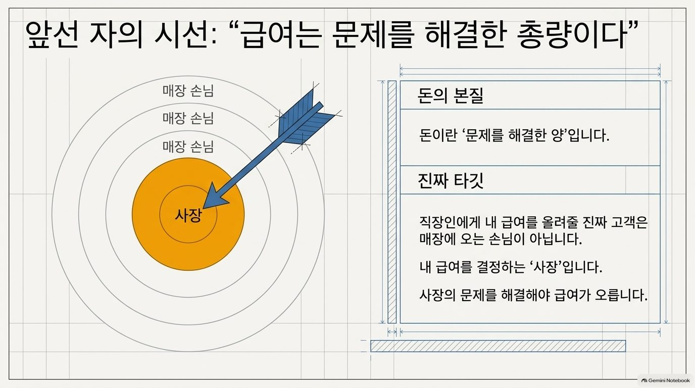

**대중의 착각: "내가 얼마나 고생했는가 = 내 급여"**

| 대중의 생각 (Common misconception) | 앞선 자의 생각 (First-mover insight) |
|---|---|
| 10시간을 들여 주먹밥 1개를 판다 | 1시간을 들여 주먹밥 100개를 판다 |
| 노력의 양 = 상품의 가격 = 내 급여 | 노력과 보상은 **비례하지 않는다** |

대중은 노력의 양과 상품의 가격(내 급여)을 등호(=)로 묶는 치명적인 착각을 합니다.

**앞선 자의 시선: 돈 = 문제를 해결한 양**

- **돈의 본질**: 돈이란 "문제를 해결한 양"입니다.
- **진짜 타깃**: 직장인에게 내 급여를 올려 줄 진짜 고객은 매장에 오는 손님이 아닙니다. 내 급여를 결정하는 **사장**입니다.
- 그러니 **사장의 문제를 해결해야** 급여가 오릅니다.

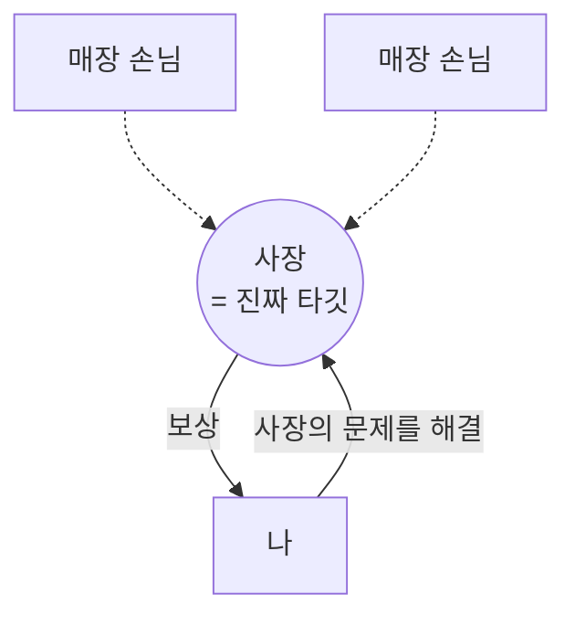

**사장의 가장 뼈저린 고통: 캐시플로우(현금 흐름)**

사장의 고통 중 가장 아픈 것은 장부상의 이익이 아니라 **통장에 현금이 있는가**입니다. 다음 예를 따라가 보세요.

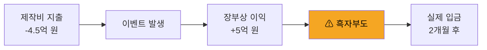

장부로는 5천만 원(5억 − 4.5억)이 남는 장사입니다. 그런데 돈이 들어오는 것은 두 달 뒤이고, 제작비는 지금 나갑니다.
그 사이 월급·임대료를 낼 현금이 없으면 회사는 쓰러집니다. 이것을 **흑자부도**라고 합니다.

> ✅ **확인** 이익이 나도 당장 수중에 현금이 없으면 회사는 쓰러집니다. 사장에게 가장 고마운 직원은 "열심히 하는 직원"이 아니라 **이 고통을 줄여 주는 직원**입니다.

**왜 그들의 연봉은 남들보다 빨리 오를까? — 창고 줄이기 예시**

어떤 직원이 물류 동선을 다시 짜서 **창고 크기를 줄이는 제안**을 했다고 해 봅시다.

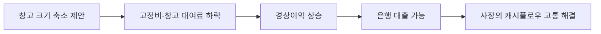

제안 하나가 고정비를 낮추고, 이익을 높이고, 회사가 대출을 받을 수 있게 만들었습니다. **본질적인 문제를 해결했기 때문에 보상도 즉각적**입니다.

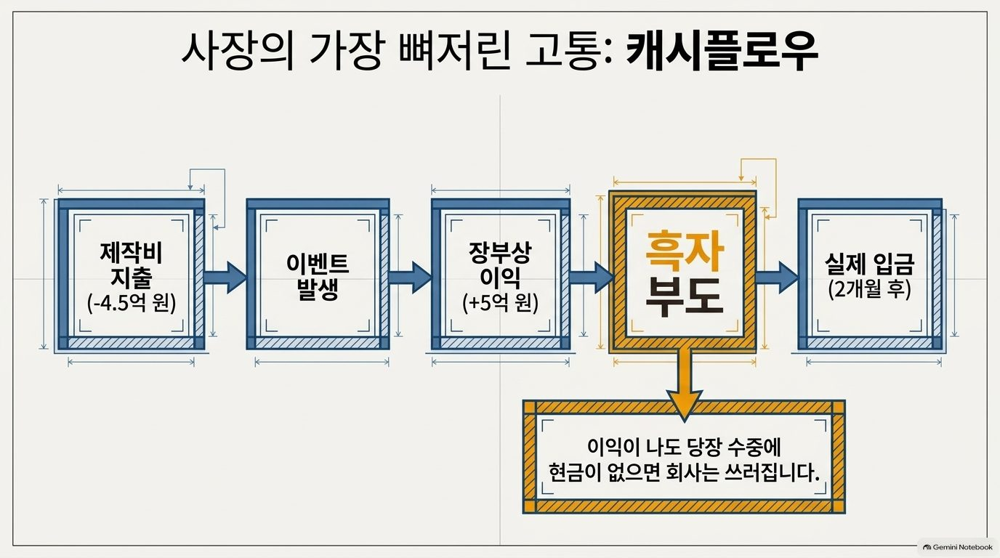

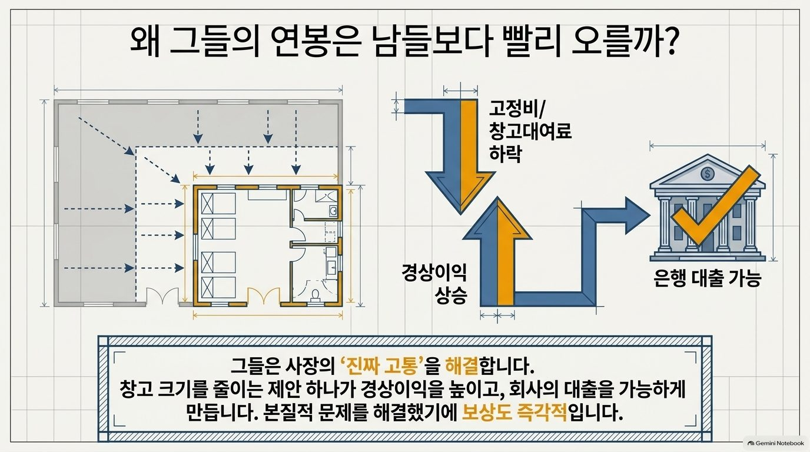

### 4. 세 번째 시선 — 성공 요인: "반복되는 운은 철저한 실력이다"

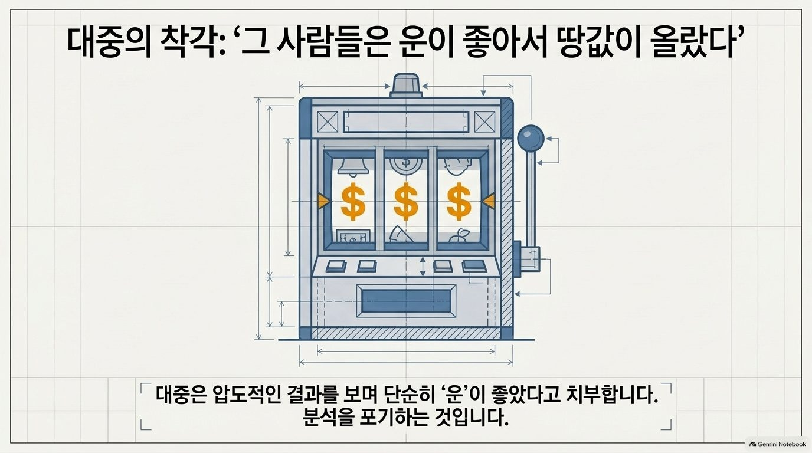

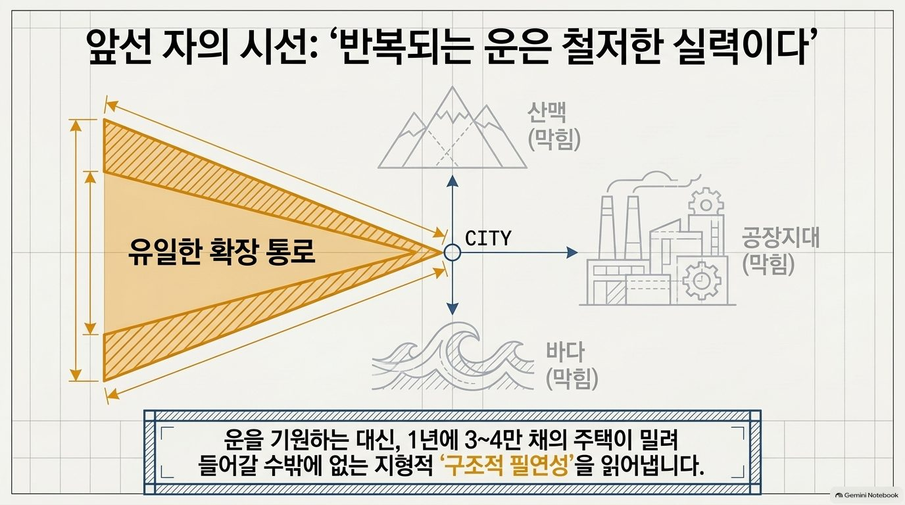

**대중의 착각: "그 사람들은 운이 좋아서 땅값이 올랐다"**

대중은 압도적인 결과를 보면 단순히 "운"이 좋았다고 치부합니다. 슬롯머신의 잭팟처럼 봅니다. 그것은 **분석을 포기하는 것**입니다.

**앞선 자의 시선: 지형과 데이터가 만든 구조적 필연**

어느 도시가 있습니다. 한쪽은 산맥으로, 한쪽은 바다로, 한쪽은 공장지대로 막혀 있습니다. 남은 방향은 하나뿐입니다.

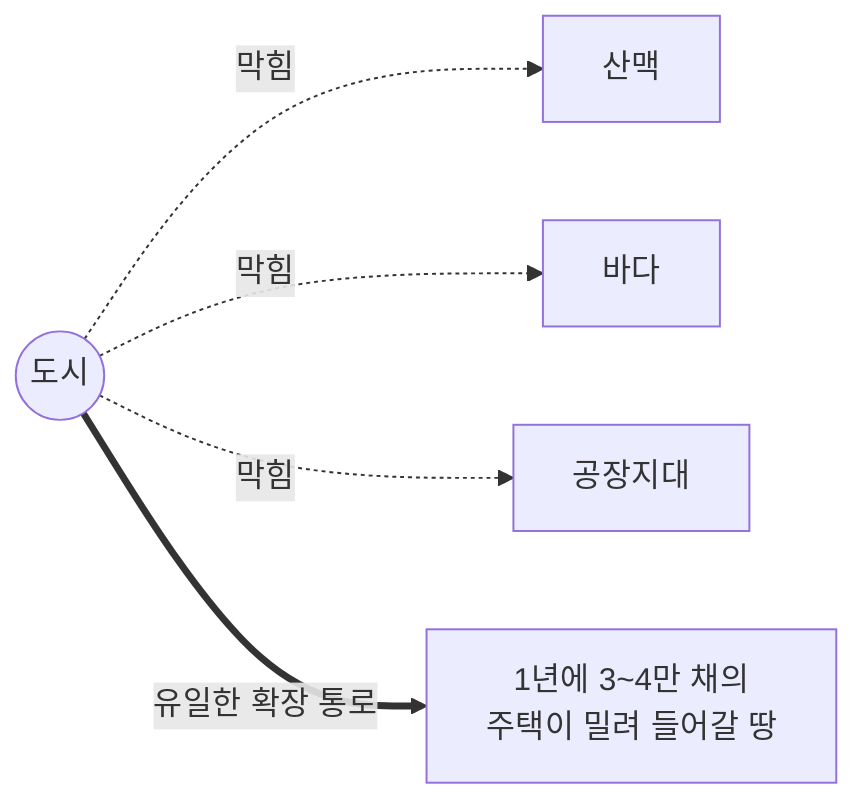

앞선 사람들은 운을 기원하는 대신, 1년에 3~4만 채의 주택이 밀려 들어갈 수밖에 없는 지형적 **"구조적 필연성"** 을 읽어 냅니다.

**왜 그들의 투자는 빠르고 정확할까? — 도로의 폭과 지도의 물리적 한계**

| 남들이 보는 것 | 그들이 보는 것 |
|---|---|
| 현재의 시세 | 도로의 **폭** — 미국에서 가장 폭이 넓은 시골길 = 정부의 도심 계획 |
| 오늘의 가격 | 지도의 **물리적 한계** — 10번 고속도로를 따라 고급 주택가가 남쪽으로 내려오는 공식 |

모든 조건이 가리키는 유일한 길목을 미리 선점하고 기다립니다. 이것은 투기(운)가 아니라 **연구(실력)** 입니다.

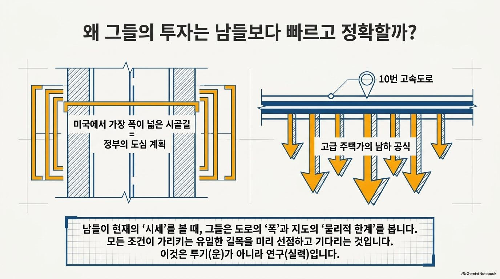

### 5. 한 장으로 정리 — 무엇이 그들을 남보다 빠르게 만들었는가?

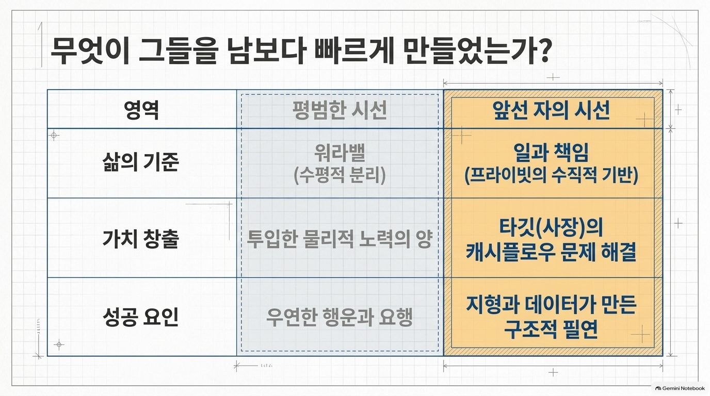

| 영역 | 평범한 시선 | 앞선 자의 시선 |
|---|---|---|
| 삶의 기준 | 워라밸 (수평적 분리) | **일과 책임** (프라이빗의 수직적 기반) |
| 가치 창출 | 투입한 물리적 노력의 양 | **타깃(사장)의 캐시플로우 문제 해결** |
| 성공 요인 | 우연한 행운과 요행 | **지형과 데이터가 만든 구조적 필연** |

> 📌 **보이지 않는 것을 보는 힘** 그들이 남보다 빨랐던 이유는 서두르지 않았기 때문입니다. 남들이 표면의 현상에 흔들릴 때, 이들은 삶·비즈니스·자본의 **설계도**를 먼저 읽고 가장 견고한 자리에 자신의 깃발을 꽂았습니다.

### 6. AI와 구조적 레버리지 — 지렛대를 어디에 걸 것인가

이제 이 장의 내용을 AI와 연결해 봅니다.

| | AI를 "노력의 대체"로 쓸 때 | AI를 "구조적 레버리지"로 쓸 때 |
|---|---|---|
| 질문 | "이 일 좀 대신 해줘" | "이 사람의 가장 큰 고통이 무엇이고, 그것을 줄이는 방법은?" |
| 겨누는 곳 | 내가 하기 싫은 일 | **진짜 고객(타깃)의 진짜 고통** |
| 결과 | 같은 일을 조금 더 빨리 | 보상이 따라오는 **문제 해결의 총량** 증가 |
| 01장과 연결 | AI가 흡수하는 쪽에 내가 섬 | 사람이 유지하는 쪽(판단·책임)에 내가 섬 |

예를 들어 회사원이 AI로 회의록을 10분 빨리 쓰는 것은 "노력의 대체"입니다.
같은 AI로 지난 1년 거래처 결제 주기를 정리해 **현금이 비는 달을 미리 찾아 사장에게 보고**하는 것은 "구조적 레버리지"입니다. 앞의 캐시플로우 고통을 정면으로 겨눴기 때문입니다.

> 💡 **팁** 좋은 지렛대 질문은 늘 **"누구의 어떤 고통인가?"** 로 시작합니다. 도구 이름은 그다음입니다.

참고로 이 장의 원자료 슬라이드 자체도 AI(Gemini 노트북 기능)로 만든 것입니다. 내 생각(설계도)을 먼저 정리하고, 시각화는 AI에게 맡긴 사례입니다. 이 방법은 [06. Gemini Notebook](../part2/06-notebooklm.md)과 [10. 대체 불가능한 창작자](../part3/10-irreplaceable-creator.md)에서 다시 다룹니다.

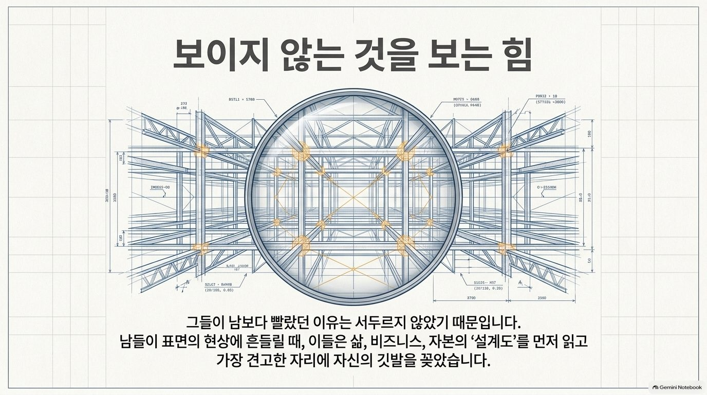

## 따라 해 보기 — 내 일의 진짜 고객과 그 고통 찾기 (20분)

### 1단계. 진짜 고객(타깃)을 적는다

내 일의 결과로 **나에게 보상(급여·매출·평가·기회)을 결정하는 사람**은 누구인가요?

| 나의 상황 | 눈에 보이는 고객 | 보상을 결정하는 **진짜 타깃** |
|---|---|---|
| (예) 카페 직원 | 매장 손님 | 사장 |
| (예) 대학생 | 수업 | 교수 · 미래의 채용 담당자 |
| (예) 중소기업 대표 | 소비자 | 거래처 · 투자자 · 은행 |
| 나 | | |

### 2단계. 그 사람의 가장 뼈저린 고통을 적는다

진짜 타깃이 밤에 잠 못 들게 하는 문제 3가지를 적고, 가장 큰 것 하나에 동그라미를 칩니다.

| 고통 후보 | 얼마나 아픈가 (1~5) | 내가 건드릴 수 있는가 (O/X) |
|---|:-:|:-:|
| 1. | | |
| 2. | | |
| 3. | | |

> 💡 **팁** 잘 모르겠다면 돈(현금 흐름), 시간(마감), 사람(이탈·갈등), 신뢰(평판) 네 방향에서 찾아보세요.

### 3단계. AI로 해결해 볼 아이디어 1개를 만든다

아래 프롬프트(AI에게 하는 요청 문장)를 복사해 [Gemini](../part2/04-gemini.md)에 붙여 넣고, `[ ]` 안을 내 상황으로 바꿉니다.

```text
나는 [나의 역할: 예) 물류회사 3년차 직원]이다.
내 일의 보상을 결정하는 진짜 타깃은 [타깃: 예) 사장]이다.
그 사람의 가장 큰 고통은 [고통: 예) 매출은 느는데 매달 말 현금이 부족하다]라고 생각한다.

다음 순서로 답해줘.
1. 이 고통이 생기는 구조적 원인 3가지 (확실하지 않으면 "추정"이라고 표시)
2. 내가 지금 위치에서 건드릴 수 있는 지렛대(작은 입력으로 큰 효과가 나는 지점) 3가지
3. 그중 하나를 골라, AI를 활용해 2주 안에 해 볼 수 있는 실행 계획
   - 내가 직접 할 일 / AI에게 맡길 일 / 결과를 확인할 숫자
4. 이 아이디어를 타깃에게 3문장으로 제안하는 말

내 회사의 실제 숫자를 모르는 부분은 임의로 만들지 말고, 내가 확인해야 할 질문으로 남겨줘.
```

### 4단계. 한 문장 제안문으로 정리한다

AI의 답을 그대로 쓰지 말고, 내 말로 고쳐 한 문장으로 적습니다.

```plaintext
[타깃]님, [고통]을 줄이기 위해 [AI를 활용한 나의 아이디어]를 [기간] 동안 시험해 보겠습니다.
결과는 [확인할 숫자]로 보고드리겠습니다.
```

> ✅ **확인** 좋은 제안문에는 **누구의 / 어떤 고통을 / 무엇으로 / 언제까지 / 어떤 숫자로** 다섯 가지가 모두 들어 있습니다. 숫자로 확인하는 방법은 [14. AI 도입 자기점검](../part4/14-ai-self-check.md)에서 자세히 배웁니다.

## 체크리스트

- [ ] "무한한 노력"과 "구조적 레버리지"의 차이를 예를 들어 설명할 수 있다.
- [ ] 세 가지 시선(일과 책임 / 문제를 해결한 총량 / 구조적 필연성)을 말할 수 있다.
- [ ] 흑자부도가 무엇인지 설명할 수 있다.
- [ ] 내 일의 진짜 타깃과 그 사람의 가장 큰 고통 1가지를 적었다.
- [ ] AI로 해결해 볼 아이디어 1개를 한 문장 제안문으로 만들었다.

## 생각해 보기

> 🗣 **토론** 이 장의 관점은 하나의 해석 틀입니다. 비판적으로 읽어 보세요.

1. "모든 프라이빗은 일 위에 성립한다"는 말에 동의하나요? 이 말이 **맞지 않는** 사람이나 상황은 없을까요?
2. "급여는 문제를 해결한 총량"이라면, 문제를 해결했는데도 보상받지 못하는 경우는 왜 생길까요? 그때 무엇을 바꿔야 할까요?
3. 내가 "운이 좋았다"고 생각했던 누군가의 성공을, 구조(지형·데이터·제도)로 다시 설명해 볼 수 있나요?
4. AI가 모든 사람에게 같은 지렛대를 준다면, 결국 차이를 만드는 것은 무엇일까요?

## 한 줄 정리

> 빠른 사람은 더 많이 뛰는 사람이 아니라, **설계도를 먼저 읽고 진짜 고통에 지렛대를 거는 사람**입니다. AI는 그 지렛대를 더 길게 만들어 줄 뿐입니다.

---
📎 **원자료**: 노션 「인공지능 특강 - 대학, CEO과정」 > GOOGLE AI EXPERIENCE LAB > 키노트 자료 「구조적_레버리지.pdf」(14장)
