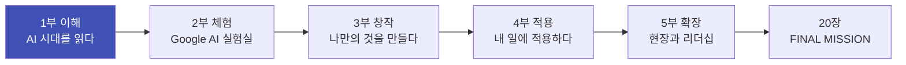
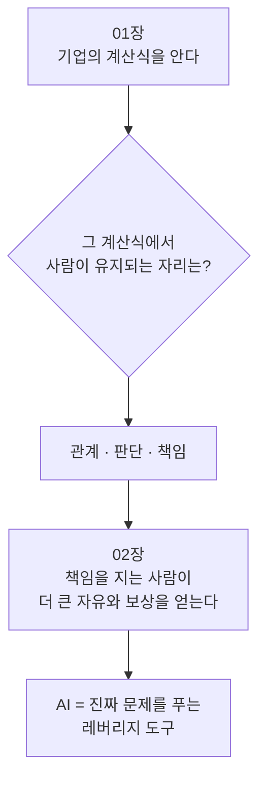

# 1부 AI 시대를 읽다

> **1부에서 배울 것**
> - AI가 일자리의 "입구"를 어떻게 바꾸고 있는지 기업의 눈으로 이해합니다.
> - 같은 노력으로 더 큰 결과를 만드는 사람들의 생각 구조(구조적 레버리지)를 배웁니다.
> - 이 두 가지를 바탕으로, 2부부터 AI 도구를 **어디에, 왜** 쓸지 스스로 정할 수 있게 됩니다.
>
> ⏱ 소요 시간: 약 90분 (01장 50분 + 02장 40분) · 🧰 준비물: 필기도구, 내 전공·업무 한 가지 · 📶 난이도: 입문

## 왜 "도구"보다 "시대"를 먼저 읽나요?

AI 수업이라고 하면 보통 "이 버튼을 누르세요"부터 시작합니다.
그런데 도구 사용법은 몇 달이면 바뀝니다. 화면이 바뀌고, 이름이 바뀌고, 무료였던 기능이 유료가 됩니다.

바뀌지 않는 것은 **질문**입니다.

- AI가 들어오면 회사는 무엇을 계산할까?
- 그 계산 속에서 나는 어디에 서 있어야 할까?
- 같은 시간을 써도 결과가 10배 차이 나는 사람은 무엇을 다르게 볼까?

1부는 이 질문에 답하는 **지도**입니다. 지도가 있어야 2부의 도구 체험이 "구경"이 아니라 "내 일을 바꾸는 실험"이 됩니다.

> 💡 **팁** 1부는 정답을 외우는 장이 아닙니다. 읽으면서 "내 전공·내 회사라면?"을 계속 떠올려 보세요. 각 장 끝의 **생각해 보기** 질문에 짧게라도 답을 적어 두면, 20장 FINAL MISSION에서 그대로 쓸 수 있습니다.

## 이 교재 전체의 흐름

이 교재는 다섯 단계로 흘러갑니다. 1부는 그 첫 번째, **이해** 단계입니다.

| 단계 | 질문 | 이 교재에서 |
|---|---|---|
| 이해 | AI는 일과 사회를 어떻게 바꾸는가? | 1부 (01–02장) |
| 체험 | AI를 직접 눌러 보면 무엇이 되는가? | 2부 (03–09장) |
| 창작 | AI로 남과 다른 결과물을 어떻게 만드는가? | 3부 (10–13장) |
| 적용 | 내 업무에 AI를 어떻게 들이고 검증하는가? | 4부 (14–17장) |
| 확장 | 현장·창업·조직으로 어떻게 넓히는가? | 5부 (18–19장) |

## 1부의 장

| 장 | 한 줄 요약 |
|---|---|
| [01. 입구 쇼크: 기업은 신입을 어떻게 보는가](01-entry-shock.md) | AI가 신입의 기초 업무를 흡수하면서 노동시장의 "입구"가 좁아지거나 모양이 바뀝니다. 기업 내부의 다섯 단계 계산을 따라가고, 그 계산을 거꾸로 읽어 나의 전략을 세웁니다. |
| [02. 구조적 레버리지: 남보다 한발 앞선 자들의 시선](02-structural-leverage.md) | 빠른 사람은 발이 빠른 것이 아니라 "숨겨진 설계도"를 먼저 읽습니다. 일과 책임, 문제 해결의 총량, 구조적 필연성이라는 세 가지 시선을 배우고 AI를 "진짜 고통"에 겨누는 법을 익힙니다. |

## 두 장은 이렇게 연결됩니다

01장은 **"기업은 무엇을 AI에 넘기는가"** 를 보여 줍니다. 그 결과 사람에게 남는 것은 관계, 판단, 책임입니다.
02장은 바로 그 **책임**과 **문제 해결**이 어떻게 더 큰 보상과 자유로 이어지는지를 보여 줍니다.
두 장을 함께 읽으면 결론은 하나로 모입니다.

> ✅ **확인** AI를 "나 대신 일하는 도구"로만 보면 경쟁 상대가 됩니다. AI를 "내가 책임지는 문제를 더 크게 푸는 도구"로 보면 레버리지가 됩니다.

## 1부를 마치면

- [ ] "입구 쇼크"를 내 말로 한 문장으로 설명할 수 있다.
- [ ] 내 전공·업무의 일 하나를 "AI가 흡수 / 사람이 유지"로 나눠 볼 수 있다.
- [ ] 내 일의 "진짜 고객"과 그 고객의 가장 큰 고통을 하나 적었다.
- [ ] 2부에서 AI로 실험해 볼 과제를 하나 골랐다.

다음 단계: [2부 Google AI 실험실](../part2/index.md)에서 오늘 고른 과제를 직접 AI에게 맡겨 봅니다.

---
📎 **원자료**: 노션 「인공지능 특강 - 대학, CEO과정」 > 인공지능 사회 생태계 파악(입구 쇼크 해부도), GOOGLE AI EXPERIENCE LAB 키노트(구조적_레버리지.pdf)
