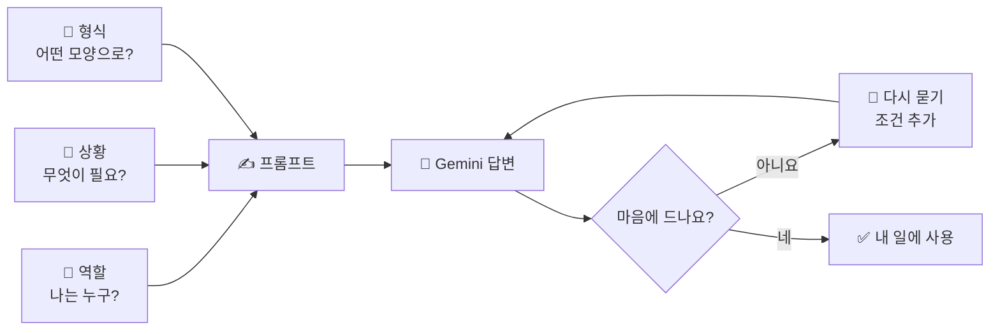

# 04. Gemini — 생각하고 질문하기

> **이 장에서 배울 것**
> - Gemini를 실행하고 첫 질문을 던져 봅니다.
> - 좋은 요청의 세 가지 재료(역할·상황·원하는 형식)를 익힙니다.
> - 첫 답변에 만족하지 않고 **다시 묻는** 방법을 연습합니다.
>
> ⏱ 소요 시간: 15분 · 🧰 준비물: Google 계정, Chrome · 📶 난이도: 입문

## 왜 배우나요?

오늘 가장 먼저 사용할 AI는 **Gemini**입니다.
Gemini는 질문·기획·아이디어·글쓰기·분석, 그리고 이미지 생성까지 할 수 있는 **대화형 AI**입니다.

많은 사람이 AI를 처음 쓸 때 "AI가 뭘 할 수 있어?"라고 묻습니다.
그런데 더 좋은 질문은 **"나는 이런 사람인데, 오늘 바로 해볼 수 있는 일이 뭐야?"** 입니다.
AI에게 나를 소개하면, AI는 내 상황에 맞춘 답을 줍니다.

## 핵심 개념

### 좋은 요청의 세 가지 재료

AI에게 하는 요청 문장을 **프롬프트(Prompt)** 라고 합니다.
좋은 프롬프트에는 보통 세 가지 재료가 들어 있습니다.

| 재료 | 질문 | 예시 |
|---|---|---|
| **역할** (나는 누구 / AI는 누구) | 누가 묻고, 누구에게 묻나요? | "나는 스포츠과학 전공 2학년이다", "너는 진로 상담 조교다" |
| **상황** (무엇을, 왜) | 지금 어떤 상황이고 무엇이 필요한가요? | "다음 주에 조별 발표가 있는데 주제를 못 정했다" |
| **원하는 형식** | 결과를 어떤 모양으로 받고 싶나요? | "초급/중급/고급으로 나누어 3개씩", "표로", "5줄 이내로" |



> 💡 **팁** 세 가지를 모두 완벽하게 쓸 필요는 없습니다. 하나만 추가해도 답변이 달라지는 것을 직접 확인해 보세요.

## 따라 해 보기

### ① Gemini 실행하기

1. 북마크해 둔 [Gemini](https://gemini.google.com/)를 엽니다.
2. 수업용 Google 계정으로 로그인되어 있는지 확인합니다.
3. 화면 아래쪽의 입력창을 찾습니다. (화면 이름은 바뀔 수 있습니다.)

### ② 3분 Mission — 아래 프롬프트를 복사합니다

`[전공/직업]` 부분만 내 상황으로 바꿔서 입력하세요.

```text
나는 [전공/직업]을 하고 있다.
내가 Google AI를 활용해서
오늘 바로 해볼 수 있는 일을
초급 / 중급 / 고급으로 나누어
각각 3개씩 제안해줘.
```

> ✅ **확인** 이 프롬프트에도 세 가지 재료가 들어 있습니다. "나는 [전공/직업]" = **역할**, "오늘 바로 해볼 수 있는 일" = **상황**, "초급/중급/고급으로 나누어 각각 3개씩" = **형식**.

### ③ 다시 묻기 — 첫 답변은 초안입니다

AI의 첫 답변은 **출발점**입니다. 마음에 들지 않으면 조건을 하나씩 추가하며 다시 물어보세요.
아래는 이어서 물어볼 수 있는 예시입니다.

```text
방금 제안한 것 중에서 초급 2번을 골랐어.
이걸 오늘 30분 안에 해보려면
어떤 순서로 하면 되는지 단계별로 알려줘.
내가 처음 해보는 거라 버튼을 누르는 순서까지 쉽게 설명해줘.
```

```text
위 제안을 [나의 상황: 예) 노트북 없이 스마트폰만 있음]에 맞게 다시 바꿔줘.
불가능한 것은 빼고, 대신할 수 있는 방법을 알려줘.
```

| 다시 묻기 유형 | 이렇게 말해 보세요 |
|---|---|
| 더 구체적으로 | "2번을 오늘 바로 할 수 있게 단계별로 알려줘" |
| 더 쉽게 | "중학생도 이해할 수 있게 다시 설명해줘" |
| 형식 바꾸기 | "표로 정리해줘", "카카오톡에 보낼 수 있게 5줄로 줄여줘" |
| 조건 추가 | "예산은 0원이고, 혼자 해야 해" |
| 검증 요청 | "이 중에서 확실하지 않은 내용은 따로 표시해줘" |

> ⚠️ **주의** 개인정보(주민등록번호, 전화번호, 학생·고객의 실명과 건강 정보 등)는 입력하지 마세요. 필요한 경우 "가상 학생 A"처럼 바꿔서 입력합니다.

### ④ 하나를 골라 실제로 해 보기

제안받은 9개 중에서 **오늘 실제로 해보고 싶은 것 하나**를 고르세요.
고른 것은 [20. FINAL MISSION](../finale/20-final-mission.md)의 "해결하고 싶은 문제" 칸에 그대로 쓸 수 있습니다.

## 체크리스트 — SUCCESS

- [ ] Gemini에게 질문했다.
- [ ] 내 분야 활용 방법을 찾았다.
- [ ] 실제 해보고 싶은 것 하나를 선택했다.
- [ ] (도전) 다시 묻기로 답변을 한 번 이상 고쳤다.

## 생각해 보기

- 같은 질문에 `[전공/직업]`만 바꿔 넣으면 답이 어떻게 달라졌나요? 옆 사람의 결과와 비교해 보세요.
- 첫 답변과 다시 물은 뒤의 답변 중 어느 쪽이 내 일에 더 쓸모 있었나요? 무엇이 차이를 만들었나요?
- AI의 제안 중 "이건 사람이 직접 판단해야겠다"고 느낀 부분이 있었나요?

## 한 줄 정리

> AI에게 **나를 소개하고, 원하는 모양을 말하고, 마음에 들 때까지 다시 묻는 것** — 이것이 생각하는 AI 활용의 시작입니다.

---
📎 **원자료**: 노션 「인공지능 특강 - 대학, CEO과정」 > 🧠 01. GEMINI · 3분 Mission · SUCCESS / 「바로가기 - 링크 안내」 > 🧠 01. Gemini
