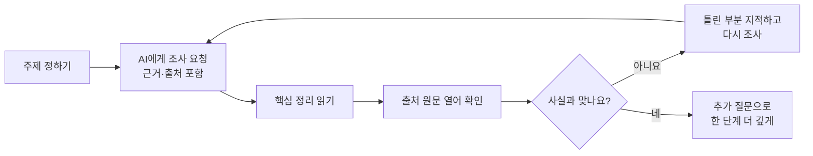

# 05. AI 리서치 — 답을 받지 말고 조사하게 하기

> **이 장에서 배울 것**
> - AI에게 "답"이 아니라 "조사"를 맡기는 요청법을 익힙니다.
> - AI 답변에 **근거와 출처**를 요구하는 습관을 만듭니다.
> - AI와 검색엔진의 차이를 직접 비교해 봅니다.
>
> ⏱ 소요 시간: 15분 · 🧰 준비물: Gemini, Google 검색 · 📶 난이도: 입문

## 왜 배우나요?

AI에게 "OO가 뭐야?"라고 물으면 그럴듯한 답이 바로 나옵니다.
그런데 그 답이 **맞는지**, **어디서 나온 이야기인지**는 알 수 없습니다.

AI에게 단순히 답을 받지 말고, **조사하게 해 봅니다.**
조사란 정보를 모으고, 정리하고, 아직 모르는 것을 찾아내는 일입니다.
AI가 조사한 결과를 내가 **확인하고 판단**하는 순간, AI는 "정답 기계"가 아니라 "유능한 조사 보조"가 됩니다.

## 핵심 개념

### 답을 받는 질문 vs 조사를 시키는 요청

| 구분 | 답을 받는 질문 | 조사를 시키는 요청 |
|---|---|---|
| 예시 | "청소년 운동참여가 왜 중요해?" | "청소년 운동참여와 자기효능감의 관계를 조사하고, 근거와 출처를 제시해줘. 추가로 확인할 질문도 만들어줘" |
| 결과 | 한 덩어리의 설명 | 핵심 정리 + 근거 + 출처 + 남은 질문 |
| 내가 할 일 | 믿거나 말거나 | 출처를 열어 **확인**하고 **판단** |
| 다음 단계 | 끝 | 남은 질문으로 다시 조사 |



## 따라 해 보기

### ① MISSION — 관심 주제를 조사시키기

[Gemini](https://gemini.google.com/)를 열고 아래 프롬프트에서 `[주제]`를 바꿔 입력합니다.

```text
내가 관심 있는 [주제]를 조사하고
핵심 내용을 정리해줘.
추가로 확인해야 할 질문도 만들어줘.
```

### ② 근거와 출처까지 요구하기

같은 대화창에서 이어서 입력합니다.

```text
방금 정리한 내용을 조사하고 근거와 출처까지 제시해줘.
출처마다 어떤 내용을 뒷받침하는지 한 줄씩 적고,
출처를 찾지 못한 내용은 "출처 미확인"이라고 표시해줘.
```

> 💡 **팁** 수업에서는 Gemini에 **"조사하고 근거와 출처까지 제시해줘"** 라고 입력하는 방식부터 체험하면 충분합니다. 화면에 별도의 조사(리서치) 기능이 보이면 그것도 눌러 보세요. 화면 이름은 바뀔 수 있습니다.

### ③ 출처를 직접 열어 확인하기

1. AI가 제시한 출처 링크 중 **두 개**를 직접 엽니다.
2. AI가 요약한 내용이 원문에 실제로 있는지 찾아봅니다.
3. 아래 표에 결과를 적습니다.

| 출처 | 원문이 열리나요? | AI 요약과 원문이 일치하나요? | 메모 |
|---|---|---|---|
| 출처 1 | 예 / 아니요 | 일치 / 일부 / 불일치 | |
| 출처 2 | 예 / 아니요 | 일치 / 일부 / 불일치 | |

### ④ 같은 주제를 Google 검색으로도 찾아보기

[Google 검색](https://www.google.com/)에 같은 주제를 입력해 보고, 아래 "생각해 보기"의 비교표를 채워 봅니다.

## 출처 확인 습관 — 반드시 기억하세요

> ⚠️ **주의** AI는 **존재하지 않는 논문이나 기사를 저자 이름과 연도까지 붙여서 그럴듯하게 만들어 낼 수 있습니다.** 이런 현상을 **할루시네이션(환각)** 이라고 부릅니다.

AI 리서치를 쓸 때 지킬 세 가지 약속입니다.

1. **AI의 출력은 언제나 초안입니다.** 제출하거나 공유하기 전에 전부 다시 읽습니다.
2. **출처가 표시되지 않은 사실은 쓰지 않습니다.** 논문은 AI가 준 서지정보를 그대로 옮기지 말고, 원문(DOI 등)을 직접 확인한 뒤 적습니다.
3. **숫자·날짜·이름은 두 번 확인합니다.** 특히 통계 수치와 법·제도 내용은 공식 기관 자료로 확인합니다.

> ✅ **확인** 이 약속은 [14. AI 도입 자기점검](../part4/14-ai-self-check.md)에서 다시 다룹니다.

## 체크리스트

- [ ] 관심 주제를 AI에게 조사시켰다.
- [ ] 근거와 출처를 요구했다.
- [ ] 출처 두 개를 직접 열어 확인했다.
- [ ] AI가 만든 "추가로 확인해야 할 질문" 중 하나를 골라 다시 물어봤다.

## 생각해 보기

### AI는 검색엔진과 무엇이 달랐습니까?

직접 써 본 경험을 바탕으로 아래 표를 채워 보세요. 예시 칸은 참고용입니다.

| 비교 기준 | Google 검색 | AI 리서치(Gemini) | 내 경험 |
|---|---|---|---|
| 결과의 모양 | 링크 목록 | 정리된 문장·표 | |
| 내가 해야 하는 일 | 링크를 하나씩 열어 읽고 정리 | 정리된 내용을 읽고 출처를 확인 | |
| 속도 | 정리까지 오래 걸림 | 정리까지 빠름 | |
| 믿을 수 있는 정도 | 출처가 바로 보임 | 출처를 요구하지 않으면 알 수 없음 | |
| 잘하는 일 | 최신 공식 페이지 찾기 | 여러 자료 묶어 요약·비교 | |
| 조심할 점 | 광고·낚시성 글 | 그럴듯한 오답(할루시네이션) | |

🗣 **토론**

- 나는 앞으로 어떤 일에 검색을, 어떤 일에 AI 리서치를 쓰겠습니까?
- AI가 준 출처가 실제로 존재하지 않았다면, 그 책임은 누구에게 있을까요?

## 한 줄 정리

> AI에게는 **조사**를 맡기고, **확인과 판단**은 내가 합니다.

---
📎 **원자료**: 노션 「인공지능 특강 - 대학, CEO과정」 > 🔎 02. AI RESEARCH / 「바로가기 - 링크 안내」 > 🔎 02. Google AI 검색·Research / AI도입_자기점검_보고서 (출처 확인 원칙)
