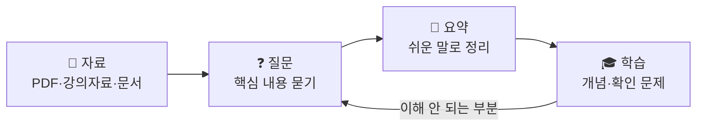

# 06. Gemini Notebook — 내 자료를 AI와 공부하기

> **이 장에서 배울 것**
> - 내가 가진 자료(PDF·강의자료·문서)를 AI에 연결해 공부하는 방법을 익힙니다.
> - **자료 → 질문 → 요약 → 학습** 의 흐름을 한 바퀴 경험합니다.
> - 자료를 올리기 전에 확인해야 할 개인정보·저작권 주의사항을 압니다.
>
> ⏱ 소요 시간: 20분 · 🧰 준비물: Google 계정, 공부할 자료 1개 (PDF·문서·웹페이지) · 📶 난이도: 초급

## 왜 배우나요?

일반 대화형 AI는 인터넷에서 배운 **일반적인 지식**으로 답합니다.
그런데 공부할 때 정말 필요한 것은 **"내 강의자료에 나온 내용"**, **"내가 읽어야 하는 이 논문의 내용"** 입니다.

**Gemini Notebook**(구 NotebookLM)은 내가 넣어 준 자료를 중심으로 답하는 AI 공부 노트입니다.
자료에 근거해 답하기 때문에, 답변이 자료의 어느 부분에서 나왔는지 따라가며 확인하기 좋습니다.

> 💡 **이름이 바뀌었어요** 이 도구는 원래 **NotebookLM** 이라는 이름이었고, **2026년 7월부터 Gemini Notebook** 으로 이름이 바뀌었습니다. 같은 제품이며, 예전에 만든 노트북도 그대로 쓸 수 있습니다. (공식 안내 페이지 확인: 2026.10.23)
> 인터넷 검색이나 예전 자료에서 "NotebookLM"이라는 이름을 보면 같은 도구라고 생각하면 됩니다. 주소는 [notebook.google](https://notebook.google/) 입니다.

## 핵심 개념

### 자료 → 질문 → 요약 → 학습



| 단계 | 내가 하는 일 | Gemini Notebook이 돕는 일 |
|---|---|---|
| 자료 | 공부할 자료를 고르고 올리기 | 자료를 읽고 내용을 파악 |
| 질문 | 궁금한 것, 모르는 것 묻기 | 자료에 근거해 답하고 근거 위치 표시 |
| 요약 | 요약이 맞는지 확인 | 핵심 내용을 짧게 정리 |
| 학습 | 스스로 문제를 풀어 보기 | 핵심 개념·확인 질문·학습자료 만들기 |

### 일반 Gemini와 무엇이 다른가요?

| 구분 | Gemini (일반 대화) | Gemini Notebook |
|---|---|---|
| 답의 바탕 | 일반 지식 | **내가 올린 자료** |
| 잘하는 일 | 아이디어, 기획, 글쓰기 | 자료 요약, 자료 기반 질문·답, 학습자료 만들기 |
| 확인 방법 | 출처를 따로 요구해야 함 | 답의 근거가 자료의 어디인지 따라가 볼 수 있음 |

## 따라 해 보기 — MISSION

1. **자료 하나 준비**
   공부할 PDF, 강의자료, 연구자료, 문서 중 **하나**를 고릅니다. 처음에는 10쪽 내외의 짧은 자료가 좋습니다.
2. **AI에 자료 연결**
   [Gemini Notebook](https://notebook.google/)을 열고 새 노트북을 만든 뒤 자료를 추가합니다. (PDF, Google Docs, 웹 주소 등을 넣을 수 있습니다. 화면 이름은 바뀔 수 있습니다.)
3. **핵심 내용 질문**
   아래 프롬프트를 입력합니다.
4. **이해되지 않는 부분 다시 질문**
   답변 중 어려운 단어나 문장을 골라 "이 부분을 예시를 들어 다시 설명해줘"라고 묻습니다.
5. **학습자료로 변환**
   요약·핵심 개념·확인 질문을 모아 나만의 복습 자료로 저장합니다.

### Prompt

```text
이 자료를 처음 배우는 대학생도
이해할 수 있도록 설명해줘.

핵심 개념 5개와
스스로 확인할 질문 3개도 만들어줘.
```

### 다시 묻기 예시

```text
방금 설명한 핵심 개념 중 [개념 이름]이 잘 이해되지 않아.
자료에 나온 예시를 그대로 사용해서
더 쉬운 말로 다시 설명해줘.
자료에 없는 내용은 "자료에 없음"이라고 표시해줘.
```

```text
스스로 확인할 질문 3개의 정답과 해설을 만들어줘.
각 정답이 자료의 어느 부분에 근거하는지도 알려줘.
```

> ✅ **확인** 답변에 근거 표시가 나오면 직접 눌러서 원래 자료의 그 부분을 읽어 보세요. 요약이 자료와 다르면 바로 지적하고 다시 물어봅니다.

## 자료를 올리기 전에 — 개인정보·저작권 주의

> ⚠️ **주의** 아래 자료는 올리지 마세요.
> - 학생·고객·환자의 실명, 연락처, 성적, 건강 정보가 들어 있는 문서
> - 회사의 대외비 문서, 계약서, 내부 재무 자료
> - 내가 공유 권한을 갖지 않은 유료 교재·논문 전체 파일

| 상황 | 이렇게 하세요 |
|---|---|
| 개인정보가 섞인 자료를 꼭 써야 한다 | 이름·번호를 "학생 A", "고객 B"처럼 바꾼 뒤 올립니다 |
| 유료 교재 내용을 공부하고 싶다 | 내가 직접 정리한 노트를 올리거나, 공개된 요약·목차를 활용합니다 |
| 학교·회사 규정이 있는지 모르겠다 | 올리기 전에 소속 기관의 AI 사용 지침을 먼저 확인합니다 |

## 체크리스트

- [ ] 공부할 자료 하나를 골랐다.
- [ ] Gemini Notebook에 자료를 연결했다.
- [ ] 핵심 개념 5개와 확인 질문 3개를 받았다.
- [ ] 이해되지 않는 부분을 한 번 이상 다시 질문했다.
- [ ] 결과를 나만의 복습 자료로 저장했다.

## 생각해 보기

- 같은 질문을 일반 Gemini와 Gemini Notebook에 각각 해 보면 답이 어떻게 다른가요?
- AI가 만든 확인 질문 3개 중, 내가 바로 답하지 못한 질문은 무엇이었나요? 그것이 내가 더 공부해야 할 부분입니다.
- 내 전공·업무에서 "자료는 많은데 읽을 시간이 없는" 일은 무엇인가요? Gemini Notebook을 어떻게 쓸 수 있을까요?

## 한 줄 정리

> Gemini Notebook은 **내 자료를 선생님으로 만드는 도구**입니다. 자료를 넣고, 묻고, 확인하며 배웁니다.

---
📎 **원자료**: 노션 「인공지능 특강 - 대학, CEO과정」 > 📚 03. NOTEBOOK / LEARNING / 「바로가기 - 링크 안내」 > 📚 03. NotebookLM
