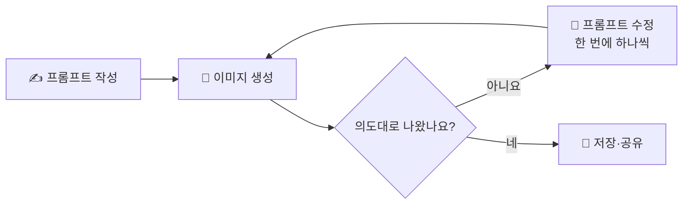

# 07. AI 이미지 — 글을 이미지로 바꾸기

> **이 장에서 배울 것**
> - 글(프롬프트)로 이미지를 만들어 봅니다.
> - 결과를 보고 프롬프트를 고쳐 **다시 만드는** 과정을 경험합니다.
> - 좋은 이미지 프롬프트의 요소(대상·목적·스타일·구성)를 익힙니다.
>
> ⏱ 소요 시간: 15분 · 🧰 준비물: Gemini · 📶 난이도: 입문

## 왜 배우나요?

내 전공이나 업무를 말로 설명하면 길고 어렵습니다.
그런데 **그림 한 장**이 있으면 처음 보는 사람도 한눈에 이해합니다.

예전에는 디자인 도구를 다룰 줄 알아야 그림을 만들 수 있었습니다.
이제는 **글을 이미지로 바꿀 수 있습니다.**
중요한 것은 그림 실력이 아니라, **무엇을 누구에게 보여 줄지 분명하게 말하는 능력**입니다.

> 💡 **팁** 학생들에게 가장 간단한 진입점은 Gemini입니다. 별도 이미지 도구까지 실험해 보고 싶다면 [Google Labs](https://labs.google/)를 함께 둘러보세요.

## 핵심 개념

### 좋은 이미지 프롬프트의 네 가지 요소

| 요소 | 질문 | 예시 |
|---|---|---|
| **대상** | 무엇을 그리나요? | 특수체육 수업, 카페 신메뉴, 데이터 분석 과정 |
| **목적·보는 사람** | 누가, 왜 보나요? | 대학생이 직관적으로 이해하도록, 손님이 메뉴를 고르도록 |
| **스타일** | 어떤 느낌인가요? | 교육용 인포그래픽, 손그림 스케치, 사진처럼 |
| **구성** | 무엇을 넣고 무엇을 뺄까요? | 핵심 개념 3개만, 글자는 최소로, 왼쪽에서 오른쪽 흐름 |

### 만들기 → 고치기 → 다시 만들기



> ⚠️ **주의** AI 이미지 안의 **한글 글자는 깨지거나 틀리게 나오는 경우가 많습니다.** 글자는 최소로 요청하고, 정확한 문구는 나중에 직접 넣는 것이 좋습니다.

## 따라 해 보기

### MISSION — 내 전공을 설명하는 이미지 하나 만들기

1. [Gemini](https://gemini.google.com/)를 엽니다.
2. 아래 프롬프트에서 `[나의 전공/업무]`를 바꿔 입력합니다.
3. 결과 이미지를 확인합니다.

### Prompt

```text
[나의 전공/업무]를
대학생이 직관적으로 이해할 수 있는
교육용 인포그래픽 이미지로 만들어줘.

복잡하지 않고
핵심 개념이 시각적으로 드러나도록 구성해줘.
```

### 프롬프트를 고쳐서 다시 만들기

첫 결과가 마음에 들지 않는 것은 **실패가 아니라 정상**입니다.
아래 표처럼 **한 번에 하나씩** 바꿔 보며 차이를 확인하세요.

| 고치고 싶은 점 | Before (처음 프롬프트) | After (고친 프롬프트) |
|---|---|---|
| 너무 복잡하다 | "교육용 인포그래픽으로 만들어줘" | "핵심 개념 **3개만** 넣고, 여백을 넉넉하게 해줘" |
| 글자가 깨진다 | "설명 문구를 넣어줘" | "**글자 없이** 그림과 아이콘으로만 표현해줘" |
| 분위기가 다르다 | "이미지로 만들어줘" | "**따뜻한 손그림 스케치** 스타일로 만들어줘" |
| 흐름이 안 보인다 | "개념을 보여줘" | "**왼쪽에서 오른쪽으로** 단계가 이어지는 흐름도로 만들어줘" |
| 대상이 모호하다 | "운동하는 사람" | "**휠체어를 탄 학생과 친구들이 함께** 배드민턴을 치는 장면" |
| 용도가 다르다 | "이미지 만들어줘" | "**세로형(9:16) 홍보 포스터**용으로 만들어줘" |

```text
방금 만든 이미지에서 다음만 바꿔서 다시 만들어줘.
- [바꾸고 싶은 점 1가지]
나머지 구성과 색감은 그대로 유지해줘.
```

> 💡 **팁** 여러 가지를 한꺼번에 바꾸면 무엇이 결과를 바꿨는지 알 수 없습니다. 한 번에 하나만 바꾸는 것이 가장 빨리 배우는 방법입니다.

## 체크리스트 — RESULT

- [ ] 이미지를 생성했다.
- [ ] 프롬프트를 수정했다.
- [ ] 다시 생성해서 처음 결과와 비교했다.
- [ ] 가장 마음에 드는 결과를 저장했다.

## 생각해 보기

- 처음 이미지와 마지막 이미지를 나란히 놓고 보세요. 어떤 한 문장이 가장 큰 차이를 만들었나요?
- 이 이미지를 내 수업·발표·가게에 그대로 써도 될까요? 사실과 다른 부분이나 오해를 부를 부분은 없나요?
- 옆 사람과 같은 프롬프트로 만든 이미지를 비교해 보세요. 왜 다르게 나왔을까요?

## 한 줄 정리

> 이미지 AI의 실력은 **그림 실력이 아니라 설명 실력**에서 나옵니다. 만들고, 고치고, 다시 만드세요.

---
📎 **원자료**: 노션 「인공지능 특강 - 대학, CEO과정」 > 🎨 04. GOOGLE AI IMAGE / 「바로가기 - 링크 안내」 > 🎨 04. 이미지 생성
