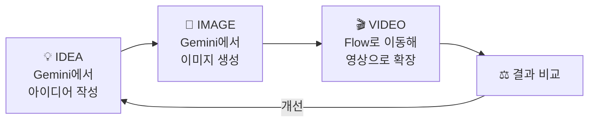

# 08. Flow — 이미지를 움직이는 콘텐츠로

> **이 장에서 배울 것**
> - **IDEA → IMAGE → VIDEO** 의 순서로 짧은 영상을 만들어 봅니다.
> - Gemini(아이디어·이미지)와 Flow(영상)를 이어서 쓰는 수업 동선을 익힙니다.
> - 결과물을 비교하는 기준을 세웁니다.
>
> ⏱ 소요 시간: 20분 · 🧰 준비물: Gemini, Flow, 앞 장에서 만든 이미지 (없어도 됨) · 📶 난이도: 초급

## 왜 배우나요?

사람들은 글보다 이미지를, 이미지보다 **움직이는 영상**을 더 오래 봅니다.
수업 소개, 가게 홍보, 연구 발표까지 짧은 영상 하나가 큰 힘을 가집니다.

영상 AI는 아이디어만 있으면 짧은 장면을 만들어 줍니다.
그런데 아이디어 없이 "멋진 영상 만들어줘"라고 하면 **누구나 만들 수 있는 뻔한 영상**이 나옵니다.
그래서 이 장에서는 **아이디어 → 이미지 → 영상** 순서로, 생각을 먼저 정리한 뒤 영상으로 확장합니다.

## 핵심 개념

### 수업 동선: Gemini에서 Flow로



| 단계 | 도구 | 남길 결과 |
|---|---|---|
| IDEA | Gemini | 장면을 설명하는 3~5줄의 글 |
| IMAGE | Gemini | 영상의 첫 장면이 될 이미지 1장 |
| VIDEO | Flow | 짧은 영상 클립 1개 이상 |

> ⚠️ **주의** Flow는 계정·지역·요금제에 따라 **사용 가능한 생성 기능이나 크레딧이 달라질 수 있습니다.** 영상 생성은 이미지보다 크레딧을 많이 쓰는 경우가 많으니, 아이디어와 이미지를 충분히 다듬은 뒤 영상을 만드세요.

## 따라 해 보기 — MISSION

### ① 아이디어 작성

[Gemini](https://gemini.google.com/)에서 아래 프롬프트로 시작합니다. 내 상황에 맞게 바꿔도 좋습니다.

```text
대학 캠퍼스에서
학생들이 AI를 활용해
자신의 전공 문제를 해결하는 모습을
짧은 교육 영상으로 표현한다.
```

이어서 아이디어를 구체화합니다.

```text
위 아이디어를 8초짜리 영상 한 장면으로 만들려고 해.
다음을 짧게 정리해줘.
- 장소와 시간대
- 등장인물과 행동
- 카메라 움직임 (예: 천천히 다가감)
- 분위기와 색감
- 마지막에 보여 줄 장면
```

### ② 이미지 생성

정리한 내용을 바탕으로 첫 장면 이미지를 만듭니다.

```text
위에서 정리한 장면의 첫 화면을 이미지로 만들어줘.
[가로형 16:9 / 세로형 9:16] 비율로,
사진처럼 자연스럽게 표현해줘.
```

### ③ Flow로 이동

[Google Flow](https://flow.google.com/)를 열고 로그인합니다.
새 프로젝트를 만들고, 앞에서 만든 이미지나 아이디어 글을 넣을 수 있는 곳을 찾습니다. (화면 이름은 바뀔 수 있습니다.)

### ④ 영상으로 확장

이미지에서 시작하는 영상이라면, **움직임만** 설명하면 됩니다.

```text
이 장면에서 카메라가 천천히 학생에게 다가가고,
학생이 노트북 화면을 보며 미소 짓는다.
배경의 다른 학생들은 자연스럽게 움직인다.
밝고 희망적인 분위기를 유지한다.
```

### ⑤ 결과 비교

같은 아이디어로 **두 가지 버전**을 만들어 비교해 보세요. (예: 카메라 움직임만 다르게)
아래 기준표로 점수를 매깁니다.

| 비교 기준 | 버전 A | 버전 B |
|---|---|---|
| 내 아이디어(메시지)가 화면에 드러나는가 | 충족 / 미충족 | 충족 / 미충족 |
| 인물·사물의 움직임이 자연스러운가 | 충족 / 미충족 | 충족 / 미충족 |
| 첫 이미지의 분위기·색감이 유지되는가 | 충족 / 미충족 | 충족 / 미충족 |
| 어색한 부분(손가락, 글자, 얼굴 변형)이 없는가 | 충족 / 미충족 | 충족 / 미충족 |
| 실제로 공유해도 될 수준인가 | 예 / 수정 필요 / 아니요 | 예 / 수정 필요 / 아니요 |

> 💡 **팁** 영상이 어색하게 나오면 프롬프트를 길게 늘리기보다 **움직임을 하나로 줄여** 보세요. "다가가고, 돌고, 웃고, 뛰는" 것보다 "천천히 다가간다" 하나가 더 자연스럽습니다.

## 체크리스트

- [ ] Gemini에서 아이디어를 글로 정리했다.
- [ ] 첫 장면 이미지를 만들었다.
- [ ] Flow에서 영상을 생성했다.
- [ ] 두 가지 버전을 기준표로 비교했다.

## 생각해 보기

- 아이디어를 먼저 글로 정리했을 때와 바로 영상을 만들었을 때, 결과가 어떻게 달랐나요?
- 내가 만든 영상에서 "AI가 만든 티"가 나는 부분은 어디인가요? 그것을 줄이려면 무엇을 더해야 할까요?
- 이 영상을 실제로 쓰려면 사람이 직접 확인해야 할 것(사실관계, 초상권, 장소 등)은 무엇인가요?

> 🗣 **토론** 더 깊이 있는 영상 연출(카메라워크·음악·장면 연속성)은 [11. 프롬프트 연출](../part3/11-prompt-directing.md)과 [12. 코드로 만드는 모션그래픽](../part3/12-motion-graphics.md)에서 이어집니다.

## 한 줄 정리

> 좋은 AI 영상은 **좋은 아이디어 한 줄**에서 시작합니다. IDEA → IMAGE → VIDEO 순서를 지키세요.

---
📎 **원자료**: 노션 「인공지능 특강 - 대학, CEO과정」 > 🎬 05. GOOGLE FLOW / 「바로가기 - 링크 안내」 > 🎬 05. Flow — AI 영상 제작
