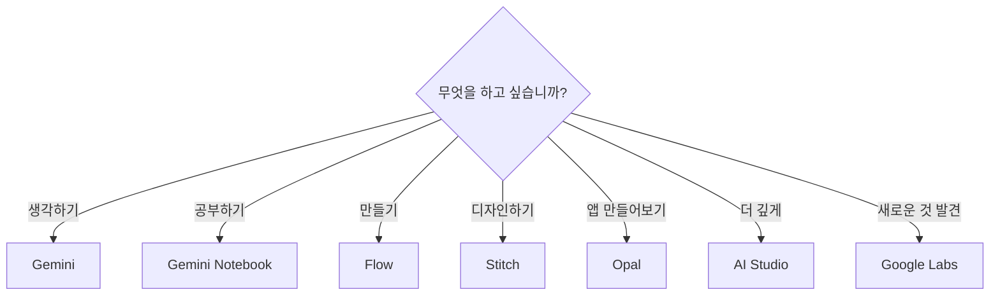
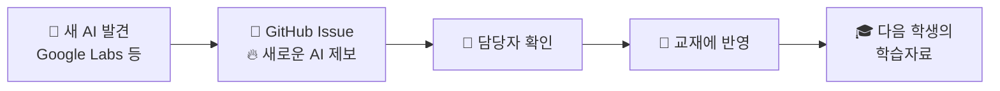

# 09. AI 도구 상자 — 무엇을 하고 싶습니까?

> **이 장에서 배울 것**
> - 도구 이름이 아니라 **"하고 싶은 일"** 에서 출발해 AI를 고르는 방법을 익힙니다.
> - Stitch, Opal, Google AI Studio를 짧게 체험합니다. (BONUS LAB)
> - 이 교재가 **GitHub 이슈로 계속 업데이트되는 방식**을 이해합니다.
>
> ⏱ 소요 시간: 15분 + 수업 끝나고 도전 · 🧰 준비물: Google 계정, Chrome · 📶 난이도: 초급~중급

## 왜 배우나요?

AI 도구는 매주 새로 나옵니다. 모든 도구를 다 알 수는 없고, 알 필요도 없습니다.
중요한 것은 **"지금 내가 무엇을 하고 싶은가?"** 를 먼저 정하는 것입니다.
하고 싶은 일이 분명하면 도구는 그다음에 고르면 됩니다.

## 핵심 개념

### 🧩 GOOGLE AI TOOL BOX — 무엇을 하고 싶습니까?

| 하고 싶은 일 | 도구 | 이런 일에 씁니다 | 바로가기 | 교재 |
|---|---|---|---|---|
| 💬 **생각하기** | Gemini | 질문 / 기획 / 아이디어 | [열기](https://gemini.google.com/) | [04장](04-gemini.md) |
| 📚 **공부하기** | Gemini Notebook | PDF / 자료 / 연구 / 학습 | [열기](https://notebook.google/) | [06장](06-notebooklm.md) |
| 🎨 **만들기** | Google Flow | 이미지 / 영상 / 콘텐츠 | [열기](https://flow.google.com/) | [08장](08-flow-video.md) |
| 🖥 **디자인하기** | Stitch | 자연어(평소 쓰는 말) 기반 UI(화면) 디자인 | [열기](https://stitch.withgoogle.com/) | 아래 BONUS LAB |
| ⚙️ **만들어보기** | Opal | 자연어로 AI 미니 앱 제작 | [열기](https://opal.google/) | 아래 BONUS LAB |
| 💻 **더 깊게 만들기** | Google AI Studio | AI 앱 / 프로토타입(시제품) 제작 | [열기](https://aistudio.google.com/) | 아래 BONUS LAB |
| 🔥 **발견하기** | Google Labs | 새로 나온 Google AI 실험 둘러보기 | [열기](https://labs.google/) | 아래 THIS WEEK'S NEW AI |



> ⚠️ **주의** 아래 BONUS LAB 도구들은 실험적 서비스인 경우가 많아 **지역·연령·계정에 따라 사용이 제한되거나 화면 이름이 자주 바뀝니다.** 열리지 않으면 건너뛰고, 다음에 다시 시도하세요.

## 따라 해 보기 — BONUS LAB (수업 끝나고 도전)

수업 시간이 부족하면 이 부분은 **수업이 끝난 뒤 혼자 도전**하는 과제로 남겨 둡니다.

### 🖥 BONUS 1. Stitch — 말로 화면 디자인하기

[Stitch](https://stitch.withgoogle.com/)를 열고, 만들고 싶은 화면을 말로 설명합니다.

```text
[우리 가게 / 우리 학과 / 내 동아리]를 소개하는
모바일 첫 화면을 디자인해줘.
- 맨 위: 이름과 한 줄 소개
- 가운데: 대표 [메뉴 / 프로그램] 3개를 카드로
- 아래: 문의하기 버튼
밝고 깔끔한 분위기로 만들어줘.
```

- [ ] 화면 디자인이 만들어졌다.
- [ ] 한 군데를 말로 수정해 봤다. (예: "카드 색을 더 따뜻하게 바꿔줘")

### ⚙️ BONUS 2. Opal — 나만의 AI 미니 앱 만들기

[Opal](https://opal.google/)에서 내가 자주 반복하는 일을 작은 앱으로 만들어 봅니다.

```text
내가 [주제]를 입력하면
1) 핵심 내용을 3줄로 요약하고
2) 초등학생도 이해할 수 있는 비유를 하나 만들고
3) 스스로 확인할 질문 2개를 만들어 주는
학습 도우미 앱을 만들어줘.
```

- [ ] 미니 앱이 만들어졌다.
- [ ] 다른 주제를 넣어 앱을 다시 실행해 봤다.

### 💻 BONUS 3. Google AI Studio — 한 단계 더 깊게

[Google AI Studio](https://aistudio.google.com/)는 **프롬프트 테스트 → 모델 실험 → 앱 프로토타이핑**으로 넘어가는 **고급 과정의 입구**입니다.

1. 앞에서 가장 잘 작동한 프롬프트 하나를 붙여 넣고 실행해 봅니다.
2. 같은 프롬프트를 다른 모델로 바꿔 실행하고 결과를 비교합니다. (화면 이름은 바뀔 수 있습니다.)
3. 결과가 마음에 들면 메모해 두세요. 이 경험은 [15. NVIDIA Build 모델 비교](../part4/15-nvidia-build.md)로 이어집니다.

```text
너는 [나의 전공/업무] 분야의 조교다.
내가 붙여 넣는 글을 읽고
1) 핵심 주장 1문장
2) 근거가 부족한 부분
3) 보완할 질문 3개
를 표로 정리해줘.
```

- [ ] AI Studio에서 프롬프트를 실행했다.
- [ ] 다른 모델로 바꿔 결과를 비교했다.

## 🔥 THIS WEEK'S NEW AI — 이 교재는 계속 업데이트됩니다

이 공간은 수업이 끝나도 계속 업데이트됩니다.
원자료 노션 페이지에서는 아래 다섯 가지를 계속 추가했고, 이 교재에서는 그 일을 **GitHub 이슈(Issue)** 로 함께 합니다.

| 표시 | 의미 | 교재에서는 |
|---|---|---|
| **NEW** | 새로운 Google AI | 🔥 새로운 AI 제보 이슈(종류: NEW)로 받아 이 장에 추가 |
| **UPDATE** | 기존 AI의 새로운 기능 | 🔥 새로운 AI 제보 이슈(종류: UPDATE)로 받아 해당 장을 수정 |
| **MISSION** | 새로운 실습 | 🔥 새로운 AI 제보 이슈(종류: MISSION)로 받아 해당 장의 "따라 해 보기"에 추가 |
| **PROMPT** | 바로 사용할 수 있는 프롬프트 | 🔥 새로운 AI 제보 이슈(종류: PROMPT)로 받아 [부록 B. 프롬프트 모음](../appendix/b-prompts.md)에 반영 |
| **CASE** | 다른 학생들의 활용 사례 | 💡 활용 사례 공유 이슈로 받아 사례로 소개 |



### 새 AI를 발견하면 이렇게 알려주세요

1. 저장소의 **Issues** 탭 → **New issue** 를 누릅니다.
2. **🔥 새로운 AI 제보** 양식을 고릅니다.
3. 어떤 도구인지, 무엇에 사용했는지, 어떤 결과가 나왔는지 적고 제출합니다.

자세한 방법은 [부록 F. 교재 제작 과정](../appendix/f-making-of.md)에 정리되어 있습니다.

> 💡 **팁** [Google Labs](https://labs.google/)는 "수업 이후에도 다시 들어와 새로운 AI를 발견하는 구조"와 특히 잘 맞습니다. 한 달에 한 번 들어가 새로 생긴 실험을 둘러보세요.

## 체크리스트

- [ ] "무엇을 하고 싶은가"에 맞춰 도구를 고를 수 있다.
- [ ] BONUS LAB 중 하나 이상을 체험했다. (수업 후 도전 가능)
- [ ] Google Labs에서 처음 보는 AI 하나를 찾아봤다.
- [ ] 새 AI를 발견하면 GitHub 이슈로 알리는 방법을 안다.

## 생각해 보기

- 내 전공·업무에서 가장 자주 하는 일은 "생각하기 / 공부하기 / 만들기 / 디자인하기" 중 어디에 가까운가요?
- 오늘 써 본 도구 중 다음 주에도 다시 쓸 도구는 무엇인가요? 왜 그런가요?
- 내가 발견한 AI가 다음 학생의 학습자료가 된다면, 어떤 정보를 함께 남겨야 도움이 될까요?

## 한 줄 정리

> 도구를 먼저 고르지 말고 **하고 싶은 일**을 먼저 정하세요. 도구는 바뀌어도 그 질문은 바뀌지 않습니다.

---
📎 **원자료**: 노션 「인공지능 특강 - 대학, CEO과정」 > 🧩 06. GOOGLE AI TOOL BOX · 🔥 THIS WEEK'S NEW AI · 💡 AI를 발견하면 알려주세요 / 「바로가기 - 링크 안내」 > 🖥 06 Stitch · ⚙️ 07 Opal · 💻 08 Google AI Studio · 🧪 09 Google Labs
