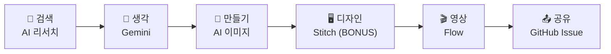
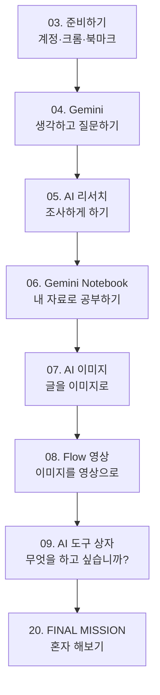

# 2부 Google AI 실험실

> **Google 계정 하나로 시작하는 AI 실전 체험**
>
> 설명을 듣는 수업이 아니라 **직접 눌러보고, 만들고, 결과를 확인하는 시간**입니다.

---

## 🎯 TODAY'S MISSION

오늘의 목표는 AI 도구를 **많이 아는 것**이 아닙니다.
Google 계정으로 다양한 AI를 직접 사용하면서 아래 과정을 **한 바퀴 직접 경험하는 것**이 목표입니다.

> 💡 **팁** 도구 이름을 외우지 않아도 됩니다. "지금 나는 **생각**하는 중인가, **만드는** 중인가?"만 구분할 수 있으면 충분합니다.

---

## ✅ 오늘 수업이 끝나면

- [ ] Google AI 서비스를 직접 실행해 본다.
- [ ] AI에게 내가 원하는 것을 자연어(평소 쓰는 말)로 요청해 본다.
- [ ] 이미지 또는 콘텐츠를 직접 만들어 본다.
- [ ] 영상 AI를 경험해 본다.
- [ ] 나의 전공/업무에 적용할 AI를 하나 찾는다.
- [ ] 이 교재 페이지를 저장(북마크)하고 수업 이후 다시 사용한다.

---

## ⚡ QUICK START — 오늘 직접 사용할 Google AI

학생들이 긴 페이지를 계속 스크롤하지 않도록, 오늘 실습은 **앞쪽 5개**에 집중합니다.
"도구 구경"이 아니라 **생각 → 자료 학습 → 이미지 → 영상 → 스스로 새로운 AI 발견**까지 실제로 한 바퀴 도는 것이 목적입니다.

| 순서 | 도구 | 무엇을 하나요? | 교재 |
|:---:|---|---|---|
| 1 | 🧠 **Gemini** | 질문하고 생각하기 | [04. Gemini](04-gemini.md) |
| 2 | 📚 **Gemini Notebook** | 내 자료로 공부하기 | [06. Gemini Notebook](06-notebooklm.md) |
| 3 | 🎨 **Gemini 이미지** | 이미지 만들기 | [07. AI 이미지](07-ai-image.md) |
| 4 | 🎬 **Flow** | 영상 만들기 | [08. Flow 영상](08-flow-video.md) |
| 5 | 🔥 **Google Labs** | 새로운 AI 발견하기 | [09. AI 도구 상자](09-ai-toolbox.md) |

### 🚀 MORE AI — 시간이 남으면, 또는 수업 끝나고 도전

| 도구 | 무엇을 하나요? | 교재 |
|---|---|---|
| 🖥 **Stitch** | 말로 화면(UI) 디자인하기 | [09. AI 도구 상자](09-ai-toolbox.md) |
| ⚙️ **Opal** | 나만의 AI 미니 앱 만들기 | [09. AI 도구 상자](09-ai-toolbox.md) |
| 💻 **Google AI Studio** | AI 앱·프로토타입(시제품) 만들기 | [09. AI 도구 상자](09-ai-toolbox.md) |

> ⚠️ **주의** 계정·지역·요금제에 따라 사용할 수 있는 기능이나 크레딧(사용 가능량)이 다를 수 있습니다. 화면 이름도 수시로 바뀝니다. 교재와 화면이 다르면 **화면을 우선**하세요.

---

## 📚 2부의 장 구성

| 장 | 제목 | 소요 시간 | 난이도 |
|---|---|---|---|
| [03](03-getting-started.md) | 준비하기 — STEP 01. Google 계정 확인 | 10분 | 입문 |
| [04](04-gemini.md) | Gemini — 생각하고 질문하기 | 15분 | 입문 |
| [05](05-ai-research.md) | AI 리서치 — 답을 받지 말고 조사하게 하기 | 15분 | 입문 |
| [06](06-notebooklm.md) | Gemini Notebook — 내 자료를 AI와 공부하기 | 20분 | 초급 |
| [07](07-ai-image.md) | AI 이미지 — 글을 이미지로 바꾸기 | 15분 | 입문 |
| [08](08-flow-video.md) | Flow — 이미지를 움직이는 콘텐츠로 | 20분 | 초급 |
| [09](09-ai-toolbox.md) | AI 도구 상자 — 무엇을 하고 싶습니까? | 15분+ | 초급~중급 |
| [20](../finale/20-final-mission.md) | FINAL MISSION — 이제 설명 없이 혼자 해봅니다 | 20분 | 종합 |

---

## 🔄 이 실험실은 끝나지 않습니다

오늘 수업은 끝나지만 이 교재는 끝나지 않습니다.
다음에 들어오면 **새로운 AI, 새로운 프롬프트, 새로운 미션**이 추가되어 있을 수 있습니다.

AI를 배우는 가장 좋은 방법은 직접 사용하는 것입니다.

> **USE → MAKE → FAIL → MODIFY → MAKE AGAIN**

---
📎 **원자료**: 노션 「인공지능 특강 - 대학, CEO과정」 > 🚀 GOOGLE AI EXPERIENCE LAB · 🎯 TODAY'S MISSION / 「바로가기 - 링크 안내」 > 📌 Quick Start
