# 10. 대체 불가능한 창작자의 조건

> **이 장에서 배울 것**
> - '딸깍' 한 번으로 만든 결과물과 경험으로 다듬은 결과물의 차이
> - AI에 모든 것을 맡길 때 가치가 떨어지는 과정(가치 하락의 굴레)
> - 창작자 4사분면으로 나의 현재 위치를 진단하는 방법
> - 오늘부터 실천할 3단계 행동 지침과 4단계 실행 가이드
>
> ⏱ 소요 시간: 50분 · 🧰 준비물: 노트(종이 또는 메모 앱), 펜, Gemini · 📶 난이도: 입문

## 왜 배우나요?

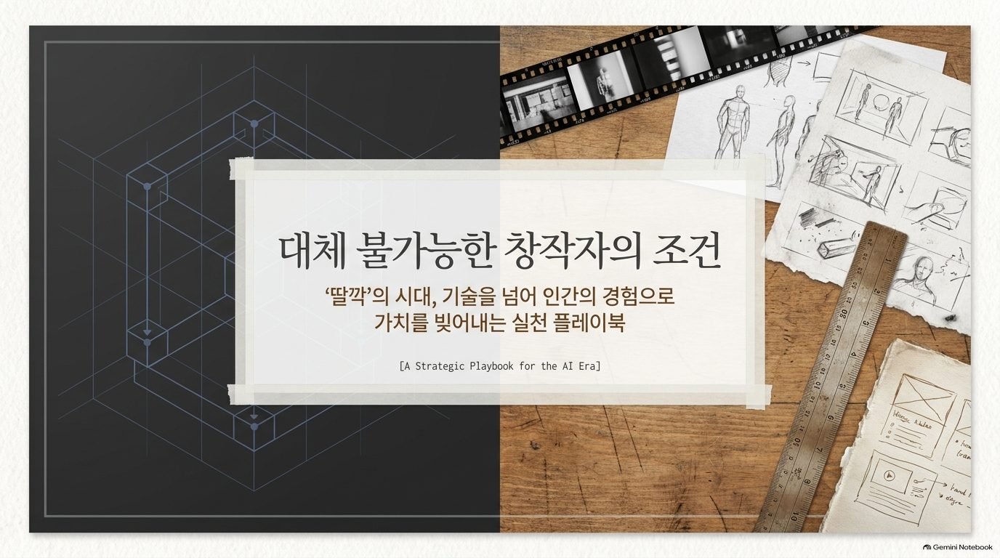

요즘은 버튼 한 번, 즉 **'딸깍'** 한 번이면 AI가 그럴듯한 글·이미지·영상을 만들어 줍니다.
기획안을 AI에게 맡기고, PPT 도표도 자동으로 만들 수 있습니다.

그런데 이런 질문이 생깁니다.

- 누구나 1분 만에 만들 수 있는 결과물이라면, 그 결과물은 얼마의 가치가 있을까요?
- 사람들이 "이건 AI가 만들었네"라고 알아차리는 순간, 그 결과물을 어떻게 평가할까요?

AI가 모든 것을 **'보통 이상의 수준'** 으로 끌어올리는 시대에는, 역설적으로 **사람의 땀이 밴 맥락과 서사(Story)** 가 가장 귀해집니다.
이 장은 AI 시대에 "대체 불가능한 사람"이 되는 조건을 실천 플레이북(행동 지침서)으로 정리합니다.

## 핵심 개념

### 1) 기술이 완벽해질수록, 차이는 '경험'에서 벌어진다

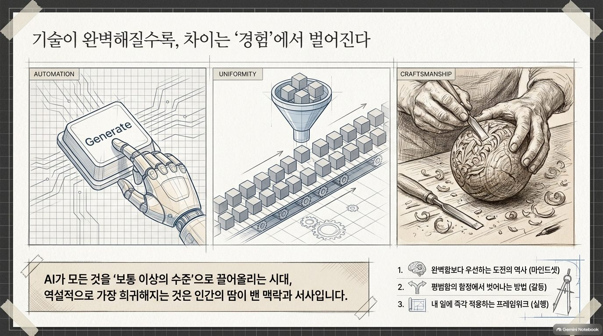

| 흐름 | 무슨 일이 일어나나요? |
|---|---|
| **자동화(Automation)** | 'Generate(생성)' 버튼 하나로 결과물이 나옵니다 |
| **획일화(Uniformity)** | 모두가 같은 도구를 쓰니 결과물이 비슷비슷해집니다 |
| **장인정신(Craftsmanship)** | 그래서 사람의 손길·경험·서사가 담긴 결과물이 희귀해지고 귀해집니다 |

이 장에서 다룰 세 가지 열쇠는 다음과 같습니다.

1. 완벽함보다 우선하는 **도전의 역사** (마인드셋)
2. 평범함의 함정에서 벗어나는 **방법** (같음과 다름)
3. 내 일에 즉시 적용하는 **프레임워크** (실행)

### 2) 완벽을 기다리지 않는 사람이 기회를 잡는다

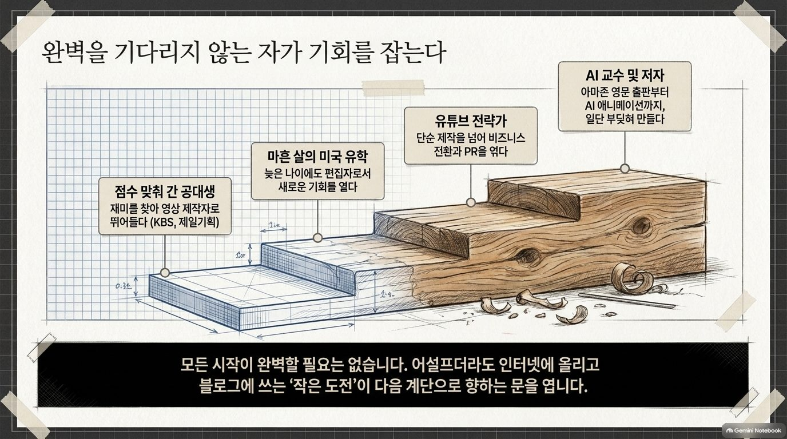

원자료에서는 한 사람의 경력이 **계단**처럼 쌓여 온 과정을 보여 줍니다.

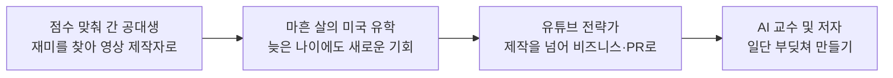

> 💡 **팁** 모든 시작이 완벽할 필요는 없습니다. 어설프더라도 인터넷에 올리고, 블로그에 쓰는 **'작은 도전'** 이 다음 계단으로 가는 문을 엽니다.

### 3) '딸깍' 영상 vs 50번 다듬은 영상

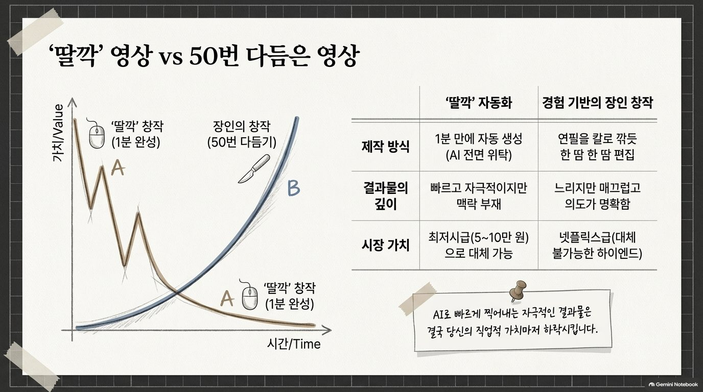

| 구분 | '딸깍' 자동화 | 경험 기반의 장인 창작 |
|---|---|---|
| **제작 방식** | 1분 만에 자동 생성 (AI에 전면 위탁) | 연필을 칼로 깎듯 한 땀 한 땀 편집 (50번 다듬기) |
| **결과물의 깊이** | 빠르고 자극적이지만 맥락이 없음 | 느리지만 매끄럽고 의도가 명확함 |
| **시간이 지날수록 가치** | 처음엔 반짝, 곧 떨어짐 | 처음엔 낮아도, 점점 올라감 |
| **시장 가치** | 최저시급 수준으로 대체 가능 | 대체 불가능한 고급(하이엔드) 가치 |

> ⚠️ **주의** AI로 빠르게 찍어내는 자극적인 결과물은 결국 **당신의 직업적 가치를 하락**시킵니다.

### 4) '복사+붙여넣기'가 부르는 가치 하락의 굴레

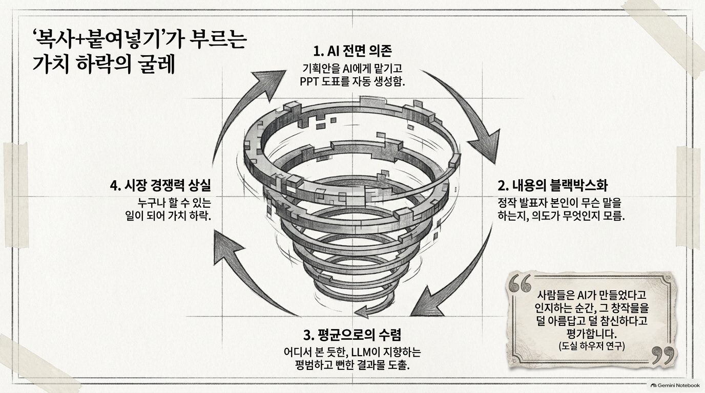

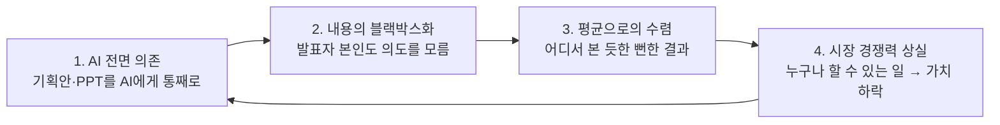

> 🗣 **토론** "사람들은 AI가 만들었다고 인지하는 순간, 그 창작물을 덜 아름답고 덜 참신하다고 평가한다"는 연구가 있습니다. 여러분도 그렇게 느낀 적이 있나요?

### 5) 대체 불가능성의 핵심: '경험'이라는 해상도

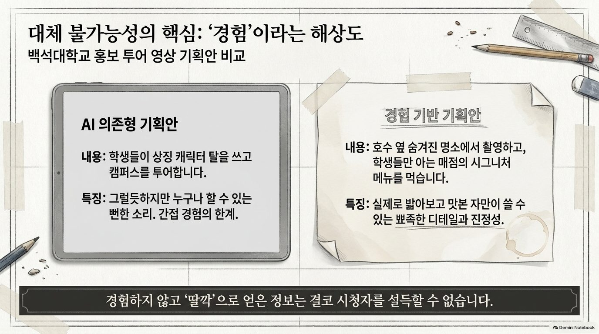

같은 주제, 대학 홍보 투어 영상의 기획안 두 개를 비교해 봅니다.

| 구분 | AI 의존형 기획안 | 경험 기반 기획안 |
|---|---|---|
| **내용** | 학생들이 상징 캐릭터 탈을 쓰고 캠퍼스를 투어합니다 | 호숫가 옆 숨겨진 명소에서 촬영하고, 학생들만 아는 매점의 시그니처 메뉴를 먹습니다 |
| **특징** | 그럴듯하지만 누구나 할 수 있는 뻔한 소리 (간접 경험의 한계) | 실제로 발 벗고 다녀 본 사람만 쓸 수 있는 뾰족한 디테일과 진정성 |

> ✅ **확인** 경험하지 않고 '딸깍'으로 얻은 정보로는 결코 시청자를 설득할 수 없습니다.

### 6) 기술적 완벽함보다 강력한 '서사(Story)'의 힘

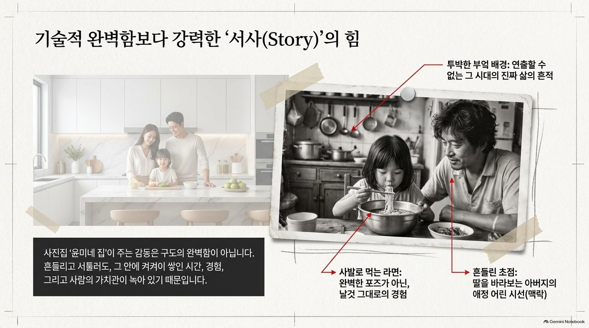

깔끔한 모델하우스 주방에서 웃고 있는 가족 사진과, 투박한 부엌에서 아버지가 딸이 라면 먹는 모습을 바라보는 흑백 사진을 비교해 보세요.

- **투박한 부엌 배경**: 연출할 수 없는, 그 시대의 진짜 삶의 흔적
- **사발로 먹는 라면**: 완벽한 포즈가 아닌, 날것 그대로의 경험
- **흔들린 초점**: 딸을 바라보는 아버지의 애정 어린 시선(맥락)

사진이 주는 감동은 구도의 완벽함이 아니라, **그 안에 켜켜이 쌓인 시간·경험·사람의 가치관**에서 나옵니다.

### 7) 모든 창작의 시작, '생각의 텍스트화'

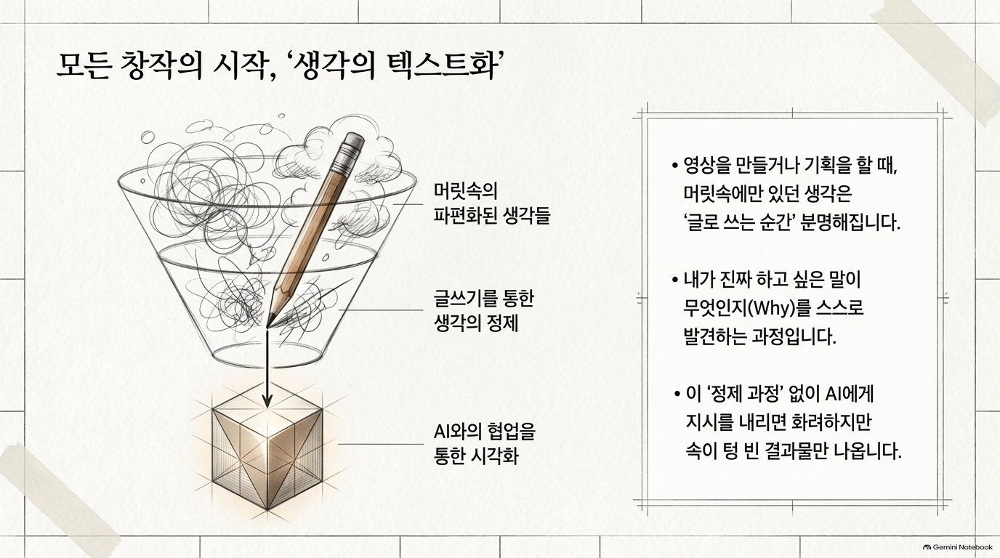

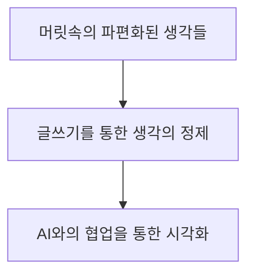

- 영상을 만들거나 기획을 할 때, 머릿속에만 있던 생각은 **글로 쓰는 순간** 분명해집니다.
- 내가 진짜 하고 싶은 말이 무엇인지(Why)를 스스로 발견하는 과정입니다.
- 이 '정제 과정' 없이 AI에게 지시를 내리면, 화려하지만 **속이 텅 빈 결과물**만 나옵니다.

### 8) 내 업무에 적용하는 창작자 프레임워크 (4사분면)

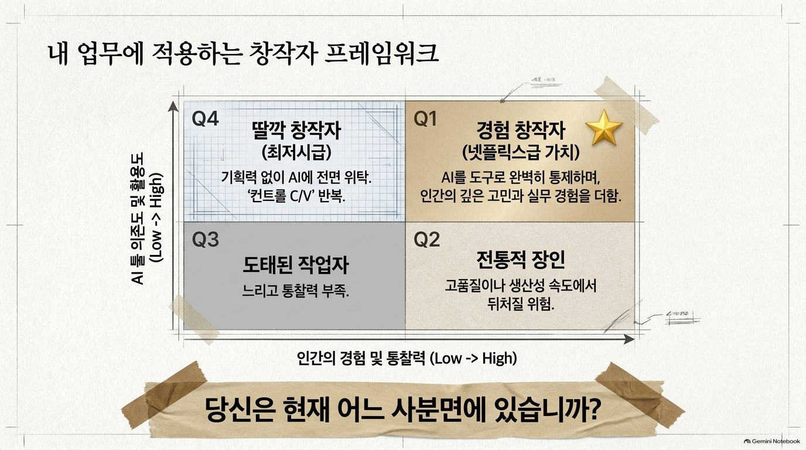

가로축은 **인간의 경험 및 통찰력**, 세로축은 **AI 의존도 및 활용도**입니다.

| | 경험·통찰력 낮음 (Low) | 경험·통찰력 높음 (High) |
|---|---|---|
| **AI 활용 높음 (High)** | **Q4 딸깍 창작자** (최저시급)<br/>기획력 없이 AI에 전면 위탁, '컨트롤 C/V' 반복 | **Q1 경험 창작자** ⭐ (넷플릭스급 가치)<br/>AI를 도구로 완벽히 통제하며, 인간의 깊은 고민과 실무 경험을 더함 |
| **AI 활용 낮음 (Low)** | **Q3 도태된 작업자**<br/>느리고 통찰력도 부족 | **Q2 전통적 장인**<br/>고품질이나 생산성·속도에서 뒤처질 위험 |

> 🗣 **토론** 당신은 현재 어느 사분면에 있습니까? 1년 뒤에는 어디에 있고 싶습니까?

### 9) 실무 적용: 멋진 기획인가, 구현 가능한 현실인가? (Feasibility Check)

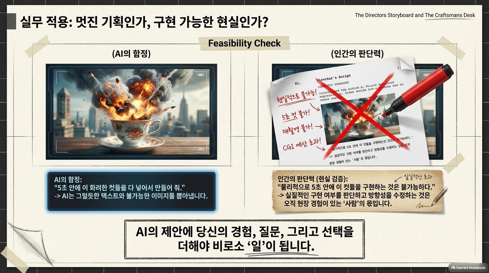

AI에게 "5초 안에 이 화려한 컷들을 다 넣어서 만들어 줘"라고 하면, AI는 그럴듯한 텍스트와 **불가능한 이미지**를 쏟아냅니다. 예를 들어 찻잔 속에서 도시가 폭발하는 장면 같은 것입니다.

| AI의 함정 | 인간의 판단력 (현실 검증) |
|---|---|
| 그럴듯한 텍스트와 불가능한 장면을 제안 | "물리적으로 5초 안에 이 컷들을 구현하는 것은 불가능하다" |
| 예산·장소·장비·시간을 고려하지 않음 | 실질적인 구현 여부를 판단하고 방향성을 수정 |

> ✅ **확인** AI의 제안에 **당신의 경험, 질문, 그리고 선택**을 더해야 비로소 '일'이 됩니다.

## 따라 해 보기

### 실습 1. 나의 창작자 사분면 진단하기 (10분)

1. 최근 한 달 동안 만든 결과물 3개를 적습니다. (보고서, 발표 자료, SNS 글, 영상 등)
2. 각 결과물에 대해 아래 두 질문에 1~5점으로 답합니다.
   - **AI 활용도**: 이 결과물에 AI를 얼마나 썼나요? (1 = 전혀, 5 = 거의 전부)
   - **경험·통찰력**: 내가 직접 보고, 겪고, 판단한 내용이 얼마나 들어 있나요? (1 = 거의 없음, 5 = 핵심 전부)
3. 표에 기록하고 사분면에 점을 찍어 봅니다. (3점 이상을 '높음'으로 봅니다)

| 결과물 | AI 활용도 (1~5) | 경험·통찰력 (1~5) | 사분면 |
|---|---|---|---|
| [결과물 1] | | | |
| [결과물 2] | | | |
| [결과물 3] | | | |

4. Q1(경험 창작자)으로 가려면 **무엇을 하나 더 넣어야 하는지** 한 줄로 적습니다.

### 실습 2. 생각의 텍스트화 → AI 협업 (20분)

1. AI를 켜기 전에, 노트에 **손으로** 다음 세 가지를 적습니다. (5분)
   - 내가 만들고 싶은 것 (한 문장)
   - 내가 직접 보거나 겪은 장면 3개 (구체적인 장소·사람·소리·맛)
   - 이것을 보는 사람이 느꼈으면 하는 감정 한 가지
2. 적은 메모를 그대로 Gemini에 붙여 넣고 아래 프롬프트로 요청합니다.

```text
아래는 내가 직접 손으로 적은 메모다.
메모에 없는 사실이나 장면을 새로 지어내지 말고,
내가 적은 경험을 중심으로 [영상 기획안 / 발표 원고 / 홍보 글]을 만들어줘.

[내가 만들고 싶은 것]
[직접 보거나 겪은 장면 1]
[직접 보거나 겪은 장면 2]
[직접 보거나 겪은 장면 3]
[보는 사람이 느꼈으면 하는 감정]

작성 순서:
1. 내가 진짜 하고 싶은 말(Why)을 한 문장으로 정리
2. 내 경험 장면을 활용한 구성안 (도입-전개-마무리)
3. 내 메모에서 더 구체적으로 적으면 좋을 부분 3가지 질문
4. 이 기획에서 '누구나 할 수 있는 뻔한 부분'이 있다면 지적
```

3. AI가 던진 질문 3가지에 **직접** 답을 적고, 한 번 더 요청해 결과를 다듬습니다.

### 실습 3. Feasibility Check (10분)

AI가 만든 기획안을 받았다면, 아래 질문으로 현실성을 점검합니다.

```text
위 기획안을 실제로 제작한다고 가정하고 현실성을 점검해줘.
- 제작 조건: 기간 [   ], 예산 [   ], 인원 [   ], 장비 [스마트폰 / 카메라 등]
- 각 장면마다 '이 조건으로 구현 가능 / 어려움 / 불가능'을 표시
- 불가능한 장면은 같은 의도를 살리는 현실적인 대안을 제시
- 확정된 내용과 추가 확인이 필요한 내용을 구분
```

> ⚠️ **주의** AI가 "가능하다"고 해도 최종 판단은 현장을 아는 사람의 몫입니다. 장소 섭외, 촬영 허가, 안전은 반드시 직접 확인하세요.

## 나만의 무기를 만드는 3단계 행동 지침

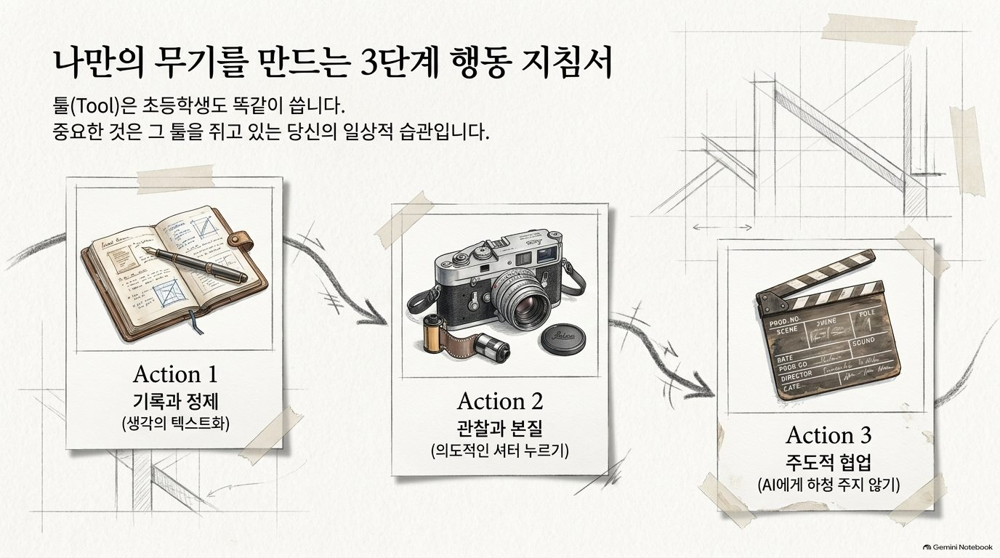

툴(Tool)은 초등학생도 똑같이 씁니다. 중요한 것은 **그 툴을 쥐고 있는 당신의 일상적 습관**입니다.

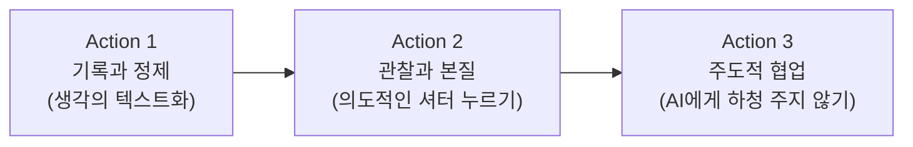

### Action 1. 과정을 생략하지 않는 '기록과 정제'

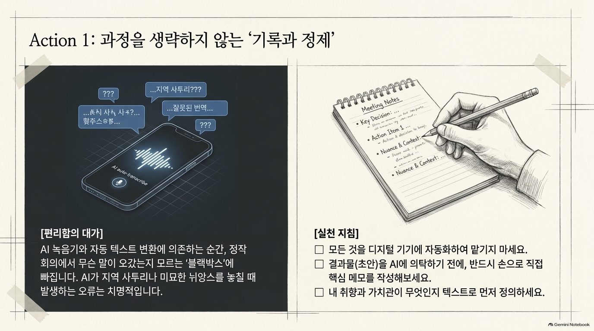

- **편리함의 대가**: AI 녹음기와 자동 텍스트 변환에만 의존하면, 정작 회의에서 무슨 말이 오갔는지 모르는 '블랙박스'에 빠집니다. 지역 사투리나 미묘한 뉘앙스를 AI가 놓쳐 생기는 오류는 치명적입니다.
- **실천 지침**
  - [ ] 모든 것을 디지털 기기에 자동화하여 맡기지 마세요.
  - [ ] 결과물(초안)을 AI에 의뢰하기 전에, 반드시 손으로 직접 핵심 메모를 작성해 보세요.
  - [ ] 내 취향과 가치관이 무엇인지 텍스트로 먼저 정의하세요.

### Action 2. 세상을 바라보는 '의도적인 셔터'

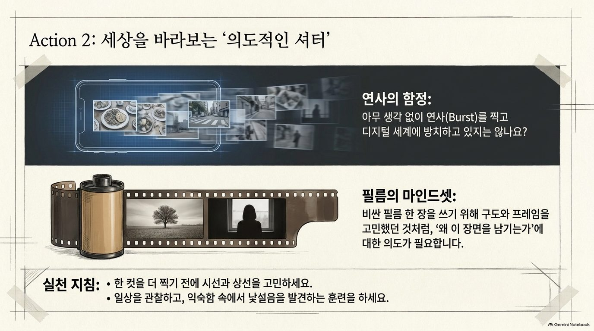

- **연사의 함정**: 아무 생각 없이 연사(Burst)를 찍고 디지털 세계에 방치하고 있지는 않나요?
- **필름의 마인드셋**: 비싼 필름 한 장을 쓰기 위해 구도와 프레임을 고민했던 것처럼, '왜 이 장면을 남기는가'에 대한 의도가 필요합니다.
- **실천 지침**
  - [ ] 한 컷을 더 찍기 전에 시선과 상선(화면의 흐름)을 고민하세요.
  - [ ] 일상을 관찰하고, 익숙함 속에서 낯섦을 발견하는 훈련을 하세요.

### Action 3. AI를 '하청' 주지 않고 '협업'하기

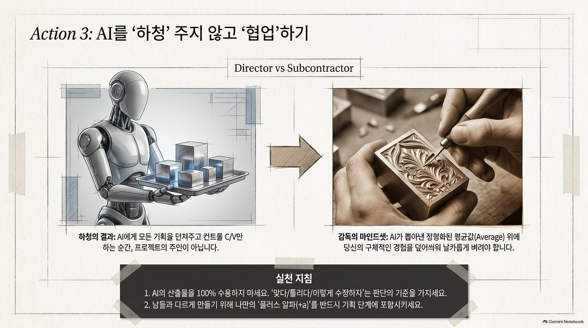

| 하청의 결과 (Subcontractor) | 감독의 마인드셋 (Director) |
|---|---|
| AI에게 모든 기획을 던져 주고 컨트롤 C/V만 하는 순간, 프로젝트의 주인이 아닙니다 | AI가 뽑아낸 정형화된 평균값(Average) 위에 당신의 구체적인 경험을 덧입혀 날카롭게 벼려야 합니다 |

- **실천 지침**
  - [ ] AI의 산출물을 100% 수용하지 마세요. "맞다 / 틀리다 / 이렇게 수정하자"는 판단의 기준을 가지세요.
  - [ ] 남들과 다르게 만들기 위해 나만의 '플러스 알파(+α)'를 반드시 기획 단계에 포함시키세요.

## AI 시대, 나만의 창작을 시작하는 4단계 실행 가이드

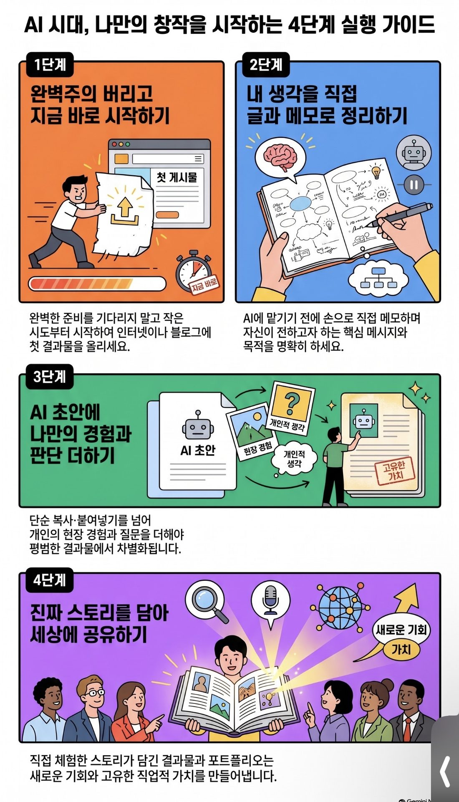

| 단계 | 할 일 | 오늘의 실천 예시 |
|---|---|---|
| **1단계** | 완벽주의를 버리고 **지금 바로 시작**하라 | 완벽하게 준비하기보다, 오늘 만든 작은 결과물 하나를 블로그·SNS에 올립니다 |
| **2단계** | 내 생각을 **직접 글과 메모로 정리**하라 | AI를 켜기 전에 손으로 핵심 메시지를 먼저 적습니다 |
| **3단계** | AI 초안에 **나만의 경험과 판단을 더하라** | AI 초안을 그대로 쓰지 않고, 내가 직접 겪은 디테일을 넣어 다시 씁니다 |
| **4단계** | **진짜 스토리를 담아** 세상에 공유하라 | 직접 체험한 스토리가 담긴 결과물로 새로운 기회와 고유한 직업적 가치를 만듭니다 |

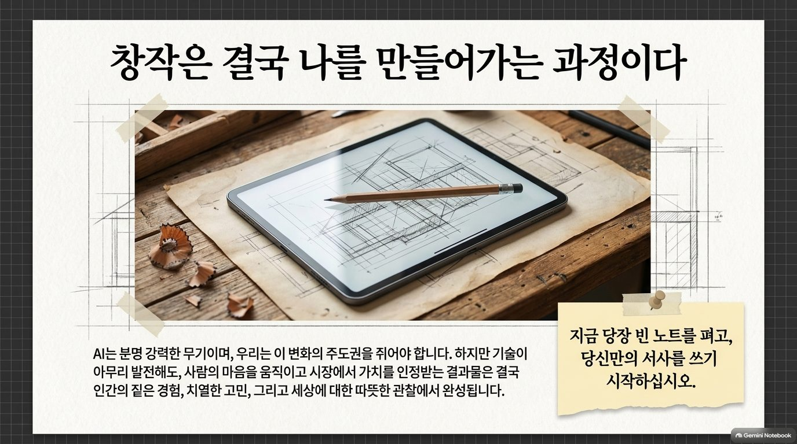

## 체크리스트

- [ ] '딸깍' 결과물과 경험 기반 결과물의 차이를 예를 들어 설명할 수 있다.
- [ ] 가치 하락의 굴레 4단계를 순서대로 말할 수 있다.
- [ ] 나의 창작자 사분면을 진단하고, Q1로 가기 위한 행동 하나를 정했다.
- [ ] AI를 켜기 전에 손으로 메모를 먼저 써 보았다.
- [ ] AI 기획안에 Feasibility Check를 해 보았다.

## 생각해 보기

1. 내 전공이나 업무에서 "AI가 만든 것 같다"는 말을 들으면 손해를 보는 결과물은 무엇인가요?
2. 나만 알고 있는 장소·사람·경험 중에서 콘텐츠가 될 수 있는 것은 무엇인가요?
3. AI가 제안한 것 중에서 "이건 현장을 모르는 소리다"라고 느낀 적이 있나요? 어떤 부분이었나요?
4. 오늘 이 장을 읽고 나서 **내일 아침에 바로 할 수 있는 일** 하나는 무엇인가요?

## 한 줄 정리

> AI는 강력한 무기지만, 사람의 마음을 움직이는 결과물은 **나의 경험·고민·관찰**에서 완성됩니다. 지금 당장 빈 노트를 펴고, 당신만의 서사를 쓰기 시작하세요.

---
📎 **원자료**: 노션 「인공지능 특강 - 대학, CEO과정」 > 이해해봅시다 · 한번 생각해 봅시다 > 「대체 불가능한 창작자의 조건」(PDF, Gemini Notebook 제작) · 「AI 시대, 나만의 창작을 시작하는 4단계 실행 가이드」(이미지) · 경험과 생각으로
