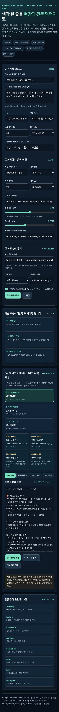
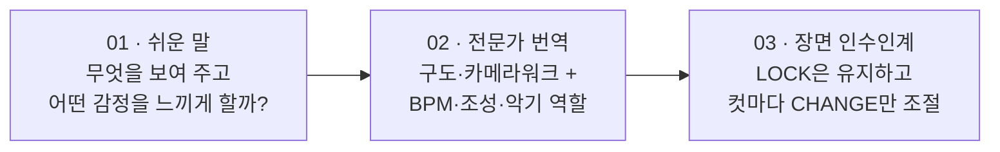
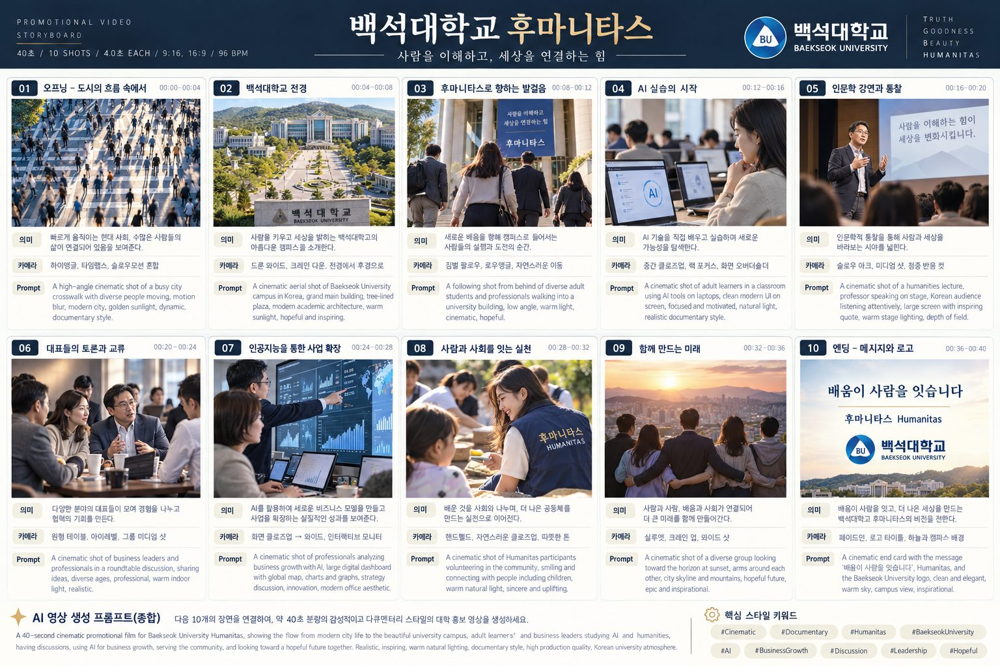
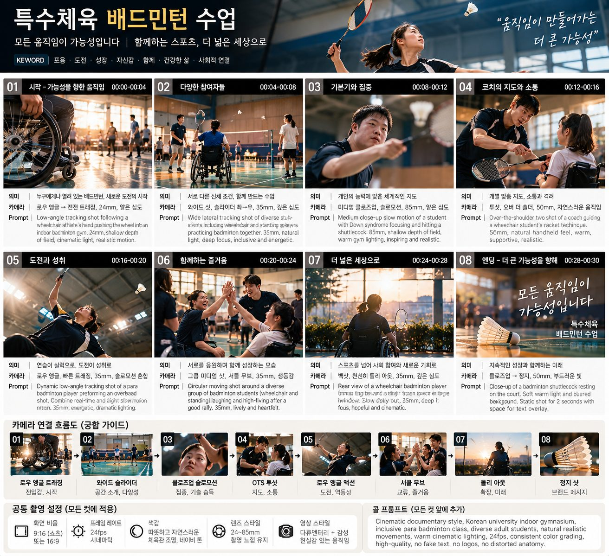

# 11. 프롬프트 연출: 쉬운 말을 현장의 전문 명령어로

> **이 장에서 배울 것**
> - 비전공자의 "이런 느낌이요"를 촬영·음악 전문 명령어로 바꾸는 3단계 방법
> - 영상 브리프(BRIEF) 작성법과 카메라워크·BPM·조성·악기의 기본 의미
> - 여러 장면이 하나의 작품처럼 이어지게 하는 연속성(LOCK / CHANGE) 관리
> - 같은 아이디어를 A/B/C 세 방향으로 비교하는 제작 가설 만들기
>
> ⏱ 소요 시간: 60분 · 🧰 준비물: Gemini(또는 사용하는 AI), 만들고 싶은 영상 아이디어 1개 · 📶 난이도: 초급

## 왜 배우나요?

영상 AI에게 "멋있게 만들어 줘"라고 하면, AI는 **어디서 본 듯한 평균적인 영상**을 만듭니다.
반대로 촬영 감독과 음악 감독이 쓰는 말로 요청하면 결과가 훨씬 정확해집니다.

| 비전공자의 말 | 현장의 전문 명령어 |
|---|---|
| "사람들이 강의실로 들어오는 장면이요" | `Tracking shot, eye-level, 강의실 입구를 지나 좌→우로 함께 이동` |
| "점점 벅차오르는 느낌으로요" | `92 BPM, D minor → 후반부 crescendo, 현악 ostinato` |
| "다음 장면도 같은 분위기로요" | `LOCK: 따뜻한 오후 빛, 3음 모티프 유지 / CHANGE: 카메라만 Dolly-in` |

문제는 처음부터 이런 전문 용어를 알 수는 없다는 것입니다.
그래서 이 장에서는 **쉬운 말로 시작해서 → 전문 명령어로 번역하고 → 장면끼리 이어 주는** 3단계 흐름을 익힙니다.

> 💡 **팁** 이 장은 원자료의 오프라인 실습 도구 **「Prompt Continuity Lab」(프롬프트 연출 현장실습)** 의 흐름을 따릅니다. 이 도구는 실제 음원·영상을 만들지 않고, **실행 가능한 제작 명세(설계도)와 학습 자료**를 만들어 줍니다.

## 핵심 개념

<details markdown="1">
<summary>📱 원자료 도구(Prompt Continuity Lab) 화면 전체 보기</summary>



</details>

### 1) 3-STAGE 학습 흐름 — 이것만 이해하면 됩니다



### 2) 01단계 — 현장 브리프(BRIEF) 쓰기

브리프는 "무엇을, 누구에게, 왜, 얼마나 길게" 만들지 적은 **제작 요청서**입니다.

| 항목 | 질문 | 예시 |
|---|---|---|
| **만들고 싶은 장면** (쉬운 말) | 무엇을 보여 주고 싶나요? | 사람들이 강의실로 들어오고, 자기만의 배움을 발견한다 |
| **대상** | 누가 보나요? | 지역 기업 대표, 예비 원우 |
| **전달 목표** | 보고 나서 무엇을 하게 하고 싶나요? | 과정에 문의하게 한다 |
| **목표 길이** | 몇 초인가요? | 60초 |
| **화면 비율** | 어디에 올리나요? | 9:16 세로형(쇼츠·릴스) / 16:9 가로형(유튜브·발표) / 1:1 정방형(피드) |
| **감정의 변화** | 처음 → 중간 → 끝 | 망설임 → 몰입 → 확신 |

> 💡 **팁** 원자료 도구에는 바로 쓸 수 있는 예시 브리프가 있습니다: **후마니타스 · 60초 홍보영상**, **특수체육 · 45초 동작 시범**, **인물 다큐 · 30초 발견**, **브랜드 소개 · 30초 광고**. 처음에는 예시를 고르고, 익숙해지면 직접 작성하세요.

### 3) 02단계 — 영상과 음악 연결(MATCH)

#### 기본 카메라워크

| 카메라워크 | 쉬운 뜻 | 이럴 때 씁니다 |
|---|---|---|
| **Tracking** | 대상을 따라 함께 이동 | 인물의 여정, 걷는 장면 |
| **Dolly-in** | 카메라가 물리적으로 인물에게 다가감 | 결심·깨달음의 순간 |
| **Rack focus** | 같은 화면에서 초점 대상을 바꿈 | 주목할 대상을 옮길 때 (손 → 얼굴) |
| **Handheld** | 손으로 들고 찍은 듯한 흔들림 | 현장감, 다큐멘터리 느낌 |
| **Drone reveal** | 높은 곳에서 공간을 드러냄 | 캠퍼스·도시 전경 공개 |
| **Dutch angle** | 화면을 비스듬히 기울임 | 불안·긴장 |
| **Locked-off** | 카메라를 고정 | 정적, 인터뷰, 설명 |
| **Orbit** | 대상 주위를 돎 | 관점의 변화, 주인공 강조 |

#### 제작 성향 4가지

| 성향 | 느낌 | 잘 맞는 영상 |
|---|---|---|
| 몰입·성찰 | 차분하고 깊이 있게 | 인물 다큐, 교수 소개 |
| 움직임·활력 | 빠르고 역동적으로 | 스포츠, 모집 홍보 |
| 설명·학습 | 정확하고 또렷하게 | 수업 시범, 사용법 안내 |
| 시네마틱·서사 | 영화처럼 이야기 중심으로 | 브랜드 스토리 |

#### 음악 설정

| 항목 | 쉬운 뜻 | 선택 예 |
|---|---|---|
| **BPM** | 1분당 박자 수 = 빠르기 | 70(느림) · 92(보통) · 120(빠름) |
| **조성(Key)** | 곡의 중심 음과 분위기 | D minor·A minor·E minor·B minor(진지·서정) / C major·G major·F major·Bb major(밝음·안정) |
| **주요 악기와 역할** | 어떤 악기가 무엇을 맡나 | 피아노 = 주선율, 현악 = 감정 받침, 타악 = 추진력 |
| **리듬·악기 밀도** (1~5) | 소리가 얼마나 꽉 찼나 | 1: 내레이션·설명에 유리 / 5: 강한 추진력·복잡한 편곡 |
| **정서적 긴장도** (0~100) | 감정이 얼마나 팽팽한가 | 40 = 잔잔한 기대감 |
| **반드시 피할 것** (Negative) | 들어가면 안 되는 요소 | 가사 있는 보컬, 과한 효과음, 갑작스러운 음량 변화 |

### 4) 03단계 — 연속성 유지(CONTINUITY)

장면을 여러 개 만들면, 컷마다 분위기가 달라져 **"다른 영상을 이어 붙인 것"** 처럼 보이기 쉽습니다.
이를 막는 장치가 **LOCK(고정)** 과 **CHANGE(변화)** 입니다.

| 구분 | 의미 | 예시 |
|---|---|---|
| **LOCK** | 모든 장면에서 **바꾸지 않는** 것 | BPM, 조성, 3음 모티프, 빛·색감, 진행 방향 |
| **CHANGE** | 장면마다 **조절하는** 것 | 카메라워크, 악기 밀도, 긴장도, 피사체 |

- **고정 3음 모티프**: 각 조성에서 **1도 → 3도 → 5도**로 올라가는 짧은 음 세 개를 장면마다 반복합니다. 같은 음높이를 그대로 반복하는 것이 아니라, **형태와 리듬**을 유지하는 것입니다. (D minor라면 레 → 파 → 라)
- **진행 방향**: 화면 좌→우 / 화면 우→좌 / 카메라 쪽으로 / 정적·방향 없음 중 하나를 정해 유지합니다. 인물이 왼쪽에서 오른쪽으로 걸었다면, 다음 컷에서도 같은 방향이어야 자연스럽습니다.
- **빛·색감 기준**: "따뜻한 오후 햇살, 낮은 채도"처럼 한 문장으로 정해 모든 장면에 붙입니다.
- **A/B/C 비교에서도 BPM은 유지**합니다. 세 버전은 장르와 악기 중심으로 비교해야 차이가 분명해집니다.

### 5) 하나의 아이디어, 3개의 제작 가설(BRAINSTORM)

같은 이야기를 **세 가지 방향으로 해석한 별도 대안**입니다. 순서대로 이어지는 장면이 아닙니다.
각 버전 **안에서는** 연속성을 유지하세요.

| 버전 | 이름 | 집중하는 것 | 어울리는 상황 |
|---|---|---|---|
| **A / EMOTION** | 정서 몰입형 | 내면·시선·잔향 | 인물 소개, 감동 스토리 |
| **B / MOTION** | 움직임 주도형 | 리듬·추적·전개 | 스포츠, 모집 홍보 |
| **C / CLARITY** | 정보 전달형 | 음성·학습·정확성 | 수업 시범, 안내 영상 |

원자료 도구는 결과를 네 가지 보기로 보여 줍니다: **쉬운 설명 · 전문 명령어 · 장면 연속성 · 수업·검수**. 이 장의 실습도 같은 네 가지를 결과물로 남깁니다.

## 따라 해 보기

### 실습 1. 브리프 → 전문 명령어 번역 (20분)

1. 위의 브리프 표를 내 아이디어로 채웁니다.
2. 아래 프롬프트를 복사해 AI에 붙여 넣고, `[대괄호]` 부분만 바꿉니다.

```text
너는 영상 촬영 감독이자 음악 감독이다.
나는 영상 제작을 처음 해 보는 비전공자다.
아래 브리프를 3단계로 정리해줘.

[브리프]
- 만들고 싶은 장면(쉬운 말): [예: 사람들이 강의실로 들어오고, 자기만의 배움을 발견한다]
- 대상: [예: 지역 기업 대표]
- 전달 목표: [예: 과정에 문의하게 한다]
- 길이: [예: 60초]
- 화면 비율: [9:16 / 16:9 / 1:1]
- 감정의 변화: [처음] → [중간] → [끝]
- 반드시 피할 것: [예: 가사 있는 보컬, 과한 효과음]

[출력 순서]
1. 쉬운 설명: 이 영상이 무엇을 보여 주는지 초등학생도 이해할 수 있게 3문장
2. 전문 명령어: 장면을 4~6컷으로 나누고, 컷마다
   구도 / 카메라워크 / 피사체 행동 / 빛·색감 / BPM / 조성 / 악기 역할 / 리듬 밀도(1~5) / 긴장도(0~100)
3. 장면 연속성: 모든 컷에 유지할 LOCK 항목과 컷마다 바뀌는 CHANGE 항목을 표로 정리
4. 수업·검수: 실제 결과물에서 확인해야 할 체크 항목 5개

전문 용어는 처음 나올 때 괄호 안에 쉬운 뜻을 붙여줘.
내가 제공하지 않은 사실(장소 이름, 인물 이름)은 지어내지 마.
```

3. AI가 만든 컷 목록에서 **내가 실제로 찍을 수 없거나 본 적 없는 장면**에 표시합니다. (10장 Feasibility Check)

### 실습 2. A/B/C 제작 가설 만들기 (15분)

```text
위에서 만든 브리프를 바탕으로 A/B/C 세 가지 제작 가설을 만들어줘.
- A / EMOTION(정서 몰입형): 내면·시선·잔향에 집중
- B / MOTION(움직임 주도형): 리듬·추적·전개에 집중
- C / CLARITY(정보 전달형): 음성·학습·정확성에 집중

조건:
- 세 버전 모두 BPM [92]와 조성 [D minor]는 똑같이 유지하고, 장르와 악기 구성으로만 차이를 만들어줘.
- 세 버전은 순서대로 이어지는 장면이 아니라 같은 이야기의 서로 다른 해석이다.
- 각 버전마다 첫 컷의 전문 명령어 한 줄, 어울리는 대상, 단점 1가지를 적어줘.
- 마지막에 내 전달 목표 "[전달 목표]"에 가장 맞는 버전을 이유와 함께 추천해줘.
```

### 실습 3. 장면 인수인계 문장 만들기 (10분)

컷을 하나씩 따로 생성하는 영상 AI를 쓸 때는, 매번 **LOCK 문장**을 맨 앞에 붙여 넣습니다.

```text
[LOCK — 모든 장면 공통, 바꾸지 말 것]
화면 비율 [9:16], [92] BPM, [D minor], 3음 모티프(1도→3도→5도 상승) 유지,
빛·색감: [따뜻한 오후 햇살, 낮은 채도], 진행 방향: [화면 좌→우]

[CHANGE — 이번 장면만]
컷 번호: [03] / 카메라워크: [Dolly-in] / 피사체: [강의를 듣다 고개를 드는 대표]
리듬 밀도: [3] / 긴장도: [55]
```

## 완성 예시: 한 장면 프롬프트 (한국어 · 영어)

후마니타스 60초 홍보영상 중 **03컷 "강의 현장"** 을 예로 듭니다.

**한국어**

```text
9:16 세로 영상, 4초. 저녁 강의실, 따뜻한 텅스텐 조명과 낮은 채도.
40~50대 기업 대표들이 강의를 듣고 있다. 카메라는 교실 뒤편에서 출발해
한 대표에게 천천히 Dolly-in(다가가기) 하고, 그가 메모를 멈추고 고개를 드는 순간
Rack focus(초점 이동)로 손에서 얼굴로 초점을 옮긴다. 인물 이동 방향은 화면 좌→우.
음악: 92 BPM, D minor, 피아노가 레-파-라 3음 모티프를 연주하고 현악이 낮게 받친다.
리듬 밀도 3/5, 정서적 긴장도 55/100. 가사 있는 보컬, 과한 효과음, 화면 글자 없음.
```

**English**

```text
Vertical 9:16, 4 seconds. Evening lecture room, warm tungsten lighting, low saturation.
Business owners in their 40s–50s are listening to a lecture. The camera starts at the back
of the room and slowly dollies in toward one participant; as he stops taking notes and looks up,
rack focus from his hands to his face. Subject movement screen left to right.
Music: 92 BPM, D minor, piano plays a rising 3-note motif (D–F–A) over low sustained strings.
Rhythm density 3/5, emotional tension 55/100.
Negative: no lyrics or vocals, no exaggerated sound effects, no on-screen text.
```

> ⚠️ **주의** 영상·음악 생성 AI가 BPM·조성·길이·시선 방향(시선 축)을 정확히 지키는지는 보장되지 않습니다. **실제 결과물에서 직접 확인**하고, 어긋나면 해당 컷만 다시 요청하세요.

## 스토리보드 예시 1 — 백석대학교 후마니타스 홍보영상 (예시)



원자료의 스토리보드를 바탕으로 흐름을 재구성한 **예시**입니다. 컷 구성과 문구는 수업용으로 단순화했습니다.

| 컷 | 장면 | 화면 내용 | 카메라 |
|---|---|---|---|
| 01 | 도입 | 이른 아침, 하루를 시작하는 도시 | Drone reveal |
| 02 | 캠퍼스 | 대학 전경과 건물 | 천천히 Tracking |
| 03 | 강의 | 후마니타스 강의 현장, 메모하는 원우 | Dolly-in + Rack focus |
| 04 | AI | 노트북으로 AI 실습을 시작하는 원우들 | Over-the-shoulder(어깨 너머) |
| 05 | 현장 | 인문학 강연·질문하는 모습 | Handheld |
| 06 | 연결 | 대표들의 토론과 교류 | Orbit |
| 07 | 확장 | 배움을 사업 현장에 적용하는 모습 | Tracking |
| 08 | 배움 | 사람과 사회를 잇는 실천 | Locked-off |
| 09 | 메시지 | 함께 만드는 미래, 노을 속 원우들 | Drone reveal (역방향) |
| 10 | 로고 | 엔딩 메시지 "배움이 사람을 잇습니다" + 로고 | Locked-off |

> 💡 **팁** 원자료 스토리보드는 컷마다 **장면 / 카메라 / Prompt** 칸을 두고, 아래에 **AI 영상 생성 프롬프트(종합)** 와 **핵심 스타일 키워드**를 따로 정리했습니다. 이 구조를 그대로 따라 하면 컷별 생성과 전체 톤 관리가 쉬워집니다.

## 스토리보드 예시 2 — 특수체육 배드민턴 수업 (예시)



주제 문구: **"모든 움직임은 가능성입니다 — 함께하는 스포츠, 더 넓은 세상으로"**

| 샷 | 장면 | 카메라 연결 흐름 |
|---|---|---|
| 01 | 시작 — 가능성을 향한 움직임 | 와이드 샷으로 체육관 공개 → 다음 샷으로 이어 줌 |
| 02 | 다양한 참여자들 | 좌→우 Tracking, 각자의 방식으로 준비하는 참여자 |
| 03 | 기본기 익히기 | Locked-off, 라켓 잡는 손 클로즈업 |
| 04 | 코치의 지도와 소통 | Over-the-shoulder, 눈높이를 맞춘 설명 |
| 05 | 도전과 성장 | 슬로 모션, 셔틀콕을 향한 시선 |
| 06 | 함께해서 즐거움 | Handheld, 하이파이브·웃음 |
| 07 | 더 넓은 세상으로 | Dolly-out(뒤로 빠지기), 전체 참여자 |
| 08 | 엔딩 — 모든 움직임은 가능성 | Locked-off + 메시지 자막 |

- **공통 촬영 설정 (모든 컷 LOCK)**: 16:9 또는 9:16 중 하나로 통일, 밝고 자연스러운 실내 조명, 진행 방향 좌→우, 같은 BPM·조성
- **CHANGE**: 샷마다 카메라워크와 리듬 밀도만 조절

> ⚠️ **주의** 특수체육·장애 관련 영상은 참여자의 **동의와 초상권**, 그리고 **장애를 동정이나 극복의 대상으로만 그리지 않는 표현**이 중요합니다. AI가 만든 장면 묘사에 편견이 섞여 있지 않은지 반드시 검토하세요.

## 전문용어 초간단 사전

| 용어 | 뜻 |
|---|---|
| **Tracking** | 대상을 따라가며 이동하는 카메라 |
| **Dolly-in** | 카메라가 물리적으로 인물에게 다가감 |
| **Rack focus** | 같은 숏에서 초점 대상을 바꿈 |
| **Ostinato** (오스티나토) | 곡을 하나로 묶는 반복 리듬·선율 |
| **Crescendo** (크레셴도) | 시간이 갈수록 음량·에너지가 상승 |
| **Motif** (모티프) | 장면마다 이어지는 짧은 음악적 서명 |
| **Key** (조성) | 곡의 중심 조성. 예: D minor |
| **Mix space** (믹스 공간) | 가까운 악기·먼 악기·잔향의 배치 |
| **LOCK / CHANGE** | 모든 장면에서 고정할 것 / 장면마다 바꿀 것 |
| **Negative** | 결과물에 들어가면 안 되는 요소 목록 |

## 체크리스트

- [ ] 내 영상 아이디어로 브리프 6칸을 모두 채웠다.
- [ ] 카메라워크 3개 이상의 뜻을 쉬운 말로 설명할 수 있다.
- [ ] BPM·조성·리듬 밀도·긴장도를 정해 전문 명령어로 바꿔 보았다.
- [ ] LOCK과 CHANGE를 구분해 장면 인수인계 문장을 만들었다.
- [ ] A/B/C 세 가설 중 내 목표에 맞는 버전을 이유와 함께 골랐다.
- [ ] 결과물이 BPM·길이·방향을 지켰는지 직접 확인했다.

## 생각해 보기

1. 같은 영상인데 BPM만 70에서 120으로 바꾸면 보는 사람의 느낌은 어떻게 달라질까요?
2. A(감정)·B(움직임)·C(정보) 중 내 전공·업무에 가장 자주 필요한 것은 무엇인가요?
3. 전문 용어를 아는 것과, 내가 직접 본 현장을 아는 것 중 결과물에 더 큰 차이를 만드는 것은 무엇일까요?

## 한 줄 정리

> 좋은 프롬프트는 화려한 단어가 아니라 **쉬운 말 → 전문가 번역 → LOCK/CHANGE 인수인계**의 순서로 만들어집니다.

---
📎 **원자료**: 노션 「인공지능 특강 - 대학, CEO과정」 > 자료 실사화 - 현장 방문 > 프롬프트 제작 관련 「프롬프트_연출_현장실습.html」(Prompt Continuity Lab v1.0) · 백석대학교 후마니타스 홍보 스토리보드(이미지) · 특수체육 배드민턴 수업 스토리보드(이미지)
