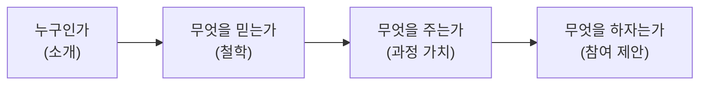
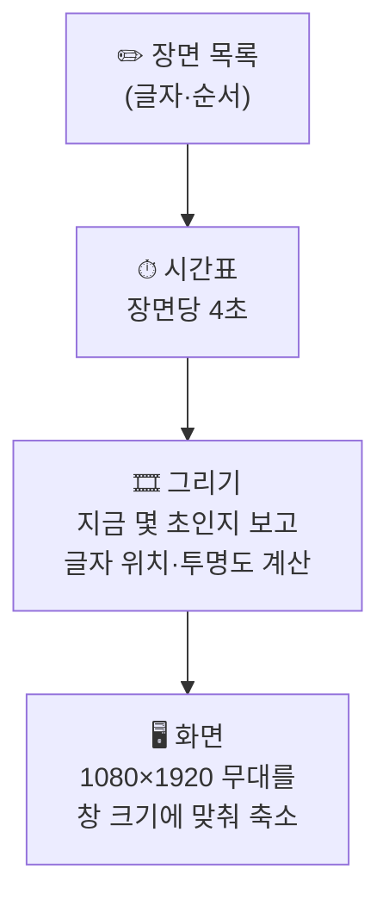

# 12. 코드로 만드는 모션그래픽 홍보영상

> **이 장에서 배울 것**
> - 영상 편집 프로그램 없이 **HTML 파일 하나**로 움직이는 홍보영상을 만드는 원리
> - 9:16 세로형 24초 영상의 장면 구성(6장면 × 4초)과 내레이션 원고 쓰는 법
> - AI 도우미에게 모션그래픽 파일을 만들어 달라고 요청하는 단계별 프롬프트
> - 템플릿을 고쳐 나만의 영상을 만들고, mp4 동영상 파일로 저장하는 방법
>
> ⏱ 소요 시간: 70분 · 🧰 준비물: Chrome, 메모장 또는 VS Code, AI 도우미(Gemini·Claude 등), [템플릿 파일](../examples/motion-promo-template.html) · 📶 난이도: 초급~중급

## 왜 배우나요?

홍보영상을 만들려면 보통 촬영 장비, 편집 프로그램, 디자이너가 필요합니다.
그런데 **모션그래픽**(글자·도형이 움직이는 영상)은 사실 **코드만으로** 만들 수 있습니다.

코드로 만든 영상에는 이런 장점이 있습니다.

| 장점 | 무슨 뜻인가요? |
|---|---|
| **수정이 쉽다** | 날짜가 바뀌면 글자 한 줄만 고치면 됩니다. 다시 편집할 필요가 없습니다 |
| **운영이 쉽다** | 같은 틀에 내용만 바꿔 개인 소개용·모집용·행사용 영상을 계속 만들 수 있습니다 |
| **어디서나 재생된다** | 인터넷이 없어도 브라우저만 있으면 재생됩니다 (오프라인 재생) |
| **AI와 잘 맞는다** | AI 도우미가 가장 잘 만드는 것 중 하나가 HTML·CSS·JavaScript 코드입니다 |

원자료에서는 이 방법으로 실제 교육기관 홍보영상과 개인 브랜딩 영상, 창업 피치 영상, 스포츠 쇼츠를 만들었습니다.

> 💡 **팁** 모션그래픽 영상을 **"코드로 만든 영상"** 이라고 생각하면 어렵게 느껴집니다. **"움직이는 웹페이지를 화면 녹화한 것"** 이라고 생각하면 쉽습니다.

## 핵심 개념

### 1) 원자료의 두 가지 예시

두 예시 모두 같은 틀을 사용합니다.

| 항목 | 규격 |
|---|---|
| 화면 비율 | **9:16 세로형** (쇼츠·릴스·스토리) |
| 원본 크기 | **1080 × 1920** 픽셀 |
| 길이 | **24초** = **6장면 × 4초** |
| 재생 방식 | 오프라인 재생 · 오디오 없음 |
| 파일 | **단일 HTML 파일** (GSAP 같은 외부 애니메이션 도구나 CDN 없이 작동) |
| 조작 | 자동재생 · 재생/일시정지 · 타임라인 이동 · 배속 · 장면 바로가기 · 키보드 ←/→ 1초 이동 · Space 재생 |

#### 예시 A. 2027 원우 모집 — 다이내믹형

숫자·타이포(글자 디자인)·속도감 중심의 홍보 영상입니다. 기존 21초 원고를 24초로 늘렸습니다.

| 시간 | 장면 | 화면 문구(요약) |
|---|---|---|
| 00:00–00:04 | 2027 후마니타스 | 기관명 · 2027 · GROW BEYOND |
| 00:04–00:08 | 리더는 배움을 멈추지 않는다 | LEADERS NEVER STOP |
| 00:08–00:12 | 인문학·리더십·AI | 01 인문 소양 · 02 실천 리더십 · 03 AI 활용 |
| 00:12–00:16 | 매주 화요일 18:30 | 퇴근 후, 더 큰 성장의 시간 |
| 00:16–00:20 | 만남에서 실행으로 | 배움 → 연결 → 성장 |
| 00:20–00:24 | 2027년 2월까지 모집 | 원우 모집 · 지금 문의하세요 |

**내레이션 원고**

```plaintext
2027, 새로운 리더의 배움이 시작됩니다. 리더는 배움을 멈추지 않습니다.
인문학으로 깊이를 더하고, 실천 리더십으로 연결하고, AI로 가능성을 확장합니다.
매주 화요일 저녁 여섯 시 삼십 분. 백석대학교 후마니타스, 2027년 원우 모집. 지금 문의하세요.
```

#### 예시 B. 교수 개인 소개형

인물 중심의 브랜딩 영상입니다. **교수 소개 → 교육 철학 → 과정 가치 → 참여 제안** 순서로 전개합니다.

| 시간 | 장면 |
|---|---|
| 00:00–00:04 | 배움을 설계하는 사람 |
| 00:04–00:08 | 안녕하세요, (이름)입니다 |
| 00:08–00:12 | AI는 도구, 변화의 중심은 사람 |
| 00:12–00:16 | 인문학 × 리더십 × AI |
| 00:16–00:20 | 배움 → 연결 → 실행 |
| 00:20–00:24 | 2027, 함께 성장할 시간 |



> 💡 **팁** 다이내믹형은 **정보(언제·무엇을·어떻게)** 를, 개인 소개형은 **사람(누가·왜)** 을 앞세웁니다. 같은 기관이라도 두 버전을 함께 쓰면 효과가 커집니다.

### 2) 게시 전 반드시: 공식 공고와 대조하기

원자료의 두 영상에는 공통으로 이런 안내가 붙어 있습니다.

> ⚠️ **주의** "매주 화요일 18:30", "2027년 2월까지 모집" 같은 문구는 **제공된 기존 원고에 따른 표기**입니다. 직함·기관명·모집 요강·날짜·시간은 **공식 모집 공고와 대조한 뒤** 배포하세요.

AI는 원고에 있는 날짜를 그대로 옮기기도 하고, 그럴듯한 날짜를 **지어내기도** 합니다.
영상은 한번 퍼지면 고치기 어렵기 때문에, 아래 표로 마지막 점검을 합니다.

| 확인 항목 | 영상 속 표기 | 공식 자료 표기 | 일치? |
|---|---|---|---|
| 기관명·과정명 | | | ☐ |
| 이름·직함 | | | ☐ |
| 요일·시간 | | | ☐ |
| 모집 기간 | | | ☐ |
| 장소·연락처 | | | ☐ |

### 3) 모션그래픽 파일의 구조 (몰라도 되지만 알면 편한 것)



- **장면 목록**: 영상에 나올 글자를 모아 둔 곳입니다. 초보자는 **여기만** 고치면 됩니다.
- **시간표**: "지금이 몇 초인가"를 기준으로 어떤 장면을 보여 줄지 정합니다. 그래서 타임라인을 끌어도 정확한 장면이 나옵니다.
- **그리기**: 글자가 아래에서 올라오며 나타나고, 장면이 끝나면 사라지는 움직임을 계산합니다.

## 따라 해 보기

### 실습 1. 템플릿 열어 보기 (5분)

1. [motion-promo-template.html](../examples/motion-promo-template.html)을 엽니다. (교재 사이트에서는 링크를 누르면 바로 재생됩니다. 내 컴퓨터에 저장했다면 파일을 Chrome으로 끌어다 놓으세요.)
2. **Space** 로 멈추고, **←/→** 로 1초씩 움직여 봅니다.
3. 아래쪽 **장면 버튼**을 눌러 6개 장면을 하나씩 확인합니다.

### 실습 2. 내 내용으로 고치기 (20분)

1. 파일을 **메모장** 또는 **VS Code**로 엽니다. (Windows: 파일 오른쪽 클릭 → 연결 프로그램 → 메모장)
2. `✏️ 여기만 고치세요` 라고 적힌 부분을 찾습니다.
3. `[여기에 ...]` 라고 적힌 곳을 내 내용으로 바꿉니다.

```plaintext
{
  label: "오프닝",                     ← 조작 버튼 이름 (영상에는 안 나옴)
  kicker: "[여기에 과정명]",            ← 제목 위 작은 글자
  title: "우리 과정\n원우 모집",         ← 큰 제목 (\n 은 줄바꿈)
  accent: "원우 모집",                  ← 제목에서 강조색으로 칠할 글자
  sub: "[여기에 과정 한 줄 소개]"        ← 제목 아래 설명
},
```

4. 색을 바꾸려면 파일 맨 위 `:root` 의 `--accent`(강조색), `--bg`(배경색) 값을 바꿉니다.
5. 저장(Ctrl+S)한 뒤 브라우저에서 새로고침(F5)합니다.

> ⚠️ **주의** 따옴표(`"`), 쉼표(`,`), 중괄호(`{ }`)를 지우면 영상이 멈춥니다. 글자만 바꾸고 기호는 그대로 두세요. 화면이 하얗게 나오면 마지막으로 고친 곳의 기호를 확인하세요.

### 실습 3. AI 도우미에게 처음부터 만들어 달라고 하기 (30분)

템플릿 없이 AI에게 직접 요청할 수도 있습니다. **한 번에 다 요청하지 말고 단계별로** 요청하는 것이 핵심입니다.

**1단계 — 원고와 장면표 먼저**

```text
나는 [기관/과정 이름]의 [모집 / 개인 소개 / 행사 안내] 홍보영상을 만들려고 한다.
- 대상: [예: 지역 기업 대표]
- 전달 목표: [예: 과정에 문의하게 한다]
- 확정된 정보: [요일·시간·장소·모집 기간 — 공식 공고에 있는 것만]
- 분위기: [다이내믹형 / 개인 소개형]

9:16 세로, 24초, 6장면 × 4초 구성으로
장면별 화면 문구(짧게)와 내레이션 원고를 표로 만들어줘.
내가 주지 않은 날짜·숫자·이름은 지어내지 말고 [확인 필요]라고 표시해줘.
```

**2단계 — HTML 파일 만들기**

```text
위 장면표로 모션그래픽 HTML 파일을 하나 만들어줘.
조건:
- 단일 HTML 파일. 외부 스크립트·CDN·외부 폰트 없이 작동
- 1080×1920 무대를 브라우저 창 크기에 맞춰 축소해서 보여줄 것
- requestAnimationFrame으로 0~24초 타임라인을 재생
- 재생/일시정지, 처음부터, 배속(0.5/1/1.5/2), 타임라인 막대, 장면 바로가기 버튼
- 키보드: Space 재생/일시정지, ←/→ 1초 이동
- 장면 글자는 파일 맨 위의 배열 하나에 모아두고, 초보자가 고칠 수 있게 한국어 주석을 달 것
- prefers-reduced-motion 설정을 존중할 것
```

**3단계 — 고치기**

```text
[3번째 장면]의 글자가 너무 빨리 사라진다. 나타나는 시간을 0.3초 늦추고,
강조색을 [#e6b85c] 대신 [#5cc8e6]으로 바꿔줘. 다른 부분은 바꾸지 마.
```

> 💡 **팁** AI가 만든 파일이 작동하지 않으면, 화면에서 **F12 → Console** 탭에 나온 빨간 오류 문장을 그대로 복사해 AI에게 보여 주세요. "이 오류를 고쳐줘" 한 줄이면 대부분 해결됩니다.

### 실습 4. mp4 동영상으로 저장하기 (15분)

HTML 영상을 SNS에 올리려면 **동영상 파일(mp4)** 로 바꿔야 합니다. 가장 쉬운 방법은 **화면 녹화**입니다.

1. 템플릿의 **🎥 녹화 모드** 버튼을 누르면 조작 패널이 사라지고, 1초 뒤 처음부터 재생됩니다. (Esc로 나갑니다)
2. 컴퓨터에 들어 있는 화면 녹화 기능을 사용합니다.

| 환경 | 방법 (예시) |
|---|---|
| Windows | 캡처 도구(Snipping Tool)의 녹화 기능, 또는 Xbox Game Bar(Win + G) |
| Mac | Shift + Command + 5 → 선택 부분 녹화 (`.mov` 파일로 저장되며, 대부분의 SNS에 그대로 올릴 수 있습니다) |
| 무료 프로그램 | OBS Studio 같은 녹화 프로그램 |

3. 녹화가 끝나면 앞뒤 빈 부분을 잘라 냅니다. (휴대폰·PC의 기본 동영상 편집 기능으로 충분합니다)
4. 내레이션이나 배경음악이 필요하면, 녹화한 영상에 따로 녹음한 음성을 덧입힙니다.

> ⚠️ **주의** 녹화 화면이 9:16 비율이 되도록 **영상 부분만** 선택해 녹화하세요. 배경음악을 넣을 때는 **저작권이 허용된 음원**만 사용합니다.

## 체크리스트

- [ ] 템플릿을 열어 재생·멈춤·장면 이동을 해 보았다.
- [ ] `[여기에 ...]` 를 내 내용으로 바꾼 6장면 영상을 만들었다.
- [ ] 강조색을 바꿔 보았다.
- [ ] 영상 속 날짜·시간·이름을 공식 자료와 대조했다.
- [ ] 화면 녹화로 mp4 파일을 만들었다.

## 생각해 보기

1. 같은 내용을 "다이내믹형"과 "개인 소개형"으로 만든다면, 각각 어떤 대상에게 보여 주는 것이 좋을까요?
2. 코드로 만든 영상이 촬영 영상보다 나은 점과 부족한 점은 무엇인가요? (10장의 '경험의 해상도'와 연결해 보세요)
3. 우리 기관·회사에서 **매년 내용만 바뀌는 영상**은 무엇이 있을까요? 템플릿으로 만들면 얼마나 시간을 아낄 수 있을까요?

## 한 줄 정리

> 모션그래픽은 **"글자를 고치면 영상이 바뀌는"** 홍보 도구입니다. 단, 화면에 나가는 모든 날짜와 이름은 **공식 자료와 대조한 뒤** 게시합니다.

---
📎 **원자료**: 노션 「인공지능 특강 - 대학, CEO과정」 > 업데이트 신규일 10월 15일 - 모션그래픽 고급버전 · 모션 그래픽을 통한 홍보영상 제작 및 툴 안내 · 「humanitas_2027_02_dynamic_recruit.html」 · 「humanitas_2027_01_personal_intro.html」 · 모션 상급자용(쇼릴 영상)
