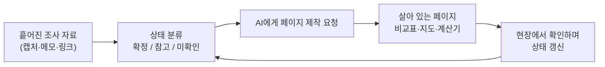

# 13. 자료 실사화: 조사한 자료를 살아 있는 페이지로

> **이 장에서 배울 것**
> - 흩어진 조사 자료를 **비교표·지도·계산기가 있는 웹페이지**로 바꾸는 방법
> - 정보를 **확정 / 참고 / 미확인**으로 나누어 표시하는 습관
> - "참고 가격의 합계"와 "예약 확정 금액"을 구분하는 검증 원칙
> - 수업의 현장 방문·워크숍·기관 탐방 계획에 이 방법을 적용하는 법
>
> ⏱ 소요 시간: 60분 · 🧰 준비물: 조사할 주제 1개, Chrome, AI 도우미(Gemini·Claude 등) · 📶 난이도: 초급

## 왜 배우나요?

현장 방문이나 행사를 준비하면 자료가 여기저기 흩어집니다.

- 메신저에 받은 일정표, 웹사이트 캡처, 엑셀 예산표, 지도 앱 즐겨찾기…
- 무엇이 **확정**이고 무엇이 **아직 확인 중**인지 나도 헷갈리고, 함께 가는 사람은 더 헷갈립니다.

**자료 실사화**는 이렇게 흩어진 조사 결과를 **한 장의 살아 있는 페이지**로 모으는 작업입니다.
"실사화(實寫化)"라는 말처럼, 머릿속 계획을 **눈으로 보고 눌러 볼 수 있는 실물**로 만드는 것입니다.

> 💡 **팁** 원자료에서는 개인 여행 계획을 예로 들어, 일정 A/B 비교·숙소 가격 검증표·지도·예산 계산기를 하나의 HTML 페이지로 만들었습니다. 이 장에서는 그 구조를 배우고, **수업용 현장 방문 계획**에 그대로 적용해 봅니다.

## 핵심 개념

### 1) 예시 페이지의 구성 (원자료: 3박 4일 1인 여행 가이드)

| 탭(메뉴) | 담긴 내용 | 배울 점 |
|---|---|---|
| **개요** | 기간, 거점, 이동 수단, 핵심 숫자 카드 | 한눈에 보는 요약을 맨 위에 |
| **A/B 비교** | 활동형(A안) vs 휴식형(B안) 시간표를 버튼으로 전환 | 하나의 계획을 두 방식으로 비교 |
| **숙소·가격** | 숙소 3곳의 날짜별 1인 최저가 검증표 | 가격은 **출처·기준일**과 함께 |
| **시설 비교** | 운영 시간·요금·특징 정밀 비교 | 공식 홈페이지 기준임을 명시 |
| **위치 지도** | 장소들을 지도 위에 표시 (Leaflet 지도 라이브러리) | 이동 동선을 눈으로 확인 |
| **코스** | 일자별 시간표 | 시간 충돌을 미리 발견 |
| **쿠폰·혜택** | 받을 수 있을지도 모르는 혜택 목록 | 실제로 받은 것만 체크 |
| **예산 계산기** | 항목을 켜고 끄면 합계가 바뀜 | 조건에 따라 달라지는 비용 확인 |



### 2) 가장 중요한 원칙: 확정과 참고를 섞지 않는다

원자료 페이지에서 가장 눈여겨볼 부분은 화려한 지도나 계산기가 아니라, **정보의 상태를 분리해서 적은 문장들**입니다.

| 원자료의 표현 (요약) | 담긴 원칙 |
|---|---|
| "1인 3박 합계 ¥16,100은 날짜별 **1박 최저가를 합산한 참고액**입니다. 같은 요금제로 3박 **연속 결제할 수 있다는 확인은 아닙니다**." | 참고 가격의 합계 ≠ 예약 확정 금액 |
| "연속 3박 재고 **미검증**" | 확인하지 않은 것은 미확인이라고 쓴다 |
| "무료권 안내 사례는 있으나 실제 적용·수령은 **미확인**. 체크 항목은 **수령한 경우에만** 켜세요." | 기대하는 혜택을 확정처럼 계산하지 않는다 |
| "운영 정보는 **공식 홈페이지 기준**이며 잔여좌석·당일 변동은 확인이 필요합니다." | 출처를 밝히고, 변할 수 있는 것을 표시한다 |
| "주말 회차 행사는 도착 시각 때문에 **참여 불가**." | 시간표를 겹쳐 보면 충돌이 보인다 |

> ⚠️ **주의** AI는 "참고 가격 3개를 더한 값"을 "총 숙박비"라고 자신 있게 써 버리기도 합니다. 숫자를 볼 때마다 **"이건 확정인가, 참고인가?"** 를 물어보세요.

### 3) 검증 상태 표 (템플릿)

모든 정보 옆에 **상태 · 출처 · 확인일**을 붙입니다.

| 상태 | 표시 | 뜻 | 예 |
|---|---|---|---|
| **확정** | ✅ | 예약·결제·공식 회신으로 확인 완료 | 기관 담당자가 방문 일시를 메일로 확정 |
| **참고** | 🔎 | 공개 자료로 확인했지만 바뀔 수 있음 | 홈페이지에 나온 운영 시간, 공시 가격 |
| **미확인** | ❓ | 아직 확인하지 못함, 또는 추정 | "단체 할인이 될 것 같다" |

| 항목 | 내용 | 상태 | 출처 | 확인일 |
|---|---|---|---|---|
| [방문 기관] | [기관명] | ✅ / 🔎 / ❓ | [메일·전화·홈페이지] | [YYYY.MM.DD] |
| [방문 일시] | | | | |
| [이동 수단] | | | | |
| [1인 비용] | | | | |
| [준비물] | | | | |
| [안전·보험] | | | | |

### 4) 일반화: 수업의 현장 방문·워크숍·기관 탐방

| 원자료 (개인 여행) | 수업 적용 (현장 방문) |
|---|---|
| A안 활동형 / B안 휴식형 | A안 기관 2곳 집중 방문 / B안 기관 1곳 + 실습 워크숍 |
| 숙소 날짜별 가격 검증표 | 대관·버스·식사 견적 비교표 |
| 시설 운영 시간·요금 비교 | 기관별 견학 가능 시간·인원 제한·준비 서류 |
| 위치 지도 | 학교 → 기관 → 식당 → 학교 동선 지도 |
| 쿠폰 체크 (수령 시에만) | 지원금·할인 체크 (승인 공문을 받은 경우에만) |
| 예산 계산기 | 참가 인원·버스 대수에 따라 1인 비용이 바뀌는 계산기 |

## 따라 해 보기

### 실습 1. 자료 모으고 상태 붙이기 (15분)

1. 계획할 주제를 하나 정합니다. (예: 다음 달 수업의 기관 탐방, 팀 워크숍, CEO 과정 현장 견학)
2. 지금까지 모은 정보를 모두 한곳에 붙여 넣습니다. (메모 앱, 문서)
3. 각 줄 앞에 ✅ / 🔎 / ❓ 를 붙입니다. **망설여지면 ❓** 입니다.

### 실습 2. AI에게 페이지 만들어 달라고 하기 (25분)

```text
아래 조사 자료로 [수업 현장 방문 / 워크숍 / 기관 탐방] 계획 페이지를 만들어줘.
결과물은 단일 HTML 파일 하나로, 인터넷 연결 없이 열려도 표와 계산기는 작동해야 한다.
(지도는 인터넷이 연결된 경우에만 보여도 된다.)

[행사 기본 정보]
- 대상·인원: [예: CEO 과정 원우 20명]
- 날짜 후보: [A안 날짜] / [B안 날짜]
- 출발·도착 장소: [   ]

[조사 자료 — 각 줄의 ✅ 확정 / 🔎 참고 / ❓ 미확인 표시를 그대로 유지할 것]
[여기에 실습 1에서 정리한 내용을 붙여 넣기]

[페이지 구성]
1. 개요: 날짜·인원·핵심 숫자 카드, 맨 위에 "최종 업데이트 날짜"
2. A/B 비교: 버튼으로 두 일정표를 전환
3. 비용 검증표: 항목·금액·상태·출처·확인일 열
4. 동선 지도: 장소 목록과 지도 (Leaflet 사용 가능)
5. 예산 계산기: 인원·항목을 바꾸면 1인 비용과 총액이 바뀜
6. 체크리스트: 준비물·안전·연락처

[반드시 지킬 것]
- 🔎 참고 금액을 더한 값은 "참고 합계"라고 쓰고, 확정 금액처럼 쓰지 마.
- ❓ 미확인 항목은 계산기에서 기본값을 '꺼짐'으로 두고, 사용자가 직접 켜게 해.
- 내가 주지 않은 가격·시간·전화번호는 지어내지 말고 [확인 필요]로 표시해.
- 시간표끼리 겹치거나 이동 시간이 부족한 곳이 있으면 경고 문구로 알려줘.
```

### 실습 3. 검증하며 고치기 (20분)

1. 만들어진 페이지를 열고 **모든 숫자**를 원래 자료와 한 번씩 대조합니다.
2. AI가 ❓를 ✅로 바꿔 놓은 곳이 없는지 확인합니다.
3. 확인 전화·메일을 하나 한 뒤, 해당 항목의 상태와 확인일을 고쳐 달라고 요청합니다.

```text
[기관명] 방문 시간이 [10:00~12:00]으로 담당자 메일을 통해 확정되었다(확인일 [YYYY.MM.DD]).
이 항목의 상태를 ✅ 확정으로 바꾸고, 이 시간과 겹치는 일정이 있으면 표시해줘.
다른 항목은 바꾸지 마.
```

> 💡 **팁** 페이지 맨 위에 **"최종 업데이트: 날짜 · 확정 n개 / 참고 n개 / 미확인 n개"** 를 보여 주면, 함께 가는 사람들이 계획이 얼마나 굳어졌는지 바로 알 수 있습니다.

> ⚠️ **주의** 참가자 명단, 연락처, 예약 번호, 항공·열차 편명 같은 개인정보는 공개 페이지에 넣지 마세요. 공유가 필요하면 **비공개 문서로 따로** 관리합니다.

## 체크리스트

- [ ] 조사 자료의 모든 줄에 확정 / 참고 / 미확인을 붙였다.
- [ ] 참고 가격의 합계를 "확정 금액"으로 쓰지 않았다.
- [ ] A/B 두 가지 안을 비교할 수 있는 페이지를 만들었다.
- [ ] 미확인 항목은 계산기에서 기본으로 꺼 두었다.
- [ ] 시간 충돌이나 이동 시간 부족을 점검했다.
- [ ] 개인정보를 페이지에서 뺐다.

## 생각해 보기

1. 지금까지 행사·여행·출장을 준비하면서 **"확정인 줄 알았는데 아니었던"** 경험이 있나요? 이 방법을 썼다면 막을 수 있었을까요?
2. 내 업무에서 자료 실사화를 하면 가장 효과가 클 일은 무엇인가요? (견적 비교, 행사 기획, 고객 안내 등)
3. AI가 만든 페이지를 다른 사람에게 보낼 때, 받는 사람이 "이건 AI가 지어낸 것 아닌가?" 하고 의심하지 않게 하려면 무엇을 함께 보여 줘야 할까요?

## 한 줄 정리

> 좋은 계획 페이지는 정보가 많은 페이지가 아니라, **무엇이 확정이고 무엇이 아직 아닌지**가 한눈에 보이는 페이지입니다.

---
📎 **원자료**: 노션 「인공지능 특강 - 대학, CEO과정」 > 자료 실사화 - 현장 방문 > 「A/B 시간표 검증 여행 가이드」 (HTML, 개인 일정 정보는 제외)
