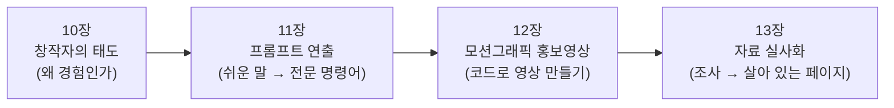

# 3부 나만의 것을 만들다

> **3부의 질문**
> AI가 누구에게나 "보통 이상의 결과물"을 만들어 주는 시대에, **나만 만들 수 있는 것**은 무엇일까요?

2부에서 Google AI 도구를 직접 눌러 보며 "AI가 이런 것도 해 주는구나"를 경험했습니다.
3부에서는 한 걸음 더 나아가, **AI를 써서 남과 다른 결과물을 만드는 방법**을 익힙니다.

핵심은 도구가 아니라 **나의 경험·관찰·판단**입니다.
도구(Tool)는 누구나 똑같이 쓸 수 있지만, 그 도구에 무엇을 넣고 무엇을 고칠지는 사람마다 다르기 때문입니다.

## 3부의 장

| 장 | 제목 | 한 줄 소개 | 난이도 |
|---|---|---|---|
| 10 | [대체 불가능한 창작자의 조건](10-irreplaceable-creator.md) | '딸깍' 한 번으로 만든 결과물과 경험으로 다듬은 결과물은 무엇이 다를까요? | 입문 |
| 11 | [프롬프트 연출: 쉬운 말을 현장의 전문 명령어로](11-prompt-directing.md) | "이런 느낌이요"를 카메라워크·BPM·조성 같은 전문 명령어로 바꿉니다 | 초급 |
| 12 | [코드로 만드는 모션그래픽 홍보영상](12-motion-graphics.md) | 영상 편집 프로그램 없이, HTML 파일 하나로 24초 세로 홍보영상을 만듭니다 | 초급~중급 |
| 13 | [자료 실사화: 조사한 자료를 살아 있는 페이지로](13-field-to-page.md) | 흩어진 조사 자료를 비교표·지도·계산기가 있는 웹페이지로 바꿉니다 | 초급 |

## 3부를 마치면

- [ ] 내가 지금 "창작자 4사분면" 중 어디에 있는지 말할 수 있습니다.
- [ ] 머릿속 생각을 글로 먼저 정리한 뒤 AI에게 요청하는 습관이 생깁니다.
- [ ] 쉬운 말로 쓴 아이디어를 전문 제작 명령어로 바꿀 수 있습니다.
- [ ] HTML 템플릿을 고쳐 나만의 홍보영상을 만들 수 있습니다.
- [ ] 조사한 내용을 **확정 / 참고 / 미확인**으로 나누어 정리할 수 있습니다.

> 💡 **팁** 3부의 모든 실습은 같은 원칙을 따릅니다.
> **AI는 초안을 만들고, 사람은 경험을 더하고 검증합니다.**
> 결과물을 바로 쓰지 말고, 반드시 "내가 직접 확인한 것인가?"를 한 번 더 물어보세요.

---
📎 **원자료**: 노션 「인공지능 특강 - 대학, CEO과정」 > 모션 그래픽을 통한 홍보영상 제작 및 툴 안내 · 자료 실사화 - 현장 방문 · 경험과 생각으로 · 대체 불가능한 창작자의 조건(PDF)
