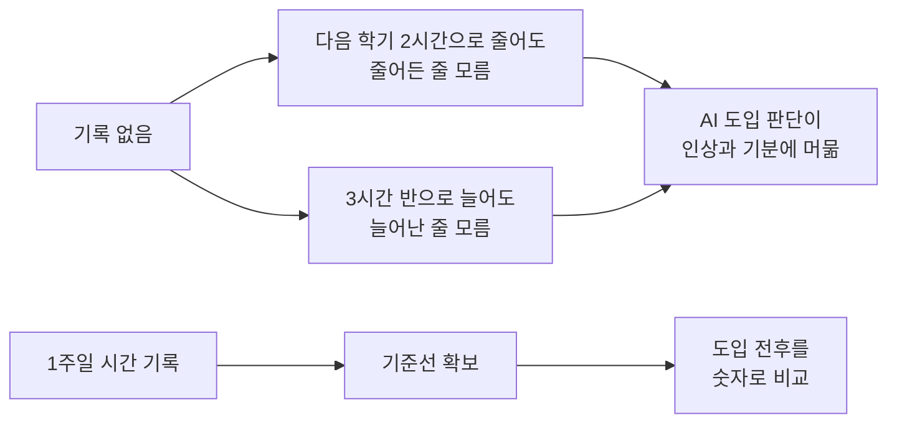

# 14. AI 도입 자기점검: 측정되지 않는 개선은 개선이 아니다

> **이 장에서 배울 것**
> - 내 AI 활용 계획을 6개 기준으로 채점하는 방법
> - "기준선(baseline, 지금 걸리는 시간)"이 왜 모든 계획의 출발점인지
> - "개인 비서"라는 막연한 기대를 4개의 역할로 나누는 방법
> - 비용과 회수를 숫자로 판정하고, 4주 안에 도입 여부를 결정하는 설계
>
> ⏱ 소요 시간: 50분 (+ 1주일 시간 기록) · 🧰 준비물: 스톱워치(휴대폰), 내 AI 활용 계획 3문장 · 📶 난이도: 입문

## 왜 배우나요?

새 학기 수업의 사전 설문에서 한 스포츠과학 전공생이 이렇게 적었습니다.

1. "AI로 스포츠 분야와 일상의 정보를 **더 쉽고 빠르게** 찾는 법을 배우고 싶다."
2. "내년에는 과제·자료 조사·일정 관리를 **도와주는 개인 비서**로 쓰고 싶다."
3. "**월 3만~5만 원**을 투자해 시간을 아끼고 더 많은 경험과 기회를 얻고 싶다."

세 문장 모두 거짓이 아니고, 성실한 답변입니다.
그런데 6개 기준으로 채점하자 **100점 만점에 38.7점**이 나왔습니다.

감점 이유는 "내용이 틀려서"가 아니었습니다.
**맞았는지 틀렸는지 확인할 방법이 없어서** 점수를 줄 수 없었던 것입니다.

> 🗣 **토론**
> 여러분이 지금 "AI로 무엇을 하고 싶은가"라는 질문에 답한다면, 그 답에 **숫자**가 하나라도 들어 있나요?

이 장은 그 학생이 자기 계획을 다시 설계한 기록을 따라가며, 여러분의 계획도 같은 방식으로 점검하게 합니다.

---

## 핵심 개념

### 1) 6개 채점 기준 (100점)

| 기준 | 배점 | 묻는 질문 |
|---|---:|---|
| 구체성 | 20 | 어떤 작업에, 언제, 어떤 도구를 쓰는지 구체적인가? |
| 근거 기반 | 15 | 지금 상태(시간·횟수·비용)를 근거로 적었는가? |
| 실행 가능성 | 20 | 이번 주에 바로 시작할 수 있는 단계가 있는가? |
| 목표와 수단의 정합성 | 15 | 고른 수단이 목표를 실제로 달성할 수 있는가? |
| 측정 가능성 | 15 | 성공했는지 예/아니오로 판정할 수 있는가? |
| 전공 연계성 | 10 | 내 전공·업무의 실제 작업과 연결되는가? |

### 2) 사례 채점 결과

| 기준 | 배점 | 세 문항 평균 |
|---|---:|---:|
| 구체성 | 20 | 9.3 |
| 근거 기반 | 15 | **3.3** |
| 실행 가능성 | 20 | 10 |
| 정합성 | 15 | 9.3 |
| 측정 가능성 | 15 | **3** |
| 전공 연계성 | 10 | 3.7 |
| **합계** | **100** | **38.7** |

가장 낮은 두 항목은 **근거 기반**과 **측정 가능성**입니다.
이 둘은 사실 **같은 결핍의 다른 이름**입니다.

- "더 쉽고 빠르게", "도와주는", "효율을 높여"라고 썼지만
- 지금 **얼마나 느리고 얼마나 비효율적인지**는 한 번도 적지 않았습니다.
- **도착점만 있고 출발점이 없는 계획**이었던 것입니다.

> 💡 **팁**
> 세 문항 중 비용을 다룬 세 번째 답이 **45점으로 가장 높았습니다.**
> 특별히 사려 깊어서가 아니라, **유일하게 숫자("월 3만~5만 원")가 들어 있었기 때문**입니다.
> 숫자 하나가 점수를 갈랐다는 사실이 무엇을 고쳐야 하는지 그대로 알려 줍니다.

### 3) 기준선(baseline): 출발점을 재는 일

구체적인 장면으로 옮겨 보겠습니다.

> 화요일 밤 11시, "청소년 운동참여와 자기효능감"으로 검색을 시작합니다.
> 결과는 400건. 제목만 보고 20개를 새 탭으로 엽니다.
> 초록을 읽으니 15개는 주제가 어긋나고, 남은 5개 중 3편은 원문을 볼 수 없습니다.
> 영문 논문 한 편을 열었다가 연구방법에서 멈추고, 번역기에 문단을 하나씩 붙여 넣습니다.
> 시계를 보니 **3시간**이 지났고, 인용할 만한 논문은 **2편** 남았습니다.

이 장면의 진짜 문제는 3시간이 길다는 것이 아닙니다.
**이 3시간을 아무도 기록하지 않았다**는 것입니다.



그래서 계획의 첫 단계는 **도구를 고르는 일이 아니라 시간을 재는 일**입니다.

### 4) "개인 비서"라는 말의 위험 → 4개의 역할로 나누기

"비서"는 편리한 비유지만, **무엇이든 맡길 수 있다**는 뜻을 품고 있어 맡기면 안 되는 것까지 맡기게 만듭니다.
그래서 하나의 비서 대신 **4개의 역할**로 나누고, 역할마다 넘지 않을 선을 긋습니다.

| 역할 | AI에게 맡기는 것 | 내가 하는 것 |
|---|---|---|
| 🔎 자료 조사원 | 키워드 확장, 초록 요약, 1차 번역 | 인용할 논문의 최종 선별, 원문 확인 |
| ✍️ 초고 작성자 | 개요, 문단 구조, 문장 다듬기 | 주장, 결론, 해석 |
| 📊 데이터 보조 | 측정치 정리, 기초 통계, 그래프 코드 | 어떤 통계 기법이 타당한지, 결과가 무엇을 뜻하는지 |
| 📅 일정 관리자 | 마감 역산, 주간 계획 정리 | 우선순위 |

> ✅ **확인**
> 규칙은 단순합니다. **재료를 모으는 일은 맡기고, 판단하는 일은 맡기지 않는다.**

### 5) 학기 내내 지킬 세 줄

1. AI의 출력은 **언제나 초안**이며, 제출 전에 전부 다시 읽는다.
2. 출처가 표시되지 않은 사실 주장은 쓰지 않는다. 참고문헌은 AI가 준 서지정보를 그대로 옮기지 않고 **DOI로 원문을 확인한 뒤** 적는다.
3. 선수·학생의 신체 측정치 같은 **개인정보는 익명화 없이 입력하지 않는다.**

> ⚠️ **주의**
> 두 번째 줄이 특히 중요합니다. AI는 **존재하지 않는 논문을 저자명과 연도까지 붙여** 그럴듯하게 만들어 내기도 합니다.
> 스포츠과학 분야의 최근 문헌고찰들도 AI의 효용(성과 예측, 부상 예방, 동작 분석)을 인정하면서, **설명가능성과 검증 부족**을 공통 한계로 지적합니다.
> 이 한계를 모른 채 인용하면, 절약한 시간보다 훨씬 큰 대가를 치르게 됩니다.

### 6) 비용과 회수를 다시 정의하기

예산은 처음 그대로 **월 3만~5만 원**을 유지하되, 배분을 분명히 합니다.

| 자리 | 용도 | 예상 비용 (개략치) |
|---|---|---|
| 주력 대화형 도구 | 글쓰기, 계산, 정리 | 월 3만 원대 |
| 검색형 도구 | 출처를 함께 가져오는 조사 | 학생 요금제 활용 시 0원~1만 원대 |
| **합계** | | **월 3만~4만 원** |

> ⚠️ **주의**
> 위 금액은 **2026년 8월 기준 공개 정보를 종합한 개략치**입니다.
> 각 회사의 요금 페이지는 환율·부가세·프로모션에 따라 금액이 달라지므로, **결제 전 공식 요금 페이지에서 원화 금액을 직접 확인**하세요.
> (당시 확인된 값 예: Claude Pro 월 결제 20달러, 연 결제 시 월 17달러 상당)

더 중요한 수정은 **"수익"의 정의**입니다.

- 처음 답: "시간을 아껴 더 많은 경험과 기회를 얻겠다."
- 빠진 고리: **시간 절약 자체는 수익이 아니다.** 아낀 시간을 어디에 쓸지 정하지 않으면 그냥 사라진다.

그래서 **재투자처를 미리 못 박습니다.**

```plaintext
목표: 주당 5시간 절약
  - 3시간 → 현장 실습·자격증 준비
  - 2시간 → 논문 정독

회수 계산
  지출: 월 4만 원 × 4개월 = 16만 원
  확보: 주 5시간 × 16주 ≈ 80시간
  시간당 환산: 16만 원 ÷ 80시간 = 2,000원

판정: 이 금액이 내 아르바이트 시급보다 낮으면 → 투자는 정당하다
```

> 💡 **팁**
> 이 계산이 의미 있는 이유는 정교해서가 아니라, **판정이 가능해졌기 때문**입니다.

---

## 따라 해 보기

### 1단계. 4주 설계표 만들기

한 달이면 도입 여부를 판정할 수 있도록 설계합니다.

| 주차 | 할 일 | 완료의 증거 |
|---|---|---|
| 1주차 | **아무것도 결제하지 않는다.** 대표 작업 3개의 실제 소요 시간만 기록한다. | 시간 기록표 1장 |
| 2주차 | 무료 요금제로 2~3개 도구에 **같은 과제를 같은 조건으로** 넣어 본다. | 비교 메모 1장 |
| 3주차 | 주력 도구 1개만 결제한다. 자주 쓰는 프롬프트 5개를 파일로 모은다. | 프롬프트 파일 1개 |
| 4주차 | 절약 시간을 다시 잰다. 확보한 시간을 실습·정독에 고정 배정한다. | 전후 비교표 1장 |

> 💡 **팁**
> 2주차 비교는 [15장 NVIDIA Build로 모델 비교하기](15-nvidia-build.md)의 비교표를 그대로 써도 됩니다.

### 2단계. 1주일 시간 기록표 채우기

대표 작업 3개를 정하고, 할 때마다 스톱워치로 잽니다. "약 3시간"이 아니라 **"2시간 47분"** 처럼 실측값을 적습니다.

| 날짜 | 작업 (예: 선행연구 파악 / 영문 논문 정독 / 근거 확인) | 시작 | 끝 | 소요(분) | 결과물 | 막힌 지점 |
|---|---|---|---|---:|---|---|
| 월 |  |  |  |  |  |  |
| 화 |  |  |  |  |  |  |
| 수 |  |  |  |  |  |  |
| 목 |  |  |  |  |  |  |
| 금 |  |  |  |  |  |  |
| 토 |  |  |  |  |  |  |
| 일 |  |  |  |  |  |  |
| **합계** |  |  |  |  |  |  |

### 3단계. 내 계획 채점하기 (워크시트)

내 AI 활용 계획 3문장을 적고, 스스로 채점해 봅니다.

```plaintext
내 계획 ①: [AI로 무엇을 배우고 싶은가]
내 계획 ②: [AI를 어떤 역할로 쓰고 싶은가]
내 계획 ③: [얼마를, 무엇을 위해 투자할 것인가]
```

| 기준 | 배점 | 내 점수 | 감점 이유 (한 줄) | 고친 문장 |
|---|---:|---:|---|---|
| 구체성 | 20 |  |  |  |
| 근거 기반 | 15 |  |  |  |
| 실행 가능성 | 20 |  |  |  |
| 정합성 | 15 |  |  |  |
| 측정 가능성 | 15 |  |  |  |
| 전공 연계성 | 10 |  |  |  |
| **합계** | **100** |  |  |  |

### 4단계. AI에게 채점을 맡겨 보기 (그리고 검증하기)

아래 프롬프트를 복사해 Gemini 등 대화형 AI에 붙여 넣습니다. `[대괄호]` 만 바꿉니다.

```text
너는 대학생과 직장인의 AI 도입 계획을 점검하는 코치다.
아래 내 계획을 6개 기준으로 채점해줘.

[채점 기준]
- 구체성 20점: 어떤 작업에, 언제, 어떤 도구를 쓰는지
- 근거 기반 15점: 현재 소요 시간·횟수·비용 같은 출발점이 있는지
- 실행 가능성 20점: 이번 주에 바로 시작할 단계가 있는지
- 목표와 수단의 정합성 15점: 수단이 목표를 실제로 달성할 수 있는지
- 측정 가능성 15점: 성공 여부를 예/아니오로 판정할 수 있는지
- 전공 연계성 10점: [나의 전공/업무]의 실제 작업과 연결되는지

[내 계획]
1. [계획 문장 1]
2. [계획 문장 2]
3. [계획 문장 3]

다음 순서로 작성해줘.
1. 문항별·기준별 점수표
2. 가장 점수가 낮은 기준 2개와 그 이유
3. 각 문장을 숫자가 들어간 문장으로 고친 예시
4. 1주차에 기록해야 할 시간 측정 항목 3개
내가 제공하지 않은 사실은 추정이라고 표시해줘.
```

> ⚠️ **주의**
> AI가 매긴 점수는 **참고용**입니다. 점수 자체보다 **"왜 감점했는가"** 를 읽고, 고친 문장을 내 상황에 맞게 다시 쓰세요.

### 5단계. 학기말(또는 분기말) 판정

다음 4개 지표는 모두 **예/아니오**로 답할 수 있습니다. 이것이 처음 계획과의 결정적 차이입니다.

| 지표 | 목표 | 예/아니오 |
|---|---|---|
| 주당 절약 시간 | 5시간 이상 |  |
| 출처 확인을 거친 답변 비율 | 100% |  |
| 검증 없이 제출한 AI 문장 | 0건 |  |
| 절약 시간의 재투자 비율 | 70% 이상 |  |

---

## 체크리스트

- [ ] 내 대표 작업 3개를 정했다.
- [ ] 1주일 시간 기록표에 **실측값**을 적었다.
- [ ] 내 AI 계획을 6개 기준으로 채점했다.
- [ ] "개인 비서"를 4개 역할로 나누고, 역할마다 내가 쥘 판단을 적었다.
- [ ] 비용 ÷ 절약 시간 = 시간당 환산 금액을 계산했다.
- [ ] 절약한 시간의 재투자처를 정했다.

## 생각해 보기

1. 개선 후 다시 쓴 계획은 같은 기준으로 **80점**이 됩니다. 그런데 하고 싶은 일 자체는 처음과 **조금도 다르지 않습니다.** 무엇이 달라졌을까요? (힌트: 출발점, 숫자로 정한 도착점, 판정 시점)
2. 80점이 100점이 되지 못한 이유는 1주차 기록이 아직 **추정**이기 때문입니다. 내 업무에서 "추정"으로 남아 있는 숫자는 무엇인가요?
3. 내 일에서 AI에게 **절대 맡기지 않을 판단**은 무엇인가요? 그 이유는?
4. CEO 과정 원우라면: 직원에게 AI 도구 구독을 지원할 때, 회수 여부를 어떤 지표로 판정하겠습니까?

## 한 줄 정리

> 도구는 2주차의 문제입니다. 지금 당장 할 일은 **스톱워치를 켜는 것**입니다. 측정되지 않는 개선은 개선이 아니고, 기록되지 않은 세 시간은 줄어들 수도 없습니다.

---
📎 **원자료**: 노션 「인공지능 특강 - 대학, CEO과정」 > GOOGLE AI EXPERIENCE LAB > AI도입_자기점검_보고서.docx (2026.08.18 작성)

**참고 문헌 (원자료에 수록)**
- Artificial intelligence in sport sciences: A systematic review of models and methods. ScienceDirect, 2025. <https://www.sciencedirect.com/science/article/pii/S0949328X25001978>
- A scoping review of explainable artificial intelligence in sports science. *Discover Artificial Intelligence*, Springer, 2025. <https://link.springer.com/article/10.1007/s44163-025-00709-8>
- Artificial intelligence in sport: A narrative review of applications, challenges and future trends. *Journal of Sports Sciences*, 2025. <https://www.tandfonline.com/doi/full/10.1080/02640414.2025.2518694>

**요금 확인 페이지 (원자료에 수록, 2026년 8월 확인)**
- Claude: <https://claude.com/pricing> · ChatGPT: <https://chatgpt.com/pricing/> · Google AI: <https://one.google.com/about/google-ai-plans/> · Perplexity: <https://www.perplexity.ai/help-center/en/articles/11187416-which-perplexity-subscription-plan-is-right-for-you>
