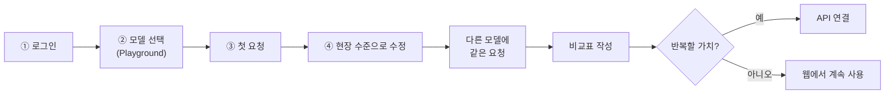
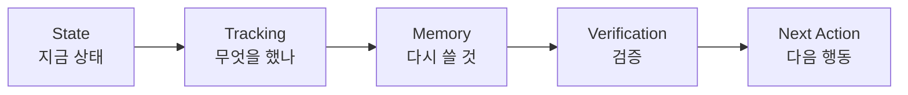

# 15. NVIDIA Build로 모델 비교하기

> **이 장에서 배울 것**
> - NVIDIA Build에서 여러 AI 모델을 브라우저로 시험하는 방법
> - 같은 요청을 두 모델에 넣고 **비교표로 판단**하는 방법
> - 첫 답을 **현장에서 쓸 수 있는 수준**으로 고치는 두 번째 요청
> - API(프로그램 연결)를 시작할 **시점**과 안전한 키 관리
>
> ⏱ 소요 시간: 60분 · 🧰 준비물: Chrome, NVIDIA 계정(화면 안내에 따라 가입), 내 업무 과제 1개 · 📶 난이도: 초급

## 왜 배우나요?

AI 모델은 하나가 아닙니다. 같은 질문에도 모델마다 답의 구조, 정확성, **고쳐야 할 분량**이 다릅니다.
그런데 대부분은 처음 써 본 모델 하나에 익숙해진 뒤, 그것이 내 일에 가장 맞는지 확인하지 않습니다.

이 장의 순서는 단순합니다.

> 💡 **웹에서 업무 1개 실험 → 같은 작업을 모델 두 개로 비교 → 반복할 가치가 있으면 API 연결**

첫 실습은 **특수체육 수업 설계**, 두 번째는 **CEO 과정(후마니타스) 복습 자료 제작**입니다.
여러분의 전공·업무로 바꿔도 순서는 같습니다.

> ⚠️ **주의**
> **2026.10.07 기준 무료**로 사용할 수 있었습니다. 사용 한도와 모델별 이용 조건은 바뀔 수 있으니 **로그인 후 화면에서 직접 확인**하세요.
> 과거의 "1,000크레딧" 같은 안내를 현재 조건으로 가정하면 안 됩니다.

---

## 핵심 개념

### 1) NVIDIA Build는 어떤 곳인가요?

[NVIDIA Build](https://build.nvidia.com/)는 여러 AI 모델을 **브라우저에서 시험**하고, **API**(Application Programming Interface, 내 프로그램이 AI를 호출하는 연결 통로)로 내 프로그램에 연결할 수 있는 공간입니다.

| 구분 | 브라우저 체험 (Playground) | API 연결 |
|---|---|---|
| 하는 일 | 화면에서 요청을 넣고 답을 확인 | 내 프로그램·자동화에서 모델을 호출 |
| 필요한 것 | Chrome, 계정 | API 키, Node.js 같은 실행 환경 |
| 내 컴퓨터 GPU | **필요 없음** (NVIDIA가 호스팅한 모델 사용) | **필요 없음** |
| 언제 | 오늘, 처음 | 같은 요청을 반복해서 쓸 때 |

> ⚠️ **주의**
> Build에 연결했다고 Gmail·캘린더·Gemini Notebook이 자동으로 연동되는 것은 아닙니다.
> **모델 호출과 업무 도구 연결은 별도 작업**입니다.

### 2) 내 업무에 어디에 쓸까?

| 업무 | 첫 활용 | 확인할 점 |
|---|---|---|
| 강의·교육 (예: 특수체육) | 학생 특성에 따른 활동 변형안 | 실제 참여 가능성·안전·평가 |
| 교육 과정 운영 (예: CEO 과정) | 안내문·복습 요약·실습 과제 | 날짜·장소·이름·문장 길이 |
| 연구 | 제공한 원문 정리·논리 점검 | 원문에 없는 주장·인용 생성 여부 |
| 행정 | 업무보고·제출서류 체크리스트 | 근거와 미확인 항목 구분 |
| 콘텐츠 | 쇼츠 대본·장면 구성·자막 초안 | 대상과 전달 메시지 일치 |

### 3) 오늘 60분 계획

| 시간 | 실행 | 남길 결과 |
|---|---|---|
| 0~10분 | 로그인하고 모델 열기 | 사용 가능한 모델 1개 |
| 10~25분 | 수업 설계 요청 | 수업 초안 1개 |
| 25~35분 | 조건을 추가해 수정 | 현장 적용안 1개 |
| 35~45분 | 다른 모델에 같은 요청 | 비교 결과 |
| 45~55분 | 두 번째 업무(복습 자료)에 적용 | 복습 자료 초안 |
| 55~60분 | 검증·상태 기록 | 다음 행동 1개 |



---

## 따라 해 보기

### ① 로그인하기

1. Chrome에서 [NVIDIA Build](https://build.nvidia.com/)를 엽니다.
2. **Login** 또는 **Sign In** 을 누릅니다.
3. NVIDIA 계정으로 로그인하거나, 화면 안내에 따라 가입합니다.
4. 필요한 인증·약관을 확인합니다.

### ② 첫 모델 선택하기

1. 검색창에 `Nemotron` 을 입력합니다.
2. **Free Endpoint** 와 **Playground** 가 함께 표시된 **텍스트 모델**을 고릅니다.
3. 출발점 예시: [Nemotron Ultra 모델 페이지](https://build.nvidia.com/nvidia/nemotron-3-ultra-550b-a55b)

> 💡 **팁**
> 첫 실습은 **Playground** 또는 **Experience** 에서 합니다. Deploy, Self-Hosted, Docker 설치는 나중 단계입니다.
> 모델 목록과 화면 이름은 바뀔 수 있으니 **실제 화면 표시를 우선**하세요.

### ③ 첫 요청 붙여 넣기 (예시: 특수체육 수업 설계)

실제 학생 개인정보 없이 쓸 수 있는 실습입니다. 아래를 그대로 붙여 넣습니다.

```text
너는 특수체육 수업 설계를 돕는 조교다.
나는 백석대학교에서 예비교사를 가르치는 교수다.
목표:
예비교사가 학생의 운동 수행 능력 차이에 따라
같은 수업의 참여 방법을 바꾸는 연습을 하게 한다.
수업 조건:
- 주제: 배드민턴 보내기와 받기
- 수업 시간: 50분
- 참여 학생: 20명
- 공간: 실내 체육관
- 준비물: 라켓, 셔틀콕, 풍선, 바닥 표시 테이프
- 가상 학생 A: 공의 이동 방향을 따라가기 어려움
- 가상 학생 B: 오래 서 있기 어려움
- 가상 학생 C: 여러 단계의 설명을 기억하기 어려움
다음 순서로 한국어로 작성해줘.
1. 관찰 가능한 수업 목표 2개
2. 도입·활동·정리 시간표
3. A·B·C가 같은 활동에 참여하는 방법
4. 교사가 사용할 짧은 지시문
5. 관찰 체크 항목 5개
6. 실행 전에 교사가 확인해야 할 사항
제공하지 않은 정보는 추정이라고 표시해줘.
학생의 진단명이나 능력을 임의로 단정하지 마.
```

> 💡 **팁: 내 분야로 바꾸기**
> 이 프롬프트의 뼈대는 **역할 → 나는 누구 → 목표 → 조건 → 출력 순서 → 금지 사항** 입니다.
> 뼈대는 그대로 두고 `[나의 역할]`, `[목표]`, `[조건]` 만 내 업무로 바꾸면 됩니다.

### ④ 결과를 현장 수준으로 고치기

첫 답변 바로 뒤에 다음을 입력합니다.

```text
위 수업안을 현장에서 실행할 수 있도록 다시 점검해줘.
- 각 활동에 준비물·교사 행동·학생 행동을 명시
- 대기 시간이 길어지는 부분 수정
- 참여가 어려운 학생에게 선택 가능한 대안 제시
- 평가를 성공 횟수만으로 제한하지 말고 참여 과정도 포함
- 확정된 내용과 추가 확인이 필요한 내용을 구분
마지막에는 내가 수업 전에 해야 할 일을 3개만 적어줘.
```

> ✅ **확인**
> 완료 기준은 "답변이 나왔다"가 아니라 **"내가 읽고 수업에 쓸 수 있는 초안을 확보했다"** 입니다.

### ⑤ 모델 두 개 비교하기

1. 다른 텍스트 모델을 엽니다.
2. ③의 **첫 요청을 그대로** 넣습니다. (한 모델에만 조건을 추가하면 공정한 비교가 안 됩니다.)
3. 아래 표를 채웁니다.

| 기준 | 모델 A: [모델 이름] | 모델 B: [모델 이름] |
|---|---|---|
| 요구한 시간·인원·준비물 준수 | 충족 / 미충족 | 충족 / 미충족 |
| 학생별 참여 방법이 구체적임 | 충족 / 미충족 | 충족 / 미충족 |
| 교사가 바로 쓸 지시문 제공 | 충족 / 미충족 | 충족 / 미충족 |
| 제공하지 않은 사실을 만들지 않음 | 충족 / 미충족 | 충족 / 미충족 |
| 수정해야 할 분량 | 적음 / 보통 / 많음 | 적음 / 보통 / 많음 |

> 💡 **팁**
> 좋은 모델은 **수정 시간이 적고, 근거와 불확실성을 잘 구분하는 모델**입니다.

> ⚠️ **주의**
> **모델이 스스로 매긴 점수("96점" 같은)는 검증 증거가 아닙니다.** 비교표의 판정은 반드시 **내가** 합니다.

### ⑥ 두 번째 업무에 바로 적용하기 (예시: CEO 과정 복습 자료)

수업 실험 다음에는 **자주 반복되는 업무**로 넘어갑니다. `[ ]` 만 실제 내용으로 바꿉니다.

```text
나는 백석대학교 후마니타스 담당 교수다.
기업 대표님들에게 수업 복습 자료를 전달하려고 한다.
실제로 진행한 내용:
[수업에서 다룬 내용을 적기]
수업에서 막혔거나 실행하지 못한 내용:
[없으면 없음이라고 적기]
대표님들이 다음에 해볼 활동:
[활동 한 가지 적기]
다음을 작성해줘.
1. 카카오톡 복사용 안내문 400자 이내
2. 핵심 배움 3개
3. 10분 안에 따라 할 복습 활동 1개
4. 다음 수업 전에 확인할 준비물
날짜·장소·강사명은 제공한 경우에만 넣어줘.
실행하지 못한 내용을 실행했다고 쓰지 마.
어려운 기술 용어는 일상적인 표현으로 바꿔줘.
```

이어서 다음처럼 요청하면 수업 자료가 **사업 현장 과제**로 확장됩니다.

```text
대표님 한 분의 업종을 가상으로 정하고, 그 업종에 적용한 예시를 추가해줘.
```

---

## API 연결은 이때 시작하기

### 시작 조건 3가지 (모두 충족할 때)

- [ ] 같은 요청을 **일주일에 여러 번** 사용한다.
- [ ] **입력 항목과 출력 형식**이 정해졌다.
- [ ] 결과를 **검토하는 기준**을 만들었다. (⑤의 비교표가 좋은 출발점입니다)

### 연결 순서 5단계

1. 모델 페이지의 **Build** 를 엽니다.
2. **Get API Key** 또는 **Generate API Key** 를 선택합니다.
3. 키를 발급받아 **비공개로 보관**합니다.
4. **Node** 예제를 선택합니다.
5. 페이지에 표시된 **모델 ID·주소·코드**를 기준으로 실행합니다.

> 💡 **팁**
> 확인한 텍스트 모델 예제는 `https://integrate.api.nvidia.com/v1` 주소를 사용합니다.
> 단, **모든 음성·영상 모델이 같은 호출 방식을 쓰는 것은 아닙니다.** 모델별 예제를 따르세요.

### 실행 환경 확인 (Windows 명령 프롬프트)

Node.js가 설치되어 있는지 먼저 확인합니다.

```bat
node --version
```

```bat
npm --version
```

버전 숫자가 나오면 준비 완료입니다. 이 교재의 예제 파일 [nvidia-build-chat.mjs](../examples/nvidia-build-chat.mjs)로 바로 시험해 볼 수 있습니다. (사용법은 파일 맨 위 설명을 참고하세요.)

### API 키 안전 수칙

> ⚠️ **주의**
> - API 키는 **비밀번호와 같습니다.** 공개 HTML, 블로그, 카카오톡, 노션 공개 페이지에 절대 넣지 않습니다.
> - 키는 서버나 내 컴퓨터 프로그램의 **환경변수**(컴퓨터에 따로 저장해 두는 설정값)로 전달합니다.
> - 키가 노출되었다면 즉시 Build 화면에서 **삭제하고 새로 발급**합니다.

> 💡 **팁: 학교·회사 네트워크에서 막힐 때**
> 웹 화면은 열리는데 API 호출만 실패한다면, 전산팀에 **`integrate.api.nvidia.com` 으로 HTTPS 통신이 가능한지** 확인을 요청하세요.

---

## 실습 기록 남기기

실습마다 아래 5칸을 기록하면 다음에 같은 일을 더 빨리 할 수 있습니다.



```plaintext
작업: [예: 특수체육 50분 수업안 작성]
State: [DRAFT / 검토 중 / 완료]
Tracking: [실행 날짜] / [모델 이름] / [입력한 요청]
Memory: [잘 작동한 조건과 다음에도 사용할 문장]
Verification: [시간·준비물·참여 대안·평가 기준 검토 결과]
Next Action: [수정 후 실제 강의 자료에 반영]
```

> ✅ **확인**
> 상태는 정직하게 적습니다. 예: **"공식 사이트·문서 확인 완료, 내 계정에서 실습 실행은 미확인"**

---

## 체크리스트

- [ ] NVIDIA Build에 로그인하고 Playground에서 텍스트 모델을 열었다.
- [ ] 첫 요청 → 현장 수준 수정까지 진행했다.
- [ ] 다른 모델에 **같은 요청**을 넣고 비교표를 채웠다.
- [ ] 두 번째 업무(복습 자료 등)에 적용해 보았다.
- [ ] State → Tracking → Memory → Verification → Next Action 기록을 남겼다.
- [ ] API 시작 조건 3가지를 내 업무에 비추어 판단했다.

## 생각해 보기

1. 비교한 두 모델 중 **수정 시간이 더 적었던 모델**은 무엇이었나요? 그 차이는 어디서 생겼나요?
2. 두 모델이 모두 "제공하지 않은 사실"을 만들어 냈다면, 프롬프트의 어느 문장을 고쳐야 할까요?
3. 내 업무 중 **API로 자동화할 가치가 있는 반복 요청**은 무엇인가요? 시작 조건 3가지를 모두 충족하나요?

## 한 줄 정리

> 로그인 → Playground → 요청 붙여 넣기 → 조건 추가 → 다른 모델과 비교. **이 한 번의 실험으로 AI가 내 시간을 실제로 줄여 주는지 판단할 수 있습니다.**

---
📎 **원자료**: 노션 「인공지능 특강 - 대학, CEO과정」 > GOOGLE AI EXPERIENCE LAB > 엔비디아 적용하기 (2026.10.07 기준)
