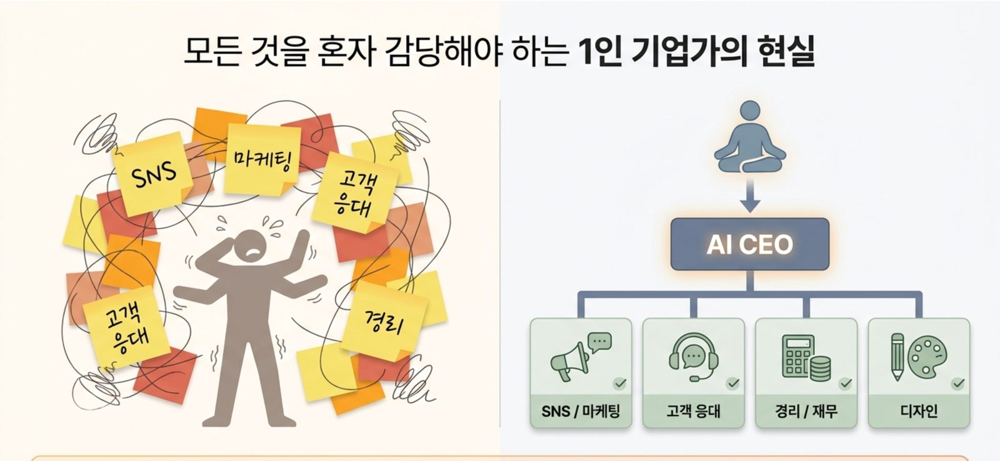
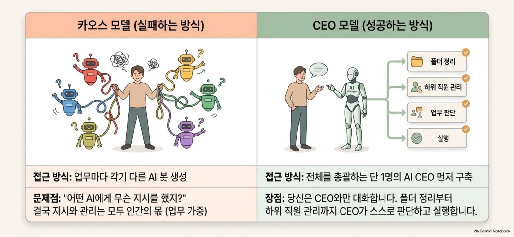
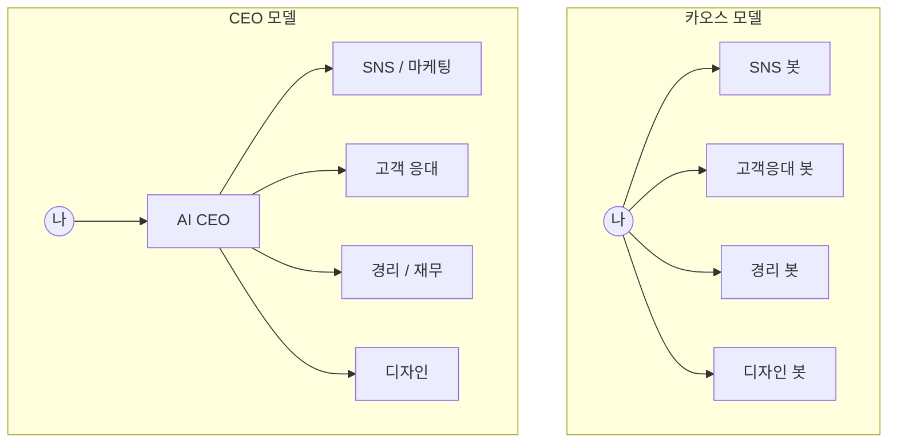
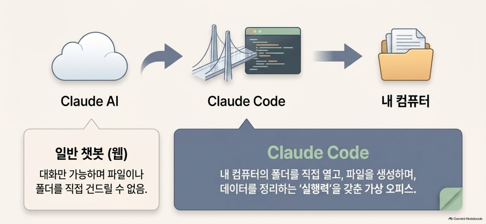
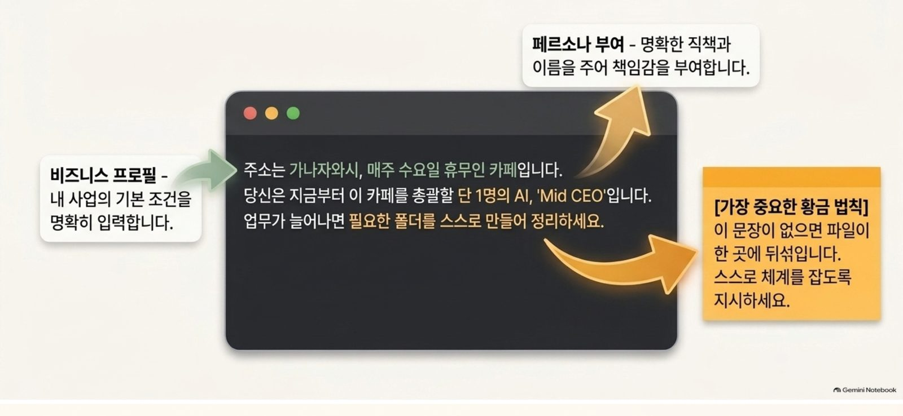
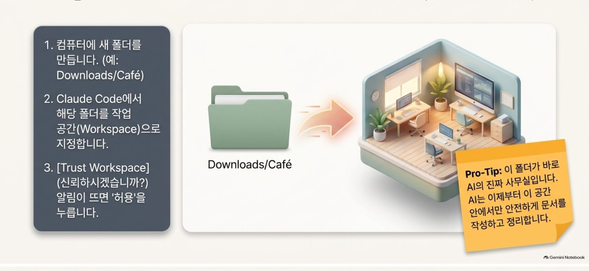
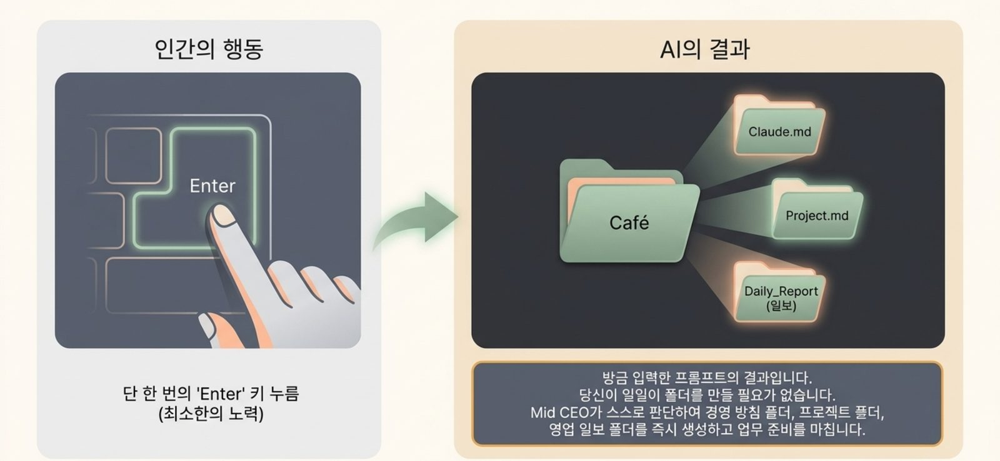
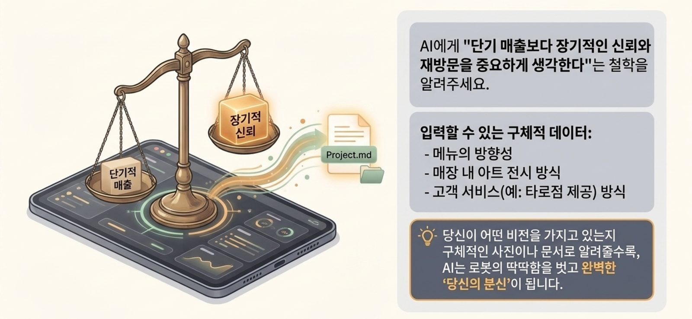

# 16. AI CEO 만들기: Claude Code로 1인 기업 업무 체계 세우기

> **이 장에서 배울 것**
> - 업무마다 AI를 따로 부르는 "카오스 모델"이 왜 실패하는지
> - 전체를 총괄하는 AI 한 명을 세우는 "CEO 모델"
> - 웹 챗봇과 Claude Code의 차이: **대화**만 하는 AI vs **내 폴더에서 직접 일하는** AI
> - 비즈니스 프로필 + 페르소나 + 황금 법칙으로 이루어진 첫 지시문
> - AI에게 내 **철학**을 전하는 방법과 안전 수칙
>
> ⏱ 소요 시간: 60분 · 🧰 준비물: 컴퓨터, Claude Code(데스크톱 앱 또는 터미널), 내 사업·업무 소개 3줄 · 📶 난이도: 초급~중급

## 왜 배우나요?



1인 기업가나 작은 가게 대표는 모든 것을 혼자 감당합니다.

> SNS, 마케팅, 고객 응대, 경리, 디자인…
> 포스트잇이 온몸에 붙어 있는 것 같은 하루입니다.

그래서 많은 분이 AI를 씁니다. SNS 글은 이 AI, 고객 답장은 저 AI, 장부 정리는 또 다른 AI.
그런데 얼마 지나지 않아 이런 말이 나옵니다.

> 🗣 "어떤 AI에게 무슨 지시를 했더라?"

AI가 늘어날수록 **지시와 관리는 모두 사람 몫**이 되고, 업무는 오히려 늘어납니다.
이 장에서는 이 문제를 **AI CEO 한 명**으로 푸는 방법을 배웁니다.

---

## 핵심 개념

### 1) 카오스 모델 vs CEO 모델



| 구분 | 카오스 모델 (실패하는 방식) | CEO 모델 (성공하는 방식) |
|---|---|---|
| 접근 방식 | 업무마다 각기 다른 AI 봇 생성 | 전체를 총괄하는 **단 1명의 AI CEO** 먼저 구축 |
| 사람이 하는 일 | 모든 봇에게 각각 지시하고 결과를 모으고 관리 | **AI CEO와만 대화** |
| 문제점 / 장점 | "어떤 AI에게 무슨 지시를 했지?" → 업무 가중 | 폴더 정리부터 하위 업무 관리까지 CEO가 스스로 판단하고 실행 |



### 2) 웹 챗봇 vs Claude Code



| 구분 | Claude AI (웹 챗봇) | Claude Code |
|---|---|---|
| 할 수 있는 일 | 대화만 가능 | 내 컴퓨터의 **폴더를 직접 열고, 파일을 만들고, 정리** |
| 결과물 | 화면 속 답변 (복사해서 옮겨야 함) | 폴더 안에 실제 파일로 남음 |
| 비유 | 전화 상담원 | **실행력을 갖춘 가상 사무실** |

> 💡 **팁**
> Claude Code는 Claude 데스크톱 앱의 **Code** 탭이나, 터미널에서 `claude` 명령으로 실행합니다.
> 사용 가능한 요금제와 설치 방법은 바뀔 수 있으니 [공식 안내](https://claude.com/product/claude-code)를 확인하세요.

### 3) 첫 지시문의 세 부분



AI CEO에게 처음 주는 지시문은 세 부분으로 이루어집니다.

| 부분 | 역할 | 예시 |
|---|---|---|
| ① 비즈니스 프로필 | 내 사업의 기본 조건을 명확히 입력 | "주소는 가나자와시, 매주 수요일 휴무인 카페입니다." |
| ② 페르소나 부여 | 명확한 직책과 이름을 주어 책임감 부여 | "당신은 지금부터 이 카페를 총괄할 단 1명의 AI, 'Mid CEO'입니다." |
| ③ 황금 법칙 ⭐ | AI가 스스로 체계를 잡도록 지시 | "업무가 늘어나면 필요한 폴더를 스스로 만들어 정리하세요." |

> ⚠️ **주의: 가장 중요한 황금 법칙**
> ③이 없으면 파일이 한 곳에 뒤섞입니다. **스스로 체계를 잡도록 지시**하는 한 문장이 전체를 바꿉니다.

---

## 따라 해 보기

### 1단계. AI의 사무실(작업 폴더) 만들기



1. 컴퓨터에 새 폴더를 만듭니다. 예: `Downloads/Café`
2. Claude Code에서 그 폴더를 **작업 공간(Workspace)** 으로 지정합니다.
3. **"이 폴더를 신뢰하시겠습니까?(Trust Workspace)"** 알림이 뜨면 **허용**을 누릅니다.

> 💡 **Pro-Tip**
> 이 폴더가 바로 **AI의 진짜 사무실**입니다. AI는 이제부터 이 공간 안에서만 안전하게 문서를 작성하고 정리합니다.
> 그러니 이 폴더에는 **AI가 다뤄도 되는 자료만** 넣으세요.

### 2단계. Mid CEO 임명하기

Claude Code 입력창에 아래를 붙여 넣고 **Enter** 를 한 번 누릅니다. `[대괄호]` 를 내 사업으로 바꿔도 됩니다.

```text
주소는 가나자와시, 매주 수요일 휴무인 카페입니다.
당신은 지금부터 이 카페를 총괄할 단 1명의 AI, 'Mid CEO'입니다.
업무가 늘어나면 필요한 폴더를 스스로 만들어 정리하세요.
```

내 사업으로 바꾼 버전:

```text
[사업 종류와 위치], [운영 시간·휴무일 등 기본 조건]입니다.
당신은 지금부터 이 [사업]을 총괄할 단 1명의 AI, '[직책 이름]'입니다.
업무가 늘어나면 필요한 폴더를 스스로 만들어 정리하세요.
```

### 3단계. 결과 확인하기



사람이 한 일은 **Enter 한 번**입니다. 사용자가 일일이 폴더를 만들 필요가 없습니다.
Mid CEO가 스스로 판단해 다음과 같은 체계를 만듭니다. (예시이며, 실제 이름·구성은 실행할 때마다 다를 수 있습니다.)

```plaintext
Café/
├── CLAUDE.md        ← 경영 방침 (AI CEO가 매번 먼저 읽는 기억 파일)
├── Project.md       ← 진행 중인 프로젝트 목록
└── Daily_Report/    ← 영업 일보
```

> 💡 **팁: CLAUDE.md 라는 이름**
> 슬라이드에는 `Claude.md` 로 표시되어 있지만, Claude Code가 **프로젝트 기억 파일로 자동으로 읽는 이름은 관례적으로 `CLAUDE.md`(대문자)** 입니다.
> 여기에 적힌 내용은 다음 대화에서도 AI가 기억합니다. 완성 예시는 [cafe-ceo/CLAUDE.md](../examples/cafe-ceo/CLAUDE.md)를 참고하세요.

### 4단계. 내 철학 전하기



폴더만 만들면 AI는 아직 **로봇처럼 딱딱한 직원**입니다.
내가 **무엇을 중요하게 여기는지** 알려 주어야 비로소 "나의 분신"이 됩니다.

```text
우리 카페는 단기 매출보다 장기적인 신뢰와 재방문을 중요하게 생각한다.
이 철학을 CLAUDE.md의 경영 방침에 기록하고,
앞으로 모든 제안과 문서에 이 기준을 적용해줘.

참고할 구체적 정보:
- 메뉴의 방향성: [예: 제철 재료, 단출한 메뉴]
- 매장 내 아트 전시 방식: [예: 지역 작가 월별 전시]
- 고객 서비스: [예: 원하는 손님에게 타로점 제공]
```

> 💡 **팁**
> 비전을 **구체적인 사진이나 문서**로 알려 줄수록, AI는 딱딱함을 벗고 완벽한 "당신의 분신"이 됩니다.
> 메뉴판, 매장 사진, 손님 후기 요약 같은 자료를 작업 폴더에 넣고 "이 자료를 참고해 경영 방침을 보완해줘"라고 요청해 보세요.

### 5단계. 매일 쓰는 업무 요청 예시

```text
오늘 영업 일보를 Daily_Report 폴더에 만들어줘.
- 오늘 날짜: [날짜]
- 매출 메모: [대략적인 내용]
- 특이사항: [손님 반응, 재고 등]
경영 방침에 비추어 내일 시도해 볼 일 1개를 제안해줘.
```

```text
이번 주 인스타그램 게시물 3개 초안을 만들어줘.
경영 방침과 이번 달 전시 정보를 반영하고,
게시 전 내가 확인해야 할 사실(가격·날짜·작가 이름)을 따로 표시해줘.
```

---

## 안전 수칙

> ⚠️ **주의**
> - **작업 폴더 범위만 허용합니다.** 바탕화면 전체, 문서 폴더 전체처럼 넓은 범위를 작업 공간으로 지정하지 않습니다.
> - **개인정보·결제정보를 넣지 않습니다.** 고객 연락처, 카드 번호, 계좌 비밀번호, 주민등록번호는 폴더에도 대화에도 넣지 않습니다.
> - **결과물은 사람이 검토합니다.** 손님에게 나가는 글, 가격, 날짜, 세금·회계 관련 내용은 반드시 직접 확인한 뒤 사용합니다.
> - AI가 파일 삭제나 외부 전송을 제안하면, 무엇을 하는지 **읽고 이해한 뒤에만** 허용합니다.

| AI CEO에게 맡기는 일 | 대표가 쥐는 일 |
|---|---|
| 폴더·문서 정리, 일보 양식 채우기 | 경영 방침 결정 |
| 게시물·안내문 초안 | 게시 승인, 가격·날짜 확인 |
| 아이디어 제안, 주간 계획 초안 | 무엇을 실행할지 선택 |
| 자료 요약, 체크리스트 작성 | 돈이 나가는 결정, 고객과의 약속 |

---

## 체크리스트

- [ ] AI 전용 작업 폴더를 만들고 Claude Code의 작업 공간으로 지정했다.
- [ ] 비즈니스 프로필 + 페르소나 + 황금 법칙으로 첫 지시를 내렸다.
- [ ] AI가 만든 폴더 구조와 `CLAUDE.md` 를 열어 확인했다.
- [ ] 내 사업 철학 한 문장과 구체적 정보 3가지를 전달했다.
- [ ] 작업 폴더에 개인정보·결제정보가 없는지 확인했다.

## 생각해 보기

1. 지금 내가 쓰는 AI 도구들은 **카오스 모델**인가요, **CEO 모델**인가요?
2. 내 사업(또는 업무)의 철학을 **한 문장**으로 적는다면? 그 문장이 AI의 제안을 어떻게 바꿀까요?
3. AI CEO에게 **절대 맡기지 않을 결정** 3가지는 무엇인가요?
4. 대학생이라면: "나"라는 1인 기업의 AI CEO에게 어떤 폴더(과제, 대외활동, 취업 준비…)를 맡기겠습니까?

## 한 줄 정리

> 여러 AI를 관리하지 말고, **나를 대신해 관리할 AI 한 명**을 세우세요. 그리고 그에게 폴더가 아니라 **철학**을 먼저 건네세요.

---
📎 **원자료**: 노션 「인공지능 특강 - 대학, CEO과정」 > 이해해봅시다! (10월 3일 추가 슬라이드)
