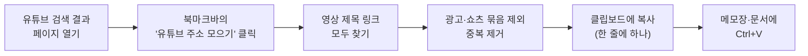

# 17. 크롬 한방: 북마클릿으로 반복 작업 줄이기

> **이 장에서 배울 것**
> - 북마클릿(bookmarklet)이 무엇이고, 왜 "한방"이 되는지
> - 유튜브 검색 결과의 영상 주소를 **클릭 한 번으로** 모으는 방법
> - 크롬 북마크 단축키: `Ctrl + Shift + O`, `Ctrl + Shift + B`
> - 남이 준 코드를 실행하기 전에 지켜야 할 안전 수칙
> - AI에게 나만의 북마클릿을 만들어 달라고 요청하는 방법
>
> ⏱ 소요 시간: 30분 · 🧰 준비물: Chrome, 유튜브 · 📶 난이도: 초급

## 왜 배우나요?

수업 자료로 쓸 영상을 고르는 장면을 떠올려 보세요.

> 유튜브에서 "특수체육 배드민턴 수업"을 검색합니다.
> 영상 하나를 오른쪽 클릭 → 링크 주소 복사 → 문서에 붙여 넣기.
> 다음 영상도 오른쪽 클릭 → 복사 → 붙여 넣기…
> 20개를 모으니 10분이 지났습니다.

이런 **같은 클릭의 반복**은 AI 챗봇보다 **북마크 하나**로 더 빨리 끝낼 수 있습니다.
이 장에서는 그 북마크, 북마클릿을 직접 설치하고 이해합니다.

---

## 핵심 개념

### 1) 북마클릿이란?

**북마클릿 = 북마크(bookmark) + 애플릿(applet, 작은 프로그램)**

보통 북마크에는 `https://...` 로 시작하는 **주소**가 들어갑니다.
북마클릿은 그 자리에 `javascript:` 로 시작하는 **짧은 프로그램**을 넣은 북마크입니다.
북마크를 누르면, **지금 보고 있는 페이지 위에서** 그 프로그램이 한 번 실행됩니다.

| 구분 | 일반 북마크 | 북마클릿 |
|---|---|---|
| 주소 칸에 들어가는 것 | `https://www.youtube.com` | `javascript:(async function(){ ... })();` |
| 누르면 | 그 페이지로 이동 | **현재 페이지에서** 프로그램 실행 |
| 설치 | 별 모양 클릭 | 북마크를 만들고 주소 칸에 코드 붙여 넣기 |
| 확장 프로그램 설치 | 필요 없음 | **필요 없음** |



### 2) 크롬 북마크 단축키 (원자료)

| 단축키 | 하는 일 |
|---|---|
| `Ctrl + Shift + O` | **북마크 관리자** 열기 (북마크 추가·수정) |
| `Ctrl + Shift + B` | **북마크바** 보이기 / 숨기기 (북마크바가 안 보일 때) |

> 💡 **팁**
> 맥(Mac)에서는 `Ctrl` 대신 `Cmd` 를 누릅니다.

### 3) 이 교재의 코드에 대하여

> ⚠️ **주의**
> 원자료(노션)에 실린 코드는 중간에서 **잘려** 그대로는 실행되지 않습니다.
> 이 교재는 같은 목적의 코드를 **처음부터 다시 작성한 완성본**을 제공합니다.
> - 설명용 원본: [youtube-links-bookmarklet.js](../examples/youtube-links-bookmarklet.js)
> - 북마크에 붙여 넣을 한 줄 버전: [youtube-links-bookmarklet.txt](../examples/youtube-links-bookmarklet.txt)

---

## 따라 해 보기

### 1단계. 북마크바 보이게 하기

1. Chrome을 엽니다.
2. 주소창 아래에 북마크바가 없으면 `Ctrl + Shift + B` 를 누릅니다.

### 2단계. 북마클릿 만들기

1. `Ctrl + Shift + O` 로 **북마크 관리자**를 엽니다.
2. 왼쪽에서 **북마크바** 폴더를 선택합니다.
3. 오른쪽 위 **⋮ (점 세 개)** → **새 북마크 추가** 를 누릅니다.
4. **이름**: `유튜브 주소 모으기`
5. **URL**: [youtube-links-bookmarklet.txt](../examples/youtube-links-bookmarklet.txt) 의 **한 줄 전체**를 복사해 붙여 넣습니다. (`javascript:` 로 시작해야 합니다.)
6. **저장** 을 누릅니다.

> ⚠️ **주의**
> 주소창에 코드를 직접 붙여 넣으면 Chrome이 앞의 `javascript:` 를 자동으로 지우는 경우가 있습니다.
> **반드시 북마크의 URL 칸**에 붙여 넣으세요.

### 3단계. 실행하기

1. 유튜브에서 원하는 주제를 검색합니다. (주소가 `youtube.com/results?...` 인 페이지)
2. 더 많은 영상을 모으고 싶다면 화면을 아래로 내려 영상을 더 불러옵니다.
3. 북마크바의 **유튜브 주소 모으기** 를 누릅니다.
4. "○개의 영상 주소를 복사했습니다" 알림이 뜨면, 메모장이나 문서에 `Ctrl + V` 로 붙여 넣습니다.
5. 복사가 막힌 환경이라면 화면에 **텍스트 상자**가 뜹니다. `Ctrl + A` → `Ctrl + C` 로 직접 복사합니다.

> 💡 **팁: 모은 주소로 할 수 있는 일**
> - Gemini Notebook에 영상 주소를 자료로 넣고 요약·비교하기 ([6장](../part2/06-notebooklm.md))
> - 수업 참고 영상 목록 만들기
> - Gemini에 목록을 주고 "주제별로 분류하고, 초보자용 시청 순서를 정해줘"라고 요청하기

### 4단계. 코드 한 줄씩 읽어 보기

실행하기 전에 **무엇을 하는 코드인지** 이해하는 습관을 들입니다. 설명용 원본의 흐름은 다음과 같습니다.

| 순서 | 코드가 하는 일 | 핵심 코드 |
|---|---|---|
| 1 | 유튜브 **검색 결과 페이지**인지 확인. 아니면 알림 후 멈춤 | `location.pathname !== '/results'` |
| 2 | 화면에 있는 **영상 카드의 제목 링크**를 모두 찾음 | `querySelectorAll('ytd-video-renderer a[id="video-title"]')` |
| 3 | 광고·쇼츠 묶음·추천 묶음 안에 있는 링크는 **건너뜀** | `a.closest(skipArea)` |
| 4 | 주소에서 **영상 ID(v=…)** 만 꺼내 깔끔한 주소로 만듦 | `url.searchParams.get('v')` |
| 5 | `Set` 에 넣어 **중복 제거** | `links.add(...)` |
| 6 | 하나도 없으면 "화면을 내려 보세요" 알림 | `links.size === 0` |
| 7 | 한 줄에 하나씩 이어 붙여 **클립보드에 복사** | `navigator.clipboard.writeText(text)` |
| 8 | 복사가 막히면 **텍스트 상자**를 띄움 | `showTextBox(...)` |

> 💡 **팁: 왜 `a#video-title` 대신 `a[id="video-title"]` 일까?**
> 둘은 같은 뜻입니다. 다만 북마크 주소 안에서는 `#` 뒤가 잘리는 경우가 있어, 더 안전한 표기를 썼습니다. 같은 이유로 코드 안에 `%` 기호도 쓰지 않았습니다.

---

## 안전 수칙

> ⚠️ **주의: 북마클릿은 "지금 보고 있는 페이지"에서 실행됩니다**
> - **이해한 코드만 실행합니다.** 무엇을 하는지 모르는 코드는 설치하지 않습니다.
> - **출처를 모르는 코드는 붙여 넣지 않습니다.** "이 코드를 붙여 넣으면 무료로…" 같은 안내는 계정 탈취 수법일 수 있습니다.
> - 은행·결제·관리자 페이지에서는 북마클릿을 실행하지 않습니다.
> - 이 교재의 코드는 **페이지의 링크를 읽어 클립보드에 복사만** 하며, 어디로도 전송하지 않습니다.

> ⚠️ **주의: 작동하지 않을 때**
> 유튜브는 화면 구조(HTML)를 자주 바꿉니다. **화면 구조가 바뀌면 코드가 영상을 찾지 못할 수 있습니다.** (2026.10 기준 작성)
> 이럴 때는 아래 "AI에게 고쳐 달라고 하기" 프롬프트를 사용하거나, 교재 저장소에 🛠 오류·수정 제안 이슈를 남겨 주세요.

---

## 다른 "한방" 아이디어

| 반복 작업 | 북마클릿 아이디어 |
|---|---|
| 웹 페이지의 모든 링크 정리 | 현재 페이지의 링크를 "제목 - 주소" 목록으로 복사 |
| 자료 출처 기록 | 현재 페이지 제목·주소·오늘 날짜를 참고문헌 형식으로 복사 |
| 긴 글 읽기 | 광고·사이드바를 숨기고 본문 글자를 크게 |
| 표 자료 수집 | 페이지 안의 표를 엑셀에 붙여 넣기 좋은 형태로 복사 |
| 수업 출석 확인 | (주의) 개인정보가 담긴 페이지에서는 만들지 않기 |

### AI에게 나만의 북마클릿 만들어 달라고 하기

```text
크롬 북마클릿을 만들어줘.

[하고 싶은 일]
[예: 지금 보고 있는 웹 페이지의 제목, 주소, 오늘 날짜를
 "제목. 주소 (접속일: YYYY-MM-DD)" 형식으로 클립보드에 복사]

[조건]
- javascript: 로 시작하는 한 줄 버전과, 주석이 달린 읽기 쉬운 버전을 모두 줘.
- 코드 안에 # 과 % 기호를 쓰지 마.
- 클립보드 복사가 실패하면 화면에 텍스트 상자를 띄워줘.
- 페이지의 정보를 외부로 전송하지 마.
- 코드가 하는 일을 초보자도 알 수 있게 단계별로 설명해줘.
```

### AI에게 고쳐 달라고 하기 (작동하지 않을 때)

```text
아래 북마클릿이 유튜브 검색 결과 페이지에서 영상을 찾지 못한다.
유튜브 화면 구조가 바뀐 것 같다.
코드가 하는 일은 그대로 두고, 영상 링크를 찾는 부분을 고쳐줘.
내가 크롬 개발자 도구(F12)에서 무엇을 확인하면 되는지도 알려줘.

[코드]
[youtube-links-bookmarklet.js 내용 붙여 넣기]
```

> ✅ **확인**
> AI가 준 코드도 **실행 전에 읽어 봅니다.** "이 코드가 외부로 데이터를 보내는 부분이 있는지 확인해줘"라고 한 번 더 물어보는 것도 좋은 습관입니다.

---

## 체크리스트

- [ ] `Ctrl + Shift + B` 로 북마크바를 표시했다.
- [ ] `Ctrl + Shift + O` 로 북마크 관리자를 열고 북마클릿을 만들었다.
- [ ] 유튜브 검색 결과에서 영상 주소를 한 번에 모아 붙여 넣었다.
- [ ] 코드 흐름 8단계를 읽고 무엇을 하는지 설명할 수 있다.
- [ ] 내 업무의 반복 작업 하나를 "한방" 아이디어로 적어 보았다.

## 생각해 보기

1. 내 하루에서 **같은 클릭을 10번 이상 반복하는 일**은 무엇인가요?
2. 그 일은 AI 챗봇, 북마클릿, 16장의 AI CEO 중 **무엇으로 줄이는 것이 가장 알맞을까요?** 이유는?
3. 남이 준 코드를 실행해도 되는지 판단하는 나만의 기준 3가지를 적어 보세요.

## 한 줄 정리

> AI만이 자동화의 답은 아닙니다. **반복되는 클릭은 북마크 한 개로** 끝낼 수 있고, 그 코드는 **이해한 뒤에만** 실행합니다.

---
📎 **원자료**: 노션 「인공지능 특강 - 대학, CEO과정」 > 크롬 한방! (유투브 한번에 가져오기 · 크롬 기반 주소 가져오기)
