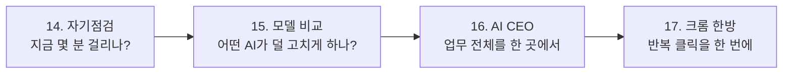

# 4부 내 일에 적용하다

> **4부의 질문**
> "AI를 써 봤다"에서 멈추지 않고, **내 일의 시간을 실제로 줄였다**고 말하려면 무엇이 필요할까요?

2부에서는 Google AI를 직접 눌러 보았고, 3부에서는 나만의 결과물을 만들었습니다.
4부에서는 한 걸음 더 들어가 **매주 반복되는 내 업무**에 AI를 붙입니다.

여기서부터는 "신기하다"가 기준이 아닙니다.
**얼마나 줄었는가, 누가 검토했는가, 다음에도 쓸 수 있는가**가 기준입니다.

---

## 4부의 대원칙

> 💡 **재료를 모으는 일은 맡기고, 판단하는 일은 맡기지 않는다.**

| AI에게 맡기는 일 (재료) | 내가 끝까지 쥐는 일 (판단) |
|---|---|
| 자료 찾기, 요약, 1차 번역 | 무엇을 인용할지 최종 선택, 원문 확인 |
| 개요, 문단 구조, 문장 다듬기 | 주장, 결론, 해석 |
| 데이터 정리, 기초 계산, 그래프 코드 | 어떤 방법이 타당한지, 결과가 무엇을 뜻하는지 |
| 일정 역산, 주간 계획 초안 | 우선순위 |
| 폴더 정리, 보고서 양식 채우기 | 결과물 승인, 고객·학생에게 나가는 문장 |

이 원칙은 4부의 모든 장에 그대로 적용됩니다.

---

## 4부의 흐름

| 장 | 제목 | 한 줄 소개 | 난이도 |
|---|---|---|---|
| 14 | [AI 도입 자기점검](14-ai-self-check.md) | 도구를 고르기 전에 스톱워치부터 켭니다. 6개 기준으로 내 AI 계획을 채점합니다. | 입문 |
| 15 | [NVIDIA Build로 모델 비교하기](15-nvidia-build.md) | 같은 요청을 두 모델에 넣고, 수정 시간이 적은 쪽을 고릅니다. 반복할 가치가 있을 때만 API로 연결합니다. | 초급 |
| 16 | [AI CEO 만들기](16-ai-ceo.md) | 업무마다 다른 AI를 부르는 대신, 내 컴퓨터 폴더를 총괄하는 AI 한 명을 세웁니다. | 초급~중급 |
| 17 | [크롬 한방](17-chrome-bookmarklet.md) | 북마크 하나로 유튜브 검색 결과의 영상 주소를 한 번에 모읍니다. | 초급 |

---

## 4부를 마치면

- [ ] 내 업무 하나의 **현재 소요 시간(기준선)** 을 숫자로 적을 수 있다.
- [ ] 같은 요청을 두 AI에 넣고 **비교표**로 판단할 수 있다.
- [ ] AI에게 맡길 일과 내가 판단할 일을 **역할별로 나눠** 적을 수 있다.
- [ ] 반복 작업 하나를 **도구(북마클릿·폴더 체계·API)** 로 줄여 본다.

> ⚠️ **주의**
> 4부에서 소개하는 서비스의 무료 여부, 요금, 화면 이름은 자주 바뀝니다.
> 교재에 적힌 날짜를 확인하고, 실제 사용 전에는 **공식 페이지에서 다시 확인**하세요.

---
📎 **원자료**: 노션 「인공지능 특강 - 대학, CEO과정」 > AI도입_자기점검_보고서 · 엔비디아 적용하기 · 10월 3일 추가 슬라이드 · 크롬 한방!
