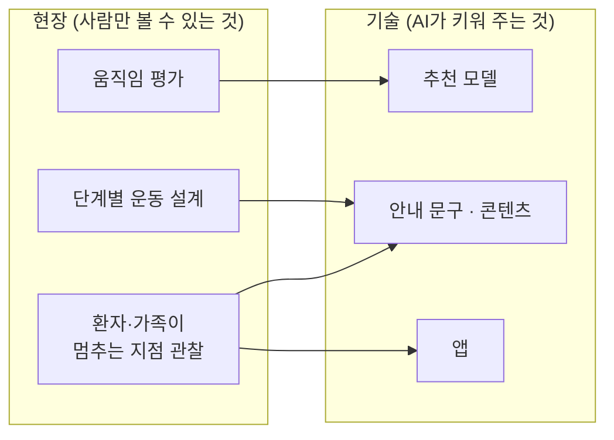
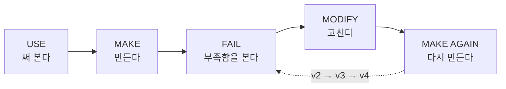
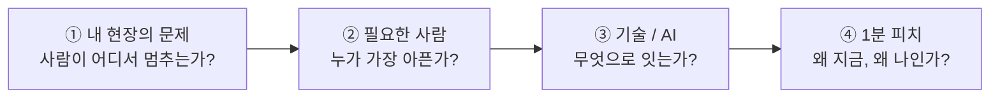

# 18. 모두의 창업 사례: 현장과 기술을 인공지능으로 잇다

> **이 장에서 배울 것**
> - 현장 전문가가 **자기 현장의 문제**를 AI·앱 아이디어로 옮기는 과정을 실제 사례로 따라갑니다.
> - AI가 창업 준비에서 **어디에 쓰였고, 어디에는 쓰이지 않았는지** 구분합니다.
> - "내 현장의 문제 → 필요한 사람 → 기술/AI → 1분 피치" 틀로 **나만의 피치 초안**을 만듭니다.
>
> ⏱ 소요 시간: 45분 · 🧰 준비물: 내 현장(전공·직장·사업)에서 겪은 불편 한 가지, AI 대화 도구(Gemini 등) · 📶 난이도: 초급

## 왜 배우나요?

"AI로 창업한다"고 하면 보통 개발자나 기술 회사를 떠올립니다.
그런데 이 장의 주인공은 개발자가 아니라 **특수체육 현장의 교수**입니다.

그는 오랫동안 사람의 움직임을 평가하고, 단계별 운동 프로그램을 설계하고, 환자·가족과 직접 일해 왔습니다.
그 과정에서 반복해서 본 장면이 있었습니다.

> 🗣 **현장의 장면** 병원에서 퇴원한 다음 날, 집으로 돌아온 환자와 가족은 "이제 무엇을, 얼마나, 어떻게 해야 하는지" 안내를 받지 못한 채 멈춰 섭니다. 병원과 집 사이에 **공백**이 있습니다.

이 공백은 기술 회사의 회의실에서는 보이지 않습니다. **현장에 있던 사람만** 볼 수 있습니다.
이 장은 그런 현장 지식이 AI를 만나 창업 아이디어와 홍보 자료로 바뀌는 과정을 보여 줍니다.
[01장](../part1/01-entry-shock.md)에서 본 것처럼 "결과물로 사람을 찾는" 시대에, 현장 지식은 가장 강력한 결과물의 재료입니다.

## 핵심 개념

### 1. 사례 한눈에 보기

| 항목 | 내용 |
|---|---|
| 프로그램 | 2026년 「모두의 창업」 — 정부(중소벤처기업부)의 창업 지원 프로그램 |
| 도전자 | 특수체육교육 전공 교수 (현장 전문가) |
| 문제 | 퇴원 이후, 병원과 일상 사이에서 환자·가족이 안내 없이 멈추는 **공백** |
| 아이디어 핵심어 | "잇다" — 피치 영상 파일명(`pitch_ieumcare`)에서 보듯 **이음 + 케어** |
| 진행 상황 | 1차 통과 후 다음 단계(2차 평가 1라운드) 진출 안내 (2026.10.15) · 멘토기관 오리엔테이션 예정 |
| AI 활용 | 코드 기반 모션그래픽 피치 영상, 개인·기업 홍보 쇼릴, AI 스포츠 숏폼 영상 |

> ⚠️ **주의** 위 내용은 원자료(공개 프로필 화면과 안내 메시지 캡처)에서 확인되는 범위만 정리했습니다. 서비스의 세부 기능·사업 모델은 진행 중인 도전이므로 교재에 확정된 사실로 적지 않습니다.

### 2. "현장과 기술을 둘 다 가진 사람"

도전자의 공개 프로필은 자신을 이렇게 소개합니다. 핵심은 **현장에서 몸으로 배운 것을 인공지능과 앱 개발로 옮기는 사람**입니다.

| 현장에서 해 온 일 | 기술로 옮기는 일 |
|---|---|
| 사람의 움직임을 평가하고 단계별 운동 프로그램을 설계·강의 | 몸이 필요한 사람의 몸을 이해하고, 그 이해를 소프트웨어로 만들기 |
| 장애인스포츠 분야 로드맵 내용 설계 | 증상 → 병원·전문의 추천 모델 구상 |
| 환자·가족과 직접 일하며 "안내가 없을 때 사람이 어디서 멈추는지"를 관찰 | 보호자 안내 문구 설계, 인공지능 모델 학습·배포 계획 |
| | 앱 설계와 구현 (2028년 상용화 목표) |



> 💡 **팁** 왼쪽 상자는 AI가 대신 만들어 주지 못합니다. 오른쪽 상자는 AI가 **속도와 규모**를 키워 줍니다. 창업 아이디어의 경쟁력은 왼쪽에서 나옵니다. [10. 대체 불가능한 창작자](../part3/10-irreplaceable-creator.md)의 "경험이라는 해상도"와 같은 이야기입니다.

### 3. AI는 어디에 쓰였나 — 피치를 "보여 주는" 데

원자료에서 확인되는 AI 활용은 주로 **설득 자료 제작**입니다.

| 결과물 | 형태 | 의미 |
|---|---|---|
| 피치 영상 (`pitch_ieumcare_v4`) | 코드로 만든 모션그래픽 영상 | 아이디어를 짧은 시간에 "이유"와 함께 보여 줌 |
| 쇼릴 (`showreel_2026`) | 개인·기업용 코드 기반 홍보 영상 | 도전자가 누구이고 무엇을 할 수 있는지 보여 줌 |
| 숏폼 (`shorts_ai_sport_v3`) | AI 스포츠 주제의 짧은 영상 | 전공(스포츠) × AI의 결합을 대중에게 보여 줌 |

원자료의 한 줄 설명이 이 사례의 태도를 잘 요약합니다.

> 📌 **"모션 그래픽으로 제작하고 이유를 만들어내다"** — 영상은 꾸미기가 아니라, 심사위원과 고객에게 "왜 이 서비스가 필요한가"를 설명하는 도구입니다.

코드 기반 모션그래픽은 영상 편집 프로그램 없이 **HTML 파일 하나**로 영상처럼 움직이는 화면을 만드는 방법입니다. 만드는 법은 [12. 코드로 만드는 모션그래픽](../part3/12-motion-graphics.md)에서 직접 실습합니다.

### 4. 파일 이름이 알려 주는 것 — v3, v4

피치 영상의 파일명은 `v4`, 숏폼은 `v3`입니다. 한 번에 완성된 것이 아니라 **여러 번 만들고 고친** 결과라는 뜻입니다.



이 교재가 처음부터 강조한 학습 원칙 **USE → MAKE → FAIL → MODIFY → MAKE AGAIN** 이 실제 창업 준비에서 그대로 일어난 것입니다.

### 5. 이 사례에서 배우는 다섯 가지

| 교훈 | 설명 |
|---|---|
| ① 문제는 현장에서 온다 | AI는 "퇴원 다음 날의 공백"을 찾아 주지 않았습니다. 수년간의 현장 관찰이 찾았습니다. |
| ② AI는 설득의 속도를 바꾼다 | 디자이너·영상팀 없이도 피치·홍보 영상을 직접, 여러 버전으로 만들 수 있었습니다. |
| ③ 결과물이 곧 증거다 | "할 수 있다"는 말 대신 영상·프로필·로드맵이라는 결과물로 보여 줬습니다. |
| ④ 로드맵은 단계적으로 | 안내 문구 → 추천 모델 → 앱(2028년 상용화 목표)처럼, 지금 할 수 있는 것부터 순서를 정했습니다. |
| ⑤ 확인된 것과 계획을 구분한다 | 진행 상황(라운드 진출)과 목표(상용화)를 섞지 않고 따로 적었습니다. |

> ✅ **확인** 이 다섯 가지는 창업만의 이야기가 아닙니다. 학생의 포트폴리오, 대표님의 신사업 제안서에도 똑같이 적용됩니다.

## 따라 해 보기 — 내 현장으로 1분 피치 만들기 (25분)

### 1단계. 틀 채우기 (10분)

아래 네 칸을 **내 말로** 먼저 채웁니다. AI는 아직 쓰지 않습니다.



| 칸 | 질문 | 사례 (퇴원 이후의 공백) | 나의 답 |
|---|---|---|---|
| ① 내 현장의 문제 | 내가 직접 본, 사람이 **멈추는** 장면은? | 퇴원 다음 날, 환자·가족이 무엇을 해야 할지 몰라 멈춤 | |
| ② 필요한 사람 | 그 문제로 가장 아픈 사람은 누구인가? | 퇴원 환자, 보호자(가족) | |
| ③ 기술 / AI | 무엇으로 그 공백을 잇는가? | 단계별 운동 안내, 보호자 안내 문구, 추천 모델, 앱 | |
| ④ 왜 나인가 | 내가 이 문제를 푸는 데 유리한 이유는? | 움직임 평가·운동 설계 현장 경험 + 기술 | |

> 💡 **팁** ①을 쓰기 어렵다면 이렇게 물어보세요. "내 현장에서 사람들이 **같은 질문을 반복해서** 하는 순간은 언제인가?" 반복되는 질문이 있는 곳에 공백이 있습니다.

### 2단계. AI로 1분 피치 초안 만들기 (10분)

채운 표를 아래 프롬프트의 `[ ]`에 옮겨 [Gemini](../part2/04-gemini.md)에 붙여 넣습니다.

```text
나는 [나의 현장: 예) 특수체육 교육 / 동네 카페 운영 / 간호학과 학생]에서 일하고 있다.
내가 현장에서 반복해서 본 문제는 다음과 같다.
[① 사람이 멈추는 장면을 2~3문장으로]

이 문제로 가장 어려움을 겪는 사람은 [② 필요한 사람]이다.
나는 이 공백을 [③ 기술 또는 AI 아이디어]로 잇고 싶다.
내가 이 문제를 푸는 데 유리한 이유는 [④ 나의 경험]이다.

다음을 한국어로 작성해줘.
1. 1분 분량(약 300자)의 피치 내레이션
   - 첫 문장은 현장의 장면으로 시작
   - "문제 → 필요한 사람 → 해결 방법 → 왜 나인가 → 다음 행동" 순서
2. 위 내레이션을 10초씩 6장면으로 나눈 화면 구성표 (장면 번호 / 화면에 보일 큰 글자 / 내레이션)
3. 심사위원이 물어볼 만한 날카로운 질문 3개
4. 내가 아직 확인하지 않은 사실(시장 규모, 경쟁 서비스, 법·제도 등) 목록

내가 제공하지 않은 숫자나 사실은 만들어 넣지 말고 "확인 필요"라고 표시해줘.
```

### 3단계. 내 말로 고치기 (5분)

AI가 만든 피치를 그대로 쓰지 않습니다. 다음 세 가지를 직접 고칩니다.

1. **첫 문장**을 내가 실제로 본 장면으로 바꿉니다. (AI가 만든 그럴듯한 장면은 지웁니다.)
2. **"확인 필요"** 항목에 밑줄을 긋고, 누구에게 무엇을 물어볼지 적습니다.
3. 심사위원 질문 3개에 **한 줄씩** 답을 적어 봅니다. 답하지 못한 질문이 다음 할 일입니다.

> ⚠️ **주의** 현장 사례에 실제 환자·고객의 이름, 진단명, 연락처 같은 개인정보를 넣지 마세요. AI에 입력하는 순간 외부 서비스로 전송됩니다.

### 4단계 (선택). 피치를 영상으로

6장면 화면 구성표가 생겼다면, [12. 코드로 만드는 모션그래픽](../part3/12-motion-graphics.md)의 템플릿에 장면별 큰 글자를 넣어 9:16 세로형 피치 영상으로 만들어 보세요.
장면마다 카메라·음악 방향을 정하고 싶다면 [11. 프롬프트 연출](../part3/11-prompt-directing.md)을 함께 보세요.

## 체크리스트

- [ ] 내 현장에서 사람이 "멈추는" 장면을 한 가지 적었다.
- [ ] 문제 → 필요한 사람 → 기술/AI → 왜 나인가 네 칸을 내 말로 채웠다.
- [ ] AI로 1분 피치 초안과 6장면 구성표를 만들었다.
- [ ] AI가 만든 문장 중 내가 직접 본 것이 아닌 부분을 고쳤다.
- [ ] "확인 필요" 항목과 다음 행동 1가지를 적었다.

## 생각해 보기

1. 내 전공·업무의 현장에서 "기술 회사는 절대 모르는" 문제는 무엇일까요?
2. 이 사례에서 AI가 **하지 않은 일**은 무엇이었나요? 그 일이 왜 창업의 핵심일까요?
3. 피치 영상을 v1에서 v4까지 고치는 동안 무엇이 바뀌었을지 상상해 보세요. 나의 결과물에는 몇 번째 버전까지 만들 각오가 있나요?
4. (CEO 과정) 우리 회사 직원들이 현장에서 매일 보는 "공백"을 신사업 아이디어로 끌어올리려면 어떤 통로가 필요할까요?

## 한 줄 정리

> AI는 문제를 찾아 주지 않습니다. **현장에서 찾은 문제를 더 빨리, 더 설득력 있게 세상에 보여 주도록** 도울 뿐입니다.

---
📎 **원자료**: 노션 「인공지능 특강 - 대학, CEO과정」 > 모두의 창업 - 현장과 기술을 인공지능으로 잇다 (피치·쇼릴·숏폼 영상, 프로필 및 진행 안내 화면)
