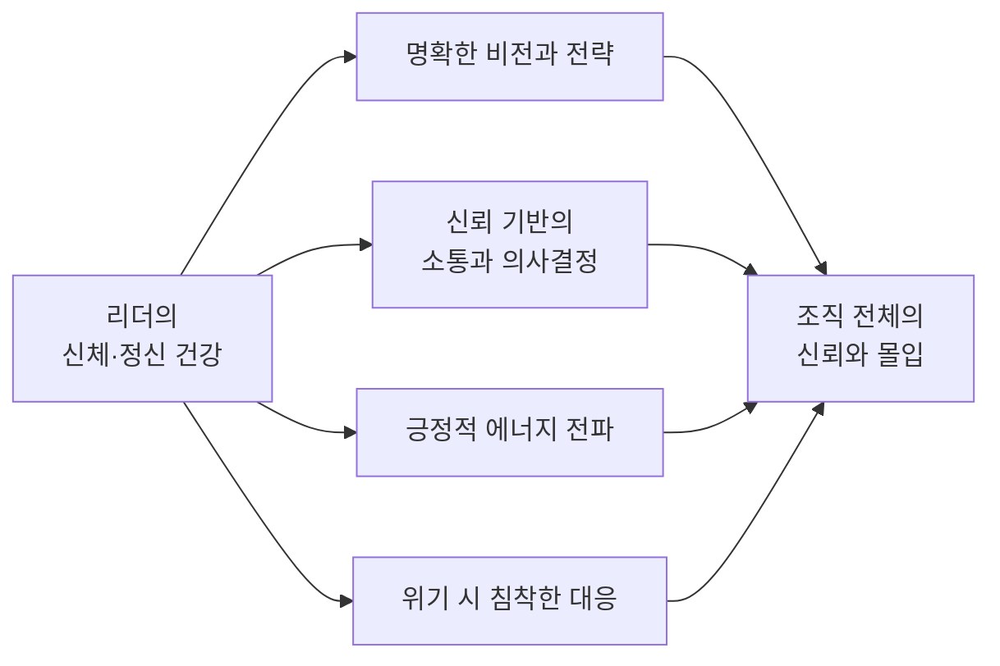

# 19. 건강리더십과 조직운영: 리더의 몸이 조직의 방향을 결정한다

> **이 장에서 배울 것**
> - 리더의 신체·정신 건강이 **신뢰 · 결정력 · 조직문화**로 이어지는 구조를 이해합니다.
> - "조직건강(organizational health)"의 구성요소와, 건강한 조직이 성과에서 어떤 차이를 보이는지 배웁니다.
> - CEO 자기점검표로 지금의 나를 확인하고, AI와 함께 **업무 일정에 맞춘 건강 루틴**을 설계합니다.
>
> ⏱ 소요 시간: 35분 · 🧰 준비물: 이번 주 업무 일정표(달력), AI 대화 도구 · 📶 난이도: 초급

## 왜 배우나요?

AI 수업의 마지막 장에 왜 "건강"이 나올까요?

AI를 도입하면 일이 줄어들 것 같지만, 리더에게는 오히려 **결정할 일이 늘어납니다.**
[01장](../part1/01-entry-shock.md)에서 본 것처럼 AI는 반복·정형 업무를 가져가고, 사람에게는 **판단과 책임**을 남깁니다.
조직의 맨 위에서 그 판단과 책임을 가장 많이 지는 사람이 리더입니다.

판단의 질은 판단하는 사람의 상태를 넘지 못합니다. 잠이 부족하고, 지쳐 있고, 여유가 없는 리더는 좋은 도구를 갖고도 나쁜 결정을 내립니다.
그래서 이 강의는 이렇게 말합니다.

> 📌 **핵심 메시지** 최고위 리더가 자신의 건강을 **전략적 자산**으로 관리할 때, 조직의 신뢰·결정력·지속가능한 문화를 설계할 수 있습니다.

이 주제는 최근 경영학과 조직이론에서 강조되는 **조직건강(organizational health)** 의 중요성과도 깊이 연결됩니다.

## 핵심 개념

### 1. 리더의 건강이 조직에 미치는 영향



- 리더의 신체적·정신적 건강은 조직의 방향과 성과에 **직접** 영향을 미칩니다. 리더가 건강할 때 더 명확한 비전과 전략을 세우고, 신뢰를 바탕으로 소통하고 결정할 수 있습니다.[^dbr]
- 건강한 리더는 구성원에게 긍정적인 에너지를 전하고, 위기 상황에서도 침착하게 대응하는 모습을 보여 줍니다. 이는 조직 전체의 신뢰와 몰입도를 높입니다.[^brunch][^dbr]

> 💡 **팁** [02장](../part1/02-structural-leverage.md)의 "모든 프라이빗은 일 위에 성립한다"를 떠올려 보세요. 건강은 그 반대 방향도 성립합니다. **책임을 오래, 크게 지려면 그 아래에 건강이라는 기초가 있어야 합니다.**

### 2. 조직건강이란 무엇인가

**조직건강**은 단순한 성과 지표를 넘어, 조직이 **지속적으로 성장하고 변화에 적응할 수 있는 능력**을 뜻합니다.[^snu]

학술 연구에서 꼽는 조직건강의 주요 구성요소는 다음과 같습니다.[^snu]

| 구성요소 | 쉬운 말로 |
|---|---|
| 의사소통 | 정보와 의견이 막힘없이 오가는가 |
| 참여와 관여 | 구성원이 결정과 실행에 함께하는가 |
| 충성심과 몰입 | 구성원이 조직에 마음을 두고 있는가 |
| 사기 | 일할 의욕과 분위기가 살아 있는가 |
| 리더십 | 방향을 제시하고 사람을 움직이는가 |
| 자원활용 | 사람·돈·시간을 잘 쓰고 있는가 |

건강한 조직은 구성원이 **공동의 목표**를 공유하고, 신뢰와 협력의 문화를 바탕으로 **자발적으로 헌신**하는 환경을 만듭니다.[^brunch][^hellodd]
리더는 규율만 강조하는 데 그치지 않고 **열린 소통과 협력의 문화**를 만들어야 하며, 이것이 조직 혁신과 성장의 촉진제가 됩니다.[^brunch][^dbr]

### 3. 건강리더십이 조직운영에 미치는 구체적 효과

| 건강리더십의 실천 | 조직에 미치는 효과 |
|---|---|
| 리더의 자기관리 (신체·정신 건강) | 신뢰받는 리더십, 결단력 향상, 위기관리 능력 강화[^dbr] |
| 지속적 자기성찰과 개선 의지 | 조직문화의 신뢰·개방성 증진, 변화 대응력 강화[^hankyung][^dbr] |
| 건강한 소통과 피드백 | 조직 내 협력, 혁신, 자발적 동기 부여 촉진[^brunch][^hellodd] |
| 건강한 조직문화 설계 | 장기적 성과, 지속가능성, 높은 몰입도와 충성심[^dbr] |

- 실제로 건강한 조직은 **주주총수익률(TRS, 주가 상승과 배당을 합친 투자자의 총수익)** 등 재무성과에서도 건강하지 않은 조직보다 **3배 이상** 뛰어난 결과를 보인다는 분석이 있습니다.[^dbr]
- 조직건강을 위한 실천 방안은 여러 유형이 있으며, 그 출발점은 **리더의 건강**입니다.[^dbr]

| 실천 유형 | 중심 활동 |
|---|---|
| 리더 주도형 | 신뢰 문화 만들기, 승진 기회 제공 |
| 실천 우위형 | 지식 공유, 구성원 참여 |
| 인재 중심형 | 보상, 인정 |

### 4. AI 시대의 건강리더십 — 세 가지 연결

| AI가 바꾸는 것 | 리더에게 생기는 부담 | 건강리더십의 대응 |
|---|---|---|
| 반복 업무가 줄고 **판단 업무**가 늘어남 | 하루에 내려야 할 결정의 수 증가 | 결정이 몰리는 시간대를 피해 회복 시간을 **일정에 먼저** 넣기 |
| 언제든 일할 수 있는 도구 | 퇴근 후에도 끊기지 않는 업무 | 업무를 끊는 규칙을 리더가 먼저 지키기 (구성원은 리더를 따라 함) |
| AI가 시간을 절약해 줌 | 아낀 시간이 다시 일로 채워짐 | 절약한 시간의 일부를 **건강과 성찰**에 재투자하기 |

> ✅ **확인** 절약한 시간을 어디에 쓸지 미리 정하지 않으면 그 시간은 그냥 사라집니다. 이 원리는 [14. AI 도입 자기점검](../part4/14-ai-self-check.md)의 "재투자처를 미리 못 박기"와 같습니다.

### 5. 결론

리더의 건강은 단순한 개인 자산이 아니라, **조직의 방향성과 지속가능성을 결정하는 전략적 자산**입니다.
건강한 리더십은 신뢰와 소통, 협력의 문화를 통해 조직 전체의 건강을 높이고, 이는 장기적인 성과와 경쟁력으로 이어집니다.[^hankyung][^brunch][^dbr]
『건강리더십과 조직운영』 강의는 이 인식을 바탕으로, **리더의 몸과 마음을 조직경영의 핵심 축**으로 삼아야 한다고 강조합니다.

## 따라 해 보기

### 1. CEO 자기점검 (10분)

지난 2주를 떠올리며 각 항목에 점수를 매깁니다. **2 = 잘 되고 있다 / 1 = 가끔 / 0 = 거의 안 된다**

| 영역 | 점검 항목 | 점수 (0~2) |
|---|---|:-:|
| 몸 | 하루 수면 시간이 대체로 일정하다 | |
| 몸 | 일주일에 3번 이상, 숨이 찰 정도로 몸을 움직인다 | |
| 몸 | 식사를 거르거나 늦은 밤에 몰아서 먹는 날이 적다 | |
| 마음 | 중요한 결정을 피곤하지 않은 시간대에 내린다 | |
| 마음 | 하루 중 일과 완전히 떨어지는 시간이 있다 | |
| 마음 | 최근 감정적으로 반응한 일을 돌아보고 기록한다 (자기성찰) | |
| 소통 | 구성원에게 피드백을 묻고, 실제로 반영한 적이 있다 | |
| 소통 | 내가 없어도 돌아가도록 일을 위임하고 있다 | |
| 문화 | 구성원의 휴식·퇴근 시간을 리더인 내가 먼저 지킨다 | |
| 문화 | 이번 달 구성원의 수고를 구체적으로 인정(칭찬·보상)했다 | |
| **합계** | | **/ 20** |

| 합계 | 해석 |
|---|---|
| 16~20 | 건강한 기반이 있습니다. 지금의 습관을 구성원과 공유해 보세요. |
| 10~15 | 한두 영역이 흔들리고 있습니다. 0점 항목 하나만 골라 이번 주에 바꿔 보세요. |
| 0~9 | 조직보다 리더 자신이 먼저 회복이 필요한 상태일 수 있습니다. 일정에서 회복 시간부터 확보하세요. |

> ⚠️ **주의** 이 점검표는 수업용 성찰 도구이며, 건강 상태를 진단하는 의학적 검사가 아닙니다.

### 2. AI와 함께 업무 일정에 맞춘 건강 루틴 설계하기 (15분)

이번 주 일정표를 옆에 두고, 아래 프롬프트의 `[ ]`를 채워 AI에게 요청합니다.

> ⚠️ **주의 — 의학적 조언이 아닙니다**
> - AI가 만든 루틴은 **일정 관리용 초안**이며, 의학적 진단이나 처방이 아닙니다.
> - 지병이 있거나, 약을 먹고 있거나, 통증·어지럼 같은 증상이 있다면 **반드시 의사·전문가와 먼저 상담**하세요.
> - 진단명, 검사 수치 같은 민감한 건강 정보는 AI에 입력하지 않는 것을 권합니다.

```text
나는 [업종·직책: 예) 직원 15명 제조업체 대표]이다.
이번 주 내 업무 일정은 다음과 같다.
- 월: [예) 09~12시 회의, 14~18시 거래처 방문]
- 화: [예) 09~18시 사무실, 18:30 후마니타스 수업]
- 수: [ ]
- 목: [ ]
- 금: [ ]
- 주말: [ ]

현재 생활 습관:
- 평균 수면: [예) 5~6시간, 취침 시각 불규칙]
- 운동: [예) 거의 안 함 / 주 1회 걷기]
- 가장 피곤한 시간대: [예) 오후 3~5시]
- 중요한 결정을 주로 내리는 시간: [예) 저녁 회식 자리]

다음을 한국어로 작성해줘.
1. 내 일정 사이에 실제로 끼워 넣을 수 있는 건강 루틴 1주일 표
   (요일 / 시간 / 활동 / 소요 시간). 한 번에 30분을 넘기지 말 것.
2. 중요한 결정을 내리기 좋은 시간대 제안과 그 이유
3. 일정이 무너졌을 때 대신 할 수 있는 "5분짜리 최소 루틴" 3가지
4. 이 루틴을 구성원과 함께할 수 있는 방법 1가지
5. 2주 뒤 루틴이 지켜졌는지 확인할 숫자 3개 (예: 주간 운동 횟수)

이것은 의학적 조언이 아닌 일정 관리용 초안으로 작성하고,
의료 전문가와 상담이 필요한 경우를 마지막에 따로 적어줘.
특정 질병이나 약에 대한 조언은 하지 마.
```

### 3. 내 것으로 고치기 (5분)

1. AI가 제안한 루틴 중 **이번 주에 반드시 할 것 하나**만 고릅니다.
2. 그 활동을 지금 바로 달력에 **회의처럼** 넣습니다. 이름도 붙입니다. 예: `🟢 리더 회복 미팅 (20분)`
3. 2주 뒤 위 자기점검표를 다시 해 보고 점수 변화를 적습니다.

> 💡 **팁** 운동 계획은 특수체육에서 수업을 설계하듯 **관찰 가능한 목표 + 단계적 난이도**로 세우면 오래 갑니다. "건강해지기"가 아니라 "주 3회, 점심 후 15분 걷기"처럼 적으세요.

## 체크리스트

- [ ] 리더의 건강이 조직에 영향을 주는 경로를 두 가지 이상 말할 수 있다.
- [ ] 조직건강의 구성요소 6가지 중 4가지 이상을 말할 수 있다.
- [ ] CEO 자기점검표로 나의 점수를 확인했다.
- [ ] AI와 함께 업무 일정에 맞춘 1주일 건강 루틴 초안을 만들었다.
- [ ] 이번 주에 할 활동 하나를 달력에 넣었다.

## 생각해 보기

1. 내가 경험한 "지친 리더"와 "여유 있는 리더"는 회의 분위기와 결정에서 어떤 차이를 보였나요?
2. AI가 아껴 준 시간이 다시 일로 채워지지 않게 하려면, 조직 차원에서 어떤 규칙이 필요할까요?
3. 리더가 자기 건강을 챙기는 모습을 구성원에게 **보여 주는 것**은 왜 중요할까요? 반대로 숨기면 어떤 일이 생길까요?
4. (대학생) 미래에 리더가 될 나는, 지금 어떤 습관을 "기초 공사"로 다져 두고 싶나요?

## 한 줄 정리

> 리더의 몸은 개인의 것이 아니라 **조직의 방향을 정하는 첫 번째 자산**입니다. AI가 판단을 더 많이 요구할수록, 그 판단을 내릴 몸과 마음을 먼저 관리하세요.

## 참고 자료

[^hankyung]: 한국경제 기사. <https://plus.hankyung.com/apps/newsinside.view?aid=2016031616191&category=NEWSPAPER&sns=y>
[^brunch]: 브런치 글 (@joshkim413). <https://brunch.co.kr/@joshkim413/43>
[^hellodd]: 헬로디디(HelloDD) 기사. <https://www.hellodd.com/news/articleView.html?idxno=3523>
[^snu]: 서울대학교 S-Space 학술 논문(PDF). <https://s-space.snu.ac.kr/bitstream/10371/70074/1/47-2_02%EB%AF%BC%EC%A7%84.pdf>
[^dbr]: 동아비즈니스리뷰(DBR) 기사. <https://dbr.donga.com/article/view/1201/article_no/6493>

---
📎 **원자료**: 노션 「인공지능 특강 - 대학, CEO과정」 > 건강리더십과 조직운영: 리더의 몸이 조직의 방향을 결정한다
