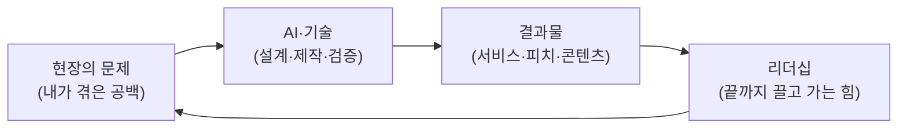

# 5부 현장과 리더십

> **5부에서 배울 것**
> - 현장 전문가가 AI를 만나 **창업 아이디어와 홍보 자료**로 확장한 실제 사례를 따라갑니다.
> - AI를 들이는 조직에서 **리더 자신의 건강**이 왜 전략이 되는지 이해합니다.
> - 지금까지 배운 것(이해 → 체험 → 창작 → 적용)을 **내 현장과 내 조직**으로 넓히는 질문을 세웁니다.
>
> ⏱ 소요 시간: 약 80분 (18장 45분 + 19장 35분) · 🧰 준비물: 내 현장(전공·직장·사업)에서 겪은 불편 한 가지 · 📶 난이도: 초급

## 왜 마지막에 "현장"과 "리더십"인가요?

1~4부에서 우리는 AI가 바꾸는 시대를 읽고, 도구를 눌러 보고, 결과물을 만들고, 내 업무에 들이는 법을 배웠습니다.
그런데 도구를 잘 다루는 사람은 앞으로 점점 많아집니다. 끝까지 남는 차이는 두 가지입니다.

1. **현장** — 내가 직접 보고 겪은 문제. AI는 이 문제를 대신 찾아 주지 않습니다.
2. **리더십** — 그 문제를 끝까지 끌고 갈 사람의 지속력. 기술보다 사람이 먼저 지칩니다.

5부의 두 장은 이 순환의 양 끝을 다룹니다. 18장은 **현장 → AI → 결과물**의 사례이고, 19장은 그 순환을 오래 돌리는 **리더 자신**에 대한 이야기입니다.

## 5부의 장

| 장 | 한 줄 요약 |
|---|---|
| [18. 모두의 창업 사례: 현장과 기술을 인공지능으로 잇다](18-startup-case.md) | 특수체육 현장의 전문가가 "퇴원 이후의 공백"이라는 문제를 AI·앱 개발 아이디어로 옮기고, 코드로 만든 모션그래픽 피치 영상으로 창업 경진에 도전해 다음 라운드에 진출한 과정을 따라갑니다. 내 현장의 문제로 1분 피치를 만들어 봅니다. |
| [19. 건강리더십과 조직운영: 리더의 몸이 조직의 방향을 결정한다](19-health-leadership.md) | 리더의 신체·정신 건강이 신뢰·결정력·조직문화로 이어지는 구조를 배우고, CEO 자기점검과 업무 일정에 맞춘 건강 루틴 설계를 AI와 함께 해 봅니다. |

## 이 부를 읽는 두 가지 방법

| 독자 | 이렇게 읽으세요 |
|---|---|
| 대학생 | 18장을 "내 전공이 어떤 현장 문제를 풀 수 있는가"의 예로 읽습니다. 19장은 미래의 리더가 될 나에게 주는 습관 설계로 읽습니다. |
| CEO 과정 원우 | 18장을 "우리 회사의 현장 지식을 AI로 상품화할 수 있는가"의 예로 읽습니다. 19장은 오늘 바로 쓰는 자기점검표로 사용합니다. |

> 💡 **팁** 5부의 결과물(1분 피치, 건강 루틴)은 [20. FINAL MISSION](../finale/20-final-mission.md)의 "내가 해결하고 싶은 문제" 칸에 그대로 옮겨 쓸 수 있습니다.

## 5부를 마치면

- [ ] 내 현장에서 "사람이 어디서 멈추는지" 한 장면을 적었다.
- [ ] 그 문제를 AI·기술로 잇는 1분 피치 초안을 만들었다.
- [ ] 리더 자기점검표로 나의 현재 상태를 확인했다.
- [ ] 내 업무 일정에 맞춘 건강 루틴 1주일 안을 만들었다.

---
📎 **원자료**: 노션 「인공지능 특강 - 대학, CEO과정」 > 모두의 창업 - 현장과 기술을 인공지능으로 잇다 / 건강리더십과 조직운영
